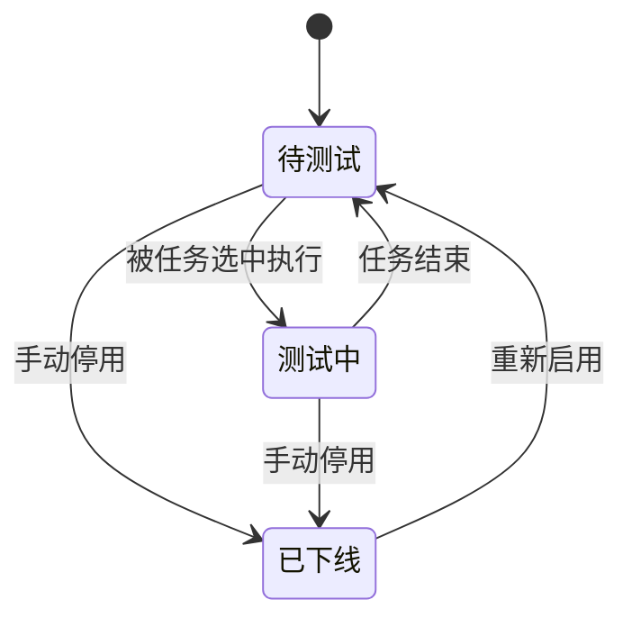
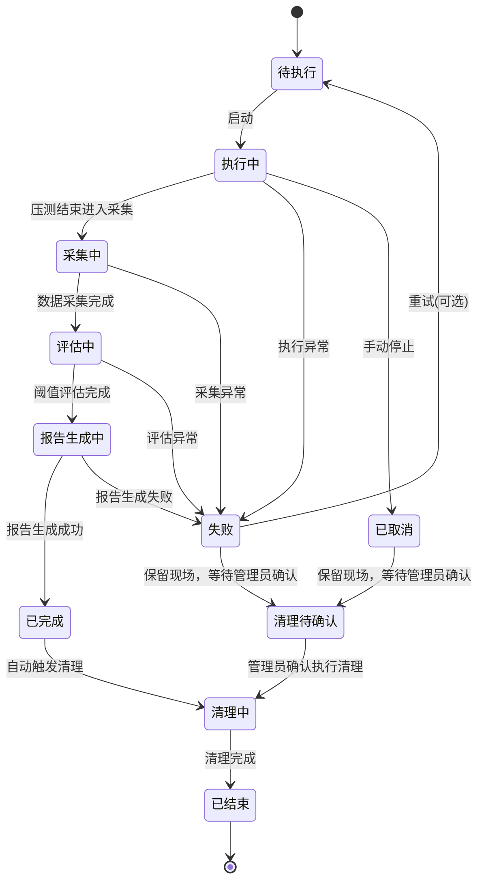
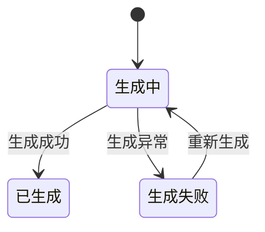

# 性能测试平台 PRD

| 项目 | 内容 |
| --- | --- |
| 项目名称 | auto_performance（性能测试平台） |
| 文档类型 | 产品需求文档（PRD） |
| 文档版本 | v1.0 |
| 编写角色 | 产品经理 |
| 编写日期 | 2026-10-26 |
| 文档状态 | 待评审 |

---

## 1. 项目概述

### 1.1 背景与定位

性能测试平台面向平台管理员，用于对被测产品开展接口性能测试。平台统一管理测试环境、被测产品与接口信息、测试任务编排、测试报告生成，以及系统自身的日志、管理员、证书、SSH/Host 等配置，形成「环境 → 产品 → 接口 → 测试任务 → 报告」的完整闭环。

### 1.2 目标

- 统一管理测试环境、被测产品与接口资产，支持分类与标签化检索。
- 通过预设接口指标阈值，实现性能是否达标的自动化、可复现判定。
- 以模板化方式组装测试任务（环境、接口范围、流程、报告输出、环境清理），降低编排成本。
- 一键生成 html/pdf/word 报告，支持在线与离线读取、导入与导出。
- 提供用户/系统/测试三类日志，满足操作审计与问题定位需要。
- 满足离线部署、可移植、可维护、可升级与可卸载的部署运维要求。

### 1.3 用户角色与分级分权

系统采用「管理员分级分权」模型：不设固定角色枚举，而是将权限**细粒度到每个子模块**，管理员的权限范围由其被授予的「分权模块」集合组成。

| 概念 | 说明 |
| --- | --- |
| 权限粒度 | 逐子模块授权（如「环境管理-环境列表」「系统设置-证书管理」），每个子模块独立授予只读/可写 |
| 权限范围 | 管理员最终权限 = 所授分权模块权限的并集 |
| 内置管理员 | 系统默认内置 `admin`，初始密码 `Cqmyg@123`，默认拥有全部权限；首次登录强制修改密码 |
| 组合示例 | 可组合出「只读观察员」（全部子模块只读）、「测试操作员」（环境/产品/接口/任务/报告可写、系统设置无权限）等形态 |

### 1.4 范围

**In Scope**：环境管理、产品管理、测试管理、报告管理、日志管理、系统设置六大模块，以及本 PRD 第 11 章所述非功能需求（业务口径层面）。

**Out of Scope**：具体技术实现方案（语言/框架/中间件选型、部署编排脚本细节）、压测引擎本身的性能调优、被测产品自身的缺陷修复。

---

## 2. 需求总览（模块地图）

| 模块 | 子模块 | 核心能力一句话 |
| --- | --- | --- |
| 环境管理 | 环境列表、标签维护 | 管理待测环境及配置，支持分类与多标签 |
| 产品管理 | 产品列表、接口管理 | 管理被测产品及接口地址、指标阈值 |
| 测试管理 | 测试任务、测试模板 | 组装环境+接口范围+流程+报告+清理，支持模板 |
| 报告管理 | 报告列表/查看/导入导出 | 解析数据生成报告，html/pdf/word，在线离线 |
| 日志管理 | 用户日志、系统日志、测试日志 | 记录操作、服务状态、测试执行三类日志 |
| 系统设置 | 管理员管理、证书管理、SSH/Host 管理 | 登录账号、SSL 证书、Host 解析与 SSH 信任配置 |

---

## 3. 模块需求详述

### 3.1 环境管理

#### 3.1.1 子模块与功能点

| 子模块 | 功能点 | 说明 |
| --- | --- | --- |
| 环境列表 | 环境新增 | 录入环境名称、分类、标签、类型（单机/集群）、主机地址、操作系统、描述等 |
| 环境列表 | 环境修改 | 编辑已有环境配置信息 |
| 环境列表 | 环境删除/停用 | 删除或停用环境（停用优先，避免误删历史关联） |
| 环境列表 | 环境查询/筛选 | 按名称、分类、标签、状态筛选；支持关键字检索 |
| 环境列表 | 环境详情 | 查看环境完整配置信息与关联标签 |
| 标签维护 | 标签新增/修改/删除 | 自定义标签名称、颜色、说明 |
| 标签维护 | 标签关联环境 | 每个标签展示其关联的环境列表，可查看/跳转 |
| 标签维护 | 标签反向维护 | 从环境侧为环境打多个标签 |

#### 3.1.2 用户故事 / 用例

| 用户故事 | 验收要点 |
| --- | --- |
| 作为测试管理员，我希望能新建一个测试环境并打上「单机」「内网」标签，以便后续测试任务选择 | 新建成功后可检索到；标签可选多个；环境与标签双向可查 |
| 作为测试管理员，我希望能按分类/标签快速筛选环境，避免在大列表里翻找 | 筛选组合生效，结果准确 |
| 作为测试管理员，我希望能维护标签并看到每个标签关联了哪些环境 | 标签列表展示关联环境数量与明细 |
| 作为测试管理员，我希望能停用不再使用的环境而不删除历史数据 | 停用后环境不可被新任务选择，历史任务仍可查看 |

#### 3.1.3 关键输入输出

| 项 | 输入 | 输出 |
| --- | --- | --- |
| 新建/编辑环境 | 名称、编码、分类、标签集、类型、主机地址列表、操作系统、描述 | 环境记录（含 ID、状态） |
| 筛选环境 | 名称关键字、分类、标签、状态 | 环境列表 |
| 维护标签 | 标签名称、颜色、说明 | 标签记录及关联环境数 |
| 标签详情 | 标签 ID | 关联环境列表 |

#### 3.1.4 状态流转

环境状态：`待测试` → `测试中` → `已下线`（停用）；`已下线` 可重新启用回到 `待测试`。

#### 3.1.5 验收口径

- 可完整完成环境的新增、修改、停用/启用、删除全流程，数据持久化正确。
- 分类与标签多选可用，标签 ↔ 环境双向关联一致（标签侧可见关联环境、环境侧可见所属标签）。
- 按分类/标签/状态组合筛选结果准确；停用环境不出现在新任务可选列表中，但历史数据不受影响。

---

### 3.2 产品管理

#### 3.2.1 子模块与功能点

| 子模块 | 功能点 | 说明 |
| --- | --- | --- |
| 产品列表 | 产品创建/修改 | 维护待测产品，字段含名称、编码、版本、平台、描述等 |
| 产品列表 | 产品删除/停用 | 停用优先，避免破坏历史任务引用 |
| 产品列表 | 产品查询/筛选 | 按名称、版本、平台筛选 |
| 接口管理 | 接口新增/修改/删除 | 维护各产品的接口地址，含请求方法、参数模板、描述 |
| 接口管理 | 接口阈值配置 | 每个接口预设关键指标阈值（响应时间、吞吐量、错误率、成功率等） |
| 接口管理 | 接口列表选择 | 测试时从接口列表选取范围（全选/按产品/按接口勾选） |

#### 3.2.2 用户故事 / 用例

| 用户故事 | 验收要点 |
| --- | --- |
| 作为测试管理员，我希望能维护被测产品的版本、平台等信息 | 产品增删改查正确，字段完整 |
| 作为测试管理员，我希望能维护每个产品的接口地址，并在测试时选取范围 | 接口归属于产品；选取范围可按产品批量或逐接口勾选 |
| 作为测试管理员，我希望能为接口预设指标阈值，用于性能达标判定 | 每个接口可配置多个指标阈值；评估时引用该阈值 |
| 作为测试管理员，我希望修改阈值后能追溯不同任务使用的阈值版本 | 阈值随任务快照或记录历史（见待确认决策） |

#### 3.2.3 关键输入输出

| 项 | 输入 | 输出 |
| --- | --- | --- |
| 产品增改 | 名称、编码、版本、平台、描述 | 产品记录 |
| 接口增改 | 产品 ID、接口名、URL、方法、参数模板、描述 | 接口记录 |
| 阈值配置 | 接口 ID、指标类型、方向、数值、单位、是否启用 | 阈值记录 |
| 选取接口范围 | 产品/接口勾选 | 接口 ID 集合 |

#### 3.2.4 状态流转

产品状态：`启用` ↔ `停用`；接口状态：`启用` ↔ `停用`；阈值状态：`启用` / `停用`。

#### 3.2.5 验收口径

- 产品与接口的增删改查完整，接口严格归属产品，删除/停用产品时对其下接口给出明确提示。
- 每个接口可配置多条指标阈值，且阈值方向（≤/≥）与数值、单位可正确保存与展示。
- 测试任务的接口范围选取能正确引用「按产品/按接口」的筛选结果。

---

### 3.3 测试管理

#### 3.3.1 子模块与功能点

| 子模块 | 功能点 | 说明 |
| --- | --- | --- |
| 测试任务 | 任务创建 | 组装环境、接口范围、测试流程（并发/时长/场景）、报告输出、环境清理过程 |
| 测试任务 | 任务执行/监控 | 触发执行，展示进度、实时状态、采集指标 |
| 测试任务 | 任务停止/取消 | 中断执行中的任务 |
| 测试任务 | 任务查询/历史 | 按名称、状态、时间、环境/产品筛选 |
| 测试模板 | 模板保存 | 将一组「环境+接口范围+流程+报告+清理」配置保存为模板 |
| 测试模板 | 模板复用 | 基于模板一键创建任务，可微调参数 |
| 测试模板 | 模板管理 | 模板增删改查 |

#### 3.3.2 用户故事 / 用例

| 用户故事 | 验收要点 |
| --- | --- |
| 作为测试管理员，我希望能一次性编排环境、接口范围、流程、报告输出与环境清理，发起一次性能测试 | 任务创建表单覆盖全部五要素，校验必填项 |
| 作为测试管理员，我希望把常用配置存为模板，下次一键复用 | 模板可保存、加载，基于模板创建任务时参数可覆盖 |
| 作为测试管理员，我希望能实时查看任务执行进度与状态 | 任务状态机与进度可见，异常可提示 |
| 作为测试管理员，我希望能手动停止一个执行中的任务 | 停止/取消后任务进入终止状态，不产生未完成报告 |

#### 3.3.3 关键输入输出

| 项 | 输入 | 输出 |
| --- | --- | --- |
| 创建任务 | 环境 ID、接口范围、流程参数、报告配置、清理配置、模板引用（可选） | 任务记录（状态=待执行） |
| 执行任务 | 任务 ID | 执行日志、采集数据、最终报告 |
| 保存模板 | 上述五要素配置 + 模板名称 | 模板记录 |
| 基于模板创建 | 模板 ID + 覆盖参数 | 新任务记录 |

#### 3.3.4 状态流转

见第 8 章「测试任务状态机」。

#### 3.3.5 验收口径

- 任务创建必须覆盖环境、接口范围、流程、报告输出、环境清理五个要素，缺项有明确校验提示。
- 模板可保存与复用，基于模板创建任务时允许覆盖参数，且不影响原模板。
- 任务执行具备可观察的进度/状态，支持停止/取消；结束后自动进入报告生成阶段。

#### 3.3.6 测试流程（可配置参数清单）

测试流程 = 有序的 5 个阶段（Stage）；「预设模板」即预填好参数的流程。

| 阶段 | 可配置参数 |
| --- | --- |
| 1 准备 | 环境连通性检查、接口就绪检查（开关）、失败处理 |
| 2 压测 | 并发模式、并发数、持续时间、预热、参数化、超时 |
| 3 采集评估 | 采样间隔、指标集合、阈值来源（快照） |
| 4 报告 | 报告格式（html/pdf/word）、输出位置 |
| 5 清理 | 清理动作列表、执行时机 |

压测阶段核心参数：

| 参数 | 说明 |
| --- | --- |
| 并发模式 | 固定并发 / 阶梯加压 / 脉冲（三种均支持） |
| 目标并发 | 峰值 VU 或 TPS |
| 档位序列 | 阶梯加压的档位（如 0→100→300→500） |
| 每档时长 | 各档持续时间 |
| 预热时间 | warmup |
| 参数化 | 数据源（CSV/JSON）变量绑定 |
| 请求超时 | 单请求/连接超时 |
| 思考时间 | think time |

#### 3.3.6.1 测试模式与流程编排（单接口 / 流程）

接口压测常需要前置条件（如先登录获取凭证）。为此区分两种测试模式（`flow.test_mode`）：

| 模式 | 值 | 说明 |
| --- | --- | --- |
| 单接口测试 | `single`（默认） | 所选接口各自独立请求，无前置依赖 |
| 流程测试 | `flow` | 按步骤顺序请求，可提取上一步响应作为变量供后续步骤引用 |

流程步骤（`flow.steps[]`）字段：

| 字段 | 说明 |
| --- | --- |
| `seq` | 执行顺序（按升序执行） |
| `name` | 步骤名（如「登录」） |
| `interface_id` | 引用的接口（必须在本任务接口范围内） |
| `scope` | 作用域，决定步骤与变量执行频率（见下表） |
| `path` | 路径覆盖（可选，支持变量占位符；留空用接口默认路径） |
| `headers` / `body` | 请求头/请求体覆盖（可选，值支持变量占位符） |
| `extract[]` | 响应变量提取规则：`name` 变量名、`source`（`jsonpath`/`regex`）、`expr` 表达式、`group` 正则捕获组 |

步骤作用域（`scope`）即变量刷新频率：

| 作用域 | 值 | 执行频率 | 典型场景 |
| --- | --- | --- | --- |
| 前置 | `once_per_test` | 整个测试周期只执行一次（k6 setup），结果全局共享 | 登录获取 token |
| 主流程 | `once_per_iteration` | 每个 VU 每次迭代执行一次，构成压测流量主体 | 业务接口请求 |
| 每请求前置 | `every_request` | 每个主流程步骤执行前执行一次 | 刷新签名 / nonce / 时间戳 |

变量使用规则：

- 步骤的路径 / 请求头 / 请求体支持 `{{ 变量名 }}` 占位符，运行期替换为已提取的变量值。
- 变量作用域跟随其来源步骤：要刷新变量必须重跑取数步骤，因此变量的作用域由步骤作用域决定。
- 流程模式至少需要一个主流程步骤（`once_per_iteration`），否则没有压测流量。
- 单步骤提取规则上限 10 条，步骤总数上限 50。

示例（登录 → 用 token 请求业务接口）：

```json
{
  "test_mode": "flow",
  "steps": [
    {
      "seq": 1, "name": "登录", "interface_id": 3,
      "scope": "once_per_test",
      "extract": [{ "name": "token", "source": "jsonpath", "expr": "$.data.token" }]
    },
    {
      "seq": 2, "name": "查询订单", "interface_id": 11,
      "scope": "once_per_iteration",
      "headers": { "Authorization": "Bearer {{token}}" }
    }
  ]
}
```

#### 3.3.7 环境清理过程

压测结束后将环境恢复原状。清理动作类型（可多选组合，支持脚本化）：

| 动作 | 说明 |
| --- | --- |
| 恢复配置 | 还原压测前改过的配置（连接池/限流阈值等） |
| 清理数据 | 删除压测产生的临时数据/日志/缓存 |
| 重启服务 | 压测后重启被测服务 |
| 释放资源 | 释放端口/连接/占用 |

执行方式：内置动作 + 用户脚本（通过 SSH/Host 管理中配置的可信 SSH 远程执行）。

执行时机规则：
- 任务**成功**：正常执行清理。
- 任务**失败**：**不自动清理**，保留现场便于排查；任务标记为「清理待确认」，待管理员人工确认后再执行清理。

---

### 3.4 报告管理

#### 3.4.1 子模块与功能点

| 子模块 | 功能点 | 说明 |
| --- | --- | --- |
| 报告列表 | 报告生成 | 解析测试数据生成报告，类型 html/pdf/word |
| 报告列表 | 在线查看 | 支持在线查看 html 与 pdf 报告 |
| 报告列表 | 离线读取 | 报告可下载离线读取 |
| 报告列表 | 报告导入/导出 | 支持从外部导入报告、导出平台生成报告 |
| 报告列表 | 报告查询 | 按任务、时间、类型、状态筛选 |

#### 3.4.2 用户故事 / 用例

| 用户故事 | 验收要点 |
| --- | --- |
| 作为测试管理员，我希望测试完成后自动生成报告 | 任务完成后触发报告生成，状态可见 |
| 作为测试管理员，我希望在线查看 html 与 pdf 报告 | html/pdf 在线渲染正常 |
| 作为测试管理员，我希望导出/下载报告离线查看 | 导出文件完整可用 |
| 作为测试管理员，我希望导入外部报告归档 | 导入后可被检索、查看 |

#### 3.4.3 关键输入输出

| 项 | 输入 | 输出 |
| --- | --- | --- |
| 生成报告 | 任务 ID、采集数据、阈值配置 | 报告记录 + 报告文件（html/pdf/word） |
| 在线查看 | 报告 ID | 渲染页面 |
| 导入/导出 | 报告文件 | 导入记录 / 导出文件 |

#### 3.4.4 状态流转

见第 8 章「报告状态机」。

#### 3.4.5 验收口径

- 任务完成后可生成 html/pdf/word 三种类型报告，类型齐全。
- html 与 pdf 支持在线查看；三种类型均支持导出/下载离线读取。
- 支持报告导入归档与导出，导入后数据可被检索与查看。

---

### 3.5 日志管理

#### 3.5.1 子模块与功能点

| 子模块 | 功能点 | 说明 |
| --- | --- | --- |
| 用户日志 | 操作记录 | 记录管理员在系统上的操作（登录、增删改查、执行/停止任务等） |
| 系统日志 | 运行状态记录 | 记录服务运行状态、重启、启动等 |
| 测试日志 | 测试执行记录 | 记录测试任务执行过程日志 |
| 请求详情 | 压测请求明细 | 记录压测时对被测接口的**每个请求**（URL/方法/入参/响应状态/响应内容/错误码/错误信息/耗时）；数据量大，按任务采样与限量 |
| 日志设置 | 日志服务配置 | 日志服务开关、最大日志条数、存储时间范围、日志类型勾选（启用哪些日志类型） |
| 通用 | 日志查询/筛选 | 按类型、时间范围、关键字、关联对象（任务/接口）筛选 |

#### 3.5.2 用户故事 / 用例

| 用户故事 | 验收要点 |
| --- | --- |
| 作为超级管理员，我希望能审计管理员的操作行为 | 用户日志记录操作人、时间、对象、动作 |
| 作为超级管理员，我希望能查看服务启动/重启/异常状态 | 系统日志记录运行状态事件 |
| 作为测试管理员，我希望能查看某次测试任务的执行日志 | 测试日志可按任务 ID 检索 |
| 作为测试管理员，我希望能查看压测时每个被测接口请求的详情与错误 | 请求详情可按任务/接口筛选，展示 URL/入参/响应/错误码/耗时 |
| 作为超级管理员，我希望能控制日志记录范围与保留策略 | 日志设置可开关日志服务、限制最大条数/保留天数、勾选启用的日志类型 |

#### 3.5.3 关键输入输出

| 项 | 输入 | 输出 |
| --- | --- | --- |
| 记录日志 | 类型、时间、操作人、对象、动作、级别 | 日志记录 |
| 查询日志 | 类型、时间范围、关键字、关联对象 | 日志列表 |
| 请求详情 | 任务、接口范围、采样率 | 请求明细列表（入参/响应/错误/耗时） |
| 日志设置 | 服务开关、最大条数、保留天数、日志类型 | 日志配置记录 |

#### 3.5.4 验收口径

- 四类日志（用户/系统/测试/请求详情）均能正确产生并可区分展示。
- 支持按类型、时间范围、关键字、关联对象筛选检索。
- 用户日志能定位到具体操作人与操作对象；测试日志能按任务定位；请求详情能按任务/接口定位并展示入参/响应/错误码/耗时。
- 日志设置可开关日志服务、限制最大条数/保留天数、勾选启用类型；设置生效于日志写入与清理。

---

### 3.6 系统设置

#### 3.6.1 子模块与功能点

| 子模块 | 功能点 | 说明 |
| --- | --- | --- |
| 管理员管理 | 管理员新增/修改/删除 | 维护登录管理员；新建字段：用户名、姓名、手机号、邮箱、描述 |
| 管理员管理 | 角色授权 | 管理员通过角色授权；角色 = 权限范围集合，支持新建/删除/修改 |
| 管理员管理 | 密码管理 | 设置/重置密码 |
| 证书管理 | 证书导入/删除 | 导入外部证书、删除证书 |
| 证书管理 | 内置自签证书 | 默认内置一份自签名证书，不可删除，可「重新初始化」（仅更新有效期时间） |
| 证书管理 | 证书查看/过期提醒 | 查看证书信息、有效期与过期提醒 |
| SSH/Host 管理 | 添加/导入/修改/删除 | 维护 Host 解析与可信 SSH 配置，支持添加、导入、修改、删除 |

#### 3.6.2 用户故事 / 用例

| 用户故事 | 验收要点 |
| --- | --- |
| 作为超级管理员，我希望能管理登录管理员并分配角色 | 管理员增删改查与角色分配正确 |
| 作为超级管理员，我希望能维护服务的 SSL 证书并获知过期时间 | 证书导入/更新成功，过期可提醒 |
| 作为超级管理员，我希望能维护 host 解析与可信 SSH 配置 | Host/SSH 配置增删改查正确 |

#### 3.6.3 关键输入输出

| 项 | 输入 | 输出 |
| --- | --- | --- |
| 管理员管理 | 用户名、姓名、手机号、邮箱、描述、密码、角色、状态 | 管理员记录 |
| 角色管理 | 角色名、权限范围（子模块授权项集合）、描述 | 角色记录 |
| 证书管理 | 证书文件、名称、颁发机构、有效期、是否内置 | 证书记录 |
| SSH/Host 管理 | 类型、主机、端口、用户名、认证方式、解析内容 | SSH/Host 记录 |

#### 3.6.4 状态流转

管理员状态：`启用` / `停用`；证书状态：`有效` / `即将过期` / `已过期`（由有效期推导）。

#### 3.6.5 验收口径

- 管理员可完整增删改查；新建时填写用户名、姓名、手机号、邮箱、描述；停用管理员无法登录。
- 角色可新建/删除/修改，管理员可通过角色授权获得权限；被引用角色禁止删除。
- SSL 证书可导入/删除，能展示有效期并给出过期提醒；内置自签名证书不可删除、可重新初始化（仅更新时间）。
- Host 解析与 SSH 信任配置可添加、导入、修改、删除，并生效于相关业务。

---

## 4. 核心实体与字段清单

> 字段类型说明：PK=主键、FK=外键、字符串/数字/枚举/时间/布尔/文件等。

### 4.1 环境分类（EnvironmentCategory）

| 字段 | 类型 | 必填 | 说明 |
| --- | --- | --- | --- |
| 分类 ID | PK | 是 | 唯一标识 |
| 分类名称 | 字符串 | 是 | 如「单机」「集群」「生产」「测试」 |
| 排序 | 数字 | 否 | 展示顺序 |
| 说明 | 字符串 | 否 | 备注 |
| 创建/更新时间 | 时间 | 是 | 审计字段 |

### 4.2 标签（Tag）

| 字段 | 类型 | 必填 | 说明 |
| --- | --- | --- | --- |
| 标签 ID | PK | 是 | 唯一标识 |
| 标签名称 | 字符串 | 是 | 如「内网」「高性能」「压测」 |
| 颜色 | 字符串 | 否 | 展示颜色 |
| 说明 | 字符串 | 否 | 备注 |
| 创建/更新时间 | 时间 | 是 | 审计字段 |

### 4.3 环境（Environment）

| 字段 | 类型 | 必填 | 说明 |
| --- | --- | --- | --- |
| 环境 ID | PK | 是 | 唯一标识 |
| 环境名称 | 字符串 | 是 | 展示名 |
| 环境编码 | 字符串 | 是 | 唯一业务编码 |
| 分类 ID | FK | 是 | 关联环境分类 |
| 标签集 | 多对多 | 否 | 关联多个标签 |
| 环境类型 | 枚举 | 是 | 单机/集群 |
| 主机地址列表 | 列表 | 是 | IP/域名列表（集群多主机） |
| 操作系统 | 字符串 | 否 | 如 Linux/Windows |
| 描述 | 字符串 | 否 | 备注 |
| 状态 | 枚举 | 是 | 待测试/测试中/已下线 |
| 创建/更新时间 | 时间 | 是 | 审计字段 |

### 4.4 产品（Product）

| 字段 | 类型 | 必填 | 说明 |
| --- | --- | --- | --- |
| 产品 ID | PK | 是 | 唯一标识 |
| 产品名称 | 字符串 | 是 | 展示名 |
| 产品编码 | 字符串 | 是 | 唯一业务编码 |
| 版本 | 字符串 | 是 | 如 v1.2.3 |
| 平台 | 字符串 | 否 | 如 Linux-x86/容器 |
| 描述 | 字符串 | 否 | 备注 |
| 状态 | 枚举 | 是 | 启用/停用 |
| 创建/更新时间 | 时间 | 是 | 审计字段 |

### 4.5 接口（Api）

| 字段 | 类型 | 必填 | 说明 |
| --- | --- | --- | --- |
| 接口 ID | PK | 是 | 唯一标识 |
| 产品 ID | FK | 是 | 所属产品 |
| 接口名称 | 字符串 | 是 | 展示名 |
| 协议 | 枚举 | 是 | http / https |
| 端口 | 数字 | 是 | 1-65535（如 443、8443） |
| 路径 | 字符串 | 是 | 以 / 开头的端点路径（如 /api/order/create）；**host 不配置** |
| 请求方法 | 枚举 | 是 | GET/POST/PUT/DELETE 等 |
| 参数模板 | JSON/文本 | 否 | 请求参数模板 |
| 描述 | 字符串 | 否 | 备注 |
| 状态 | 枚举 | 是 | 启用/停用 |
| 创建/更新时间 | 时间 | 是 | 审计字段 |

### 4.6 指标阈值（Threshold）

| 字段 | 类型 | 必填 | 说明 |
| --- | --- | --- | --- |
| 阈值 ID | PK | 是 | 唯一标识 |
| 接口 ID | FK | 是 | 所属接口 |
| 指标类型 | 枚举 | 是 | 平均响应时间/95 分位/99 分位/最大响应时间/吞吐量(TPS/QPS)/错误率/成功率/并发数 |
| 方向 | 枚举 | 是 | ≤（越小越好）/ ≥（越大越好） |
| 阈值数值 | 数字 | 是 | 判定基准 |
| 单位 | 字符串 | 是 | ms、% 、req/s 等 |
| 是否启用 | 布尔 | 是 | 参与评估开关 |
| 创建/更新时间 | 时间 | 是 | 审计字段 |

### 4.7 测试模板（TestTemplate）

| 字段 | 类型 | 必填 | 说明 |
| --- | --- | --- | --- |
| 模板 ID | PK | 是 | 唯一标识 |
| 模板名称 | 字符串 | 是 | 展示名 |
| 环境配置 | 引用/快照 | 否 | 默认环境 |
| 接口范围 | 引用/快照 | 否 | 默认接口集 |
| 流程配置 | JSON | 是 | 并发、时长、场景、预热等 |
| 报告输出配置 | JSON | 是 | 类型、输出策略 |
| 环境清理配置 | JSON | 是 | 清理过程 |
| 创建/更新时间 | 时间 | 是 | 审计字段 |

### 4.8 测试任务（TestTask）

| 字段 | 类型 | 必填 | 说明 |
| --- | --- | --- | --- |
| 任务 ID | PK | 是 | 唯一标识 |
| 任务名称 | 字符串 | 是 | 展示名 |
| 模板 ID | FK | 否 | 来源模板（可空） |
| 环境 ID | FK | 是 | 被测环境 |
| 目标 Host | 字符串 | 是 | 从所选环境的 hosts 中任选一个，作为压测访问的 host（接口不配 host） |
| 产品 ID | FK | 否 | 关联产品（可选） |
| 接口范围 | 引用/快照 | 是 | 本次选取的接口集 |
| 测试参数 | JSON | 是 | 并发、时长、场景等快照 |
| 阈值快照 | 快照 | 否 | 评估使用的阈值（见待确认决策） |
| 状态 | 枚举 | 是 | 待执行/执行中/采集中/评估中/报告生成中/已完成/失败/已取消 |
| 发起人 | FK | 是 | 管理员 ID |
| 开始/结束时间 | 时间 | 否 | 执行起止 |
| 报告 ID | FK | 否 | 关联报告 |
| 创建/更新时间 | 时间 | 是 | 审计字段 |

### 4.9 测试报告（Report）

| 字段 | 类型 | 必填 | 说明 |
| --- | --- | --- | --- |
| 报告 ID | PK | 是 | 唯一标识 |
| 任务 ID | FK | 是 | 来源任务 |
| 报告类型 | 枚举 | 是 | html/pdf/word |
| 报告状态 | 枚举 | 是 | 生成中/已生成/生成失败 |
| 存储路径 | 字符串 | 是 | 文件位置 |
| 解析摘要 | JSON | 否 | 达标统计、关键指标摘要 |
| 生成时间 | 时间 | 是 | 生成时刻 |
| 创建/更新时间 | 时间 | 是 | 审计字段 |

### 4.10 日志（Log）

| 字段 | 类型 | 必填 | 说明 |
| --- | --- | --- | --- |
| 日志 ID | PK | 是 | 唯一标识 |
| 日志类型 | 枚举 | 是 | 用户/系统/测试 |
| 时间 | 时间 | 是 | 发生时刻 |
| 操作人 | 字符串 | 否 | 用户日志必填 |
| 动作 | 枚举 | 是 | 登录/新增/修改/删除/执行/停止/重启等 |
| 对象类型/ID | 字符串 | 否 | 关联对象 |
| 内容 | 文本 | 是 | 详情 |
| 级别 | 枚举 | 是 | info/warn/error |

### 4.11 管理员（Admin）

| 字段 | 类型 | 必填 | 说明 |
| --- | --- | --- | --- |
| 管理员 ID | PK | 是 | 唯一标识 |
| 用户名（管理员名） | 字符串 | 是 | 登录名（唯一） |
| 姓名 | 字符串 | 是 | 管理员真实姓名 |
| 手机号 | 字符串 | 否 | 联系方式 |
| 邮箱 | 字符串 | 否 | 联系方式 |
| 描述 | 字符串 | 否 | 备注说明 |
| 密码哈希 | 字符串 | 是 | 加密存储 |
| 角色 | 关联（Role） | 是 | 通过「角色授权」关联一个或多个角色，权限 = 角色权限范围并集 |
| 状态 | 枚举 | 是 | 启用/停用 |
| 最后登录时间 | 时间 | 否 | 审计字段 |
| 创建/更新时间 | 时间 | 是 | 审计字段 |

### 4.11.1 角色（Role）

每个角色是「权限范围的集合」，支持新建、删除与修改；管理员通过角色授权获得权限。

| 字段 | 类型 | 必填 | 说明 |
| --- | --- | --- | --- |
| 角色 ID | PK | 是 | 唯一标识 |
| 角色名 | 字符串 | 是 | 唯一，如「只读观察员」「测试操作员」 |
| 权限范围 | 集合 | 是 | 由若干「子模块 + 只读/可写」授权项组成（见第 8 章） |
| 描述 | 字符串 | 否 | 角色说明 |
| 创建/更新时间 | 时间 | 是 | 审计字段 |

> 角色删除规则：角色被管理员引用时禁止删除（或先解除引用）。

### 4.12 证书（Certificate）

| 字段 | 类型 | 必填 | 说明 |
| --- | --- | --- | --- |
| 证书 ID | PK | 是 | 唯一标识 |
| 证书名称 | 字符串 | 是 | 展示名 |
| 颁发机构 | 字符串 | 否 | CA |
| 有效期起/止 | 时间 | 是 | 用于过期提醒 |
| 证书文件路径 | 文件 | 是 | 证书文件 |
| 关联服务 | 字符串 | 否 | 使用该证书的服务 |
| 是否内置 | 布尔 | 是 | 标记系统内置的自签名证书 |
| 状态 | 枚举 | 是 | 有效/即将过期/已过期 |
| 创建/更新时间 | 时间 | 是 | 审计字段 |

> 操作规则：支持**导入**与**删除**证书；系统**默认内置一份自签名证书**，该内置证书**不允许删除**，但允许**重新初始化**——重新初始化仅更新证书的有效期时间。

### 4.13 SSH/Host（SshHost）

| 字段 | 类型 | 必填 | 说明 |
| --- | --- | --- | --- |
| 记录 ID | PK | 是 | 唯一标识 |
| 记录类型 | 枚举 | 是 | Host 解析 / SSH 信任 |
| 主机名/IP | 字符串 | 是 | 目标主机 |
| Host 解析内容 | 字符串 | 否 | Host 类型：域名↔IP 映射 |
| SSH 用户名 | 字符串 | 否 | SSH 类型必填 |
| 认证方式 | 枚举 | 否 | 密码/密钥 |
| 端口 | 数字 | 否 | SSH 端口（默认 22） |
| 描述 | 字符串 | 否 | 备注 |
| 创建/更新时间 | 时间 | 是 | 审计字段 |

> 操作规则：SSH 与 Host 配置支持**添加（新建）**、**导入**、**修改**与**删除**。

---

## 5. 实体间关系

| 关系 | 基数 | 说明 |
| --- | --- | --- |
| 环境分类 → 环境 | 1 : N | 一个分类下多个环境，一个环境属于一个分类 |
| 标签 ↔ 环境 | N : M | 一个标签关联多个环境，一个环境有多个标签 |
| 产品 → 接口 | 1 : N | 一个产品下多个接口，一个接口属于一个产品 |
| 接口 → 指标阈值 | 1 : N | 一个接口多条阈值，一条阈值属于一个接口 |
| 产品 → 测试任务 | 1 : N | 一个产品可被多次测试 |
| 环境 → 测试任务 | 1 : N | 一个环境可承载多个测试任务 |
| 测试模板 → 测试任务 | 1 : N | 一个模板可生成多个任务（任务可无模板） |
| 测试任务 → 测试报告 | 1 : N | 一个任务可生成多份报告（html/pdf/word） |
| 管理员 → 测试任务 | 1 : N | 发起人关系 |
| 管理员 → 用户日志 | 1 : N | 操作审计关系 |
| 管理员 ↔ 角色 | N : M | 一个管理员可授多个角色，一个角色可授予多个管理员 |

> 关联规则要点：删除受保护对象（分类、产品、标签）时，若存在关联则阻止或提示；任务对「接口范围/阈值/环境」采用快照或引用，保证历史报告可回溯（策略见待确认决策）。

---

## 6. 关键流程

### 6.1 一次性能测试完整流程

1. **准备资产**：维护环境（含分类/标签）、产品与接口、为接口配置指标阈值。
2. **创建任务**：选择环境、接口范围，配置流程（并发/时长/场景）、报告输出、环境清理；可选保存为模板或基于模板创建。
3. **执行测试**：任务进入执行，压测引擎按流程对接口范围发起请求。
4. **采集数据**：收集响应时间、吞吐量、错误率、成功率、并发等指标。
5. **评估阈值**：按接口预设阈值逐项判定「达标/不达标」，汇总达标率。
6. **生成报告**：解析数据生成 html/pdf/word 报告。
7. **清理环境**：按配置执行环境清理过程。
8. **查看/导出报告**：在线查看 html/pdf，或导出/下载离线读取，或导入外部报告归档。
9. **记录日志**：全程记录用户操作、系统状态与测试执行日志。

### 6.2 模板复用流程

保存配置 → 命名模板 → 基于模板创建任务 → 覆盖可选参数 → 进入 6.1 第 3 步执行。

---

## 7. 状态机

### 7.1 环境状态机



- 环境被引用中的任务占用时为「测试中」，停用需确认。

### 7.2 测试任务状态机



### 7.3 报告状态机



---

## 8. 权限模型（分级分权）

权限控制粒度为**子模块级**，每个子模块可单独授予「只读」或「可写」权限；管理员的最终权限 = 所授子模块权限的并集。

| 子模块 | 可授予权限 |
| --- | --- |
| 环境管理 · 环境列表 | 只读 / 可写 |
| 环境管理 · 标签维护 | 只读 / 可写 |
| 产品管理 · 产品列表 | 只读 / 可写 |
| 产品管理 · 接口管理 | 只读 / 可写 |
| 测试管理 · 测试任务 | 只读 / 可写 |
| 测试管理 · 预设模板 | 只读 / 可写 |
| 报告管理 · 报告列表 | 只读 / 可写（含导入导出） |
| 日志管理 · 用户/系统/测试日志 | 只读（默认） |
| 系统设置 · 管理员管理 | 可写（敏感） |
| 系统设置 · 证书管理 | 可写（敏感） |
| 系统设置 · SSH 与 Host 管理 | 可写（敏感） |

> 说明：内置 `admin` 默认拥有全部子模块可写权限；敏感子模块（管理员/证书/SSH-Host）建议仅授予少数管理员。

**角色授权**：管理员通过「角色」获得权限——每个角色是若干子模块授权项的集合（即上表「可授予权限」的组合），支持**新建/删除/修改**角色；管理员最终权限 = 其所有角色权限范围的并集。被管理员引用的角色禁止删除。

---

## 9. 阈值评估规则（接口性能达标判定）

### 9.1 指标与方向

| 指标类型 | 方向 | 单位示例 | 说明 |
| --- | --- | --- | --- |
| 平均响应时间 | ≤ | ms | 越低越好 |
| 95/99 分位响应时间 | ≤ | ms | 越低越好 |
| 最大响应时间 | ≤ | ms | 越低越好 |
| 错误率 | ≤ | % | 越低越好 |
| 成功率 | ≥ | % | 越高越好 |
| 吞吐量（TPS/QPS） | ≥ | req/s | 越高越好 |
| 并发数 | ≥ | 个 | 达到目标并发能力 |

> 默认统计口径（已确认）：响应时间取 **P95 与 P99 分位**，错误率 = 失败请求 / 总请求（非 2xx 或超时计入失败）。

### 9.2 判定逻辑

1. 对某接口，取其**所有「已启用」阈值**，逐条比较「实测值 vs 阈值数值」。
2. 方向为 `≤` 的指标：实测值 ≤ 阈值 → 该指标**达标**，否则**不达标**。
3. 方向为 `≥` 的指标：实测值 ≥ 阈值 → 该指标**达标**，否则**不达标**。
4. 接口达标 = 该接口所有启用阈值**全部达标**；任一不达标则该接口整体判定为**不达标**。
5. 汇总：报告展示各接口逐指标达标/不达标明细，并统计**接口达标率 = 达标接口数 / 参与评估接口总数**，不达标项在报告中高亮标注。

### 9.3 边界与异常

| 场景 | 处理 |
| --- | --- |
| 接口未配置任何启用阈值 | 标记为「未配置阈值」，不计入达标率分母，仅展示实测数据 |
| 实测数据缺失/请求超时/无响应 | 记为「数据缺失/异常」，该接口判定为不达标并在报告标注原因 |
| 阈值方向与指标类型不匹配 | 校验拦截，阻止保存非法组合 |

---

## 10. 非功能需求（业务口径，不展开技术方案）

| 维度 | 需求口径 |
| --- | --- |
| 离线部署 | 支持在无外网环境完成部署 |
| 可移植性 | 可迁移至不同主机/操作系统环境运行 |
| 可维护性 | 配置、日志、报告结构清晰，便于排查与维护 |
| 依赖完整性 | 构建部署包时包含全部依赖，安装后即可用 |
| 卸载与升级 | 支持平滑升级与完整卸载，且升级不丢失历史数据 |

> 本轮仅在产品层明确上述目标与验收口径，具体技术方案由架构/开发阶段承接。

---

## 11. 假设清单（Assumptions）

1. 平台的直接用户是「管理员」，被测对象是接口（HTTP/HTTPS 为主），不覆盖 UI 性能、移动端真机压测。
2. 环境「分类」为单值（一个环境属于一个分类），而「标签」为多值（一个环境可有多个标签）。
3. 接口严格归属单一产品，不支持跨产品共享接口。
4. 一次测试任务针对一个环境（可含集群多主机），接口范围可跨产品多接口。
5. 一个测试任务可生成多份报告（html/pdf/word 各一份或按需），以任务维度归档。
6. 阈值判定是「全阈值达标才算接口达标」，默认无权重机制。
7. 系统采用分级分权：子模块级授权，管理员权限 = 所授分权模块并集；内置 `admin` 默认全权限。
8. 报告导入支持 html/pdf/word 三种格式，允许无任务归属的孤立归档（标注「外部导入」）。

---

## 12. 决策记录（已确认）

> 以下决策由需求方于 2026-10-26 逐项确认，作为后续设计与实现的约束。

| # | 决策点 | 结论 |
| --- | --- | --- |
| 1 | 阈值版本策略 | **做任务快照**：任务创建时固化阈值与接口范围，历史报告可复现 |
| 2 | 接口范围快照 | **做快照**：接口被删/停用不影响历史任务与报告 |
| 3 | 环境「测试中」互斥 | **禁止并发**：同一环境同一时刻仅允许一个任务压测（需排队/占用机制） |
| 4 | 报告多格式策略 | **默认全量生成 HTML+PDF+Word**，任务创建时可勾选调整 |
| 5 | 「离线读取」形态 | 报告文件可下载离线查看；平台支持整体离线部署（见非功能需求） |
| 6 | 报告导入来源 | **允许孤立归档**，标注「外部导入」，可指定产品/任务归属 |
| 7 | 权限细节 | **分级分权**：子模块级授权，管理员权限 = 所授分权模块并集；内置 `admin` 全权限 |
| 8 | 环境分类是否必填 | **必填** |
| 9 | 标签是否预定义 | **预定义后复选**：需先在「标签维护」定义，再被环境选择 |
| 10 | 测试流程参数范围 | 流程 = 有序阶段列表（准备→压测→采集→报告→清理）；可配置项清单见详细设计 |
| 11 | 环境清理过程语义 | 脚本化清理：恢复配置/释放资源/清理临时文件；是否重启服务可配置 |
| 12 | 指标统计口径 | 响应时间 **P95 + P99 分位** + **错误率**（失败请求/总请求） |
| 13 | 删除策略 | **逻辑删除**；存在历史关联时禁止物理删除 |
| 14 | 压测并发模式 | **固定并发 + 阶梯加压 + 脉冲**（三种均支持） |
| 15 | 环境清理动作 | **恢复配置 / 清理数据 / 重启服务 / 释放资源 + 脚本执行** |
| 16 | 清理执行时机 | 成功自动清理；失败不自动清理，标记「清理待确认」待管理员确认后执行 |

---

## 13. 附录：模块 ↔ 验收口径速查

| 模块 | 完成标准一句话 |
| --- | --- |
| 环境管理 | 环境增删改查 + 分类/标签双向关联 + 组合筛选全部可用 |
| 产品管理 | 产品/接口/阈值可维护，接口范围可按产品/接口选取 |
| 测试管理 | 五要素（环境/接口范围/流程/报告/清理）可组装，模板可复用，任务可执行可停止 |
| 报告管理 | 生成 html/pdf/word，支持在线查看 html/pdf、导入导出、离线读取 |
| 日志管理 | 用户/系统/测试三类日志可产生、可分类筛选检索 |
| 系统设置 | 管理员/证书/SSH-Host 可维护，权限隔离正确，证书过期可提醒 |
