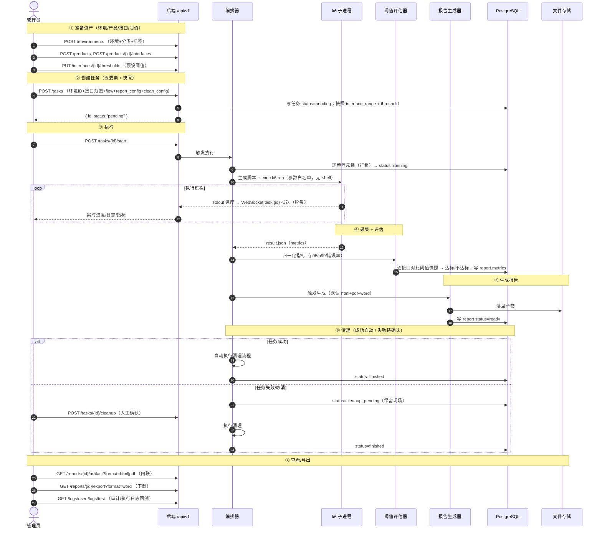
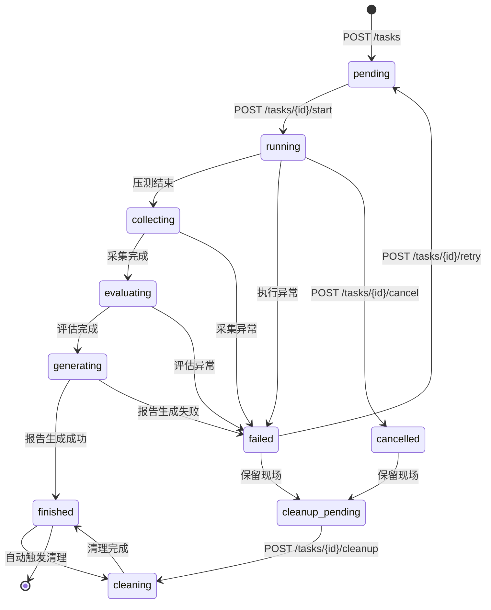

# auto_performance REST API 接口契约与关键数据流（api-contract.md）

- **项目**：auto_performance（性能测试平台）
- **文档类型**：详细设计 / REST API 契约
- **状态**：评审中（Draft）
- **日期**：2026-10-26
- **作者**：架构师
- **关联**：
  - 需求：`prds/PRD-performance-testing-platform.md`（实体/状态机/决策）
  - 架构：`specs/architecture.md`（分层/数据模型/时序图/鉴权约定）
  - 前端：`specs/frontend-structure.md`（路由表，需与后端接口对齐）
  - 安全：`security/security-design-report.md`（安全要求，接口设计需体现）
  - 决策：`decisions/ADR-0001~0006`

> 本契约是后端实现与前端联调的唯一接口依据。约定「接口清单」与「权限映射」以 `architecture.md` §5 为准，安全要求（认证/脱敏/上传校验/密钥加密/防注入/限流）以 `security-design-report.md` 为准。

---

## 1. API 设计约定

### 1.1 风格与统一前缀

| 项 | 约定 |
| --- | --- |
| 风格 | REST 资源风格，名词复数 + 资源 ID；动作型操作（start/cancel/retry/cleanup/import/export/generate/reinit）以动词子资源表达 |
| 统一前缀 | 所有业务接口前缀 `/api/v1`，完整路径示例 `/api/v1/environments` |
| 实时通道 | WebSocket `WS /api/v1/ws?token=<jwt>`（握手携带 token，服务端鉴权），订阅频道 `task:{id}`（任务进度/指标/日志）与 `logs:{type}` |
| 静态产物 | 报告 html/pdf 在线查看、word/报告导出通过鉴权接口返回文件流，不直接暴露文件系统 URL |
| 版本 | 主版本 `v1`，破坏性变更升主版本 |

### 1.2 统一响应格式

所有 HTTP 接口（含错误）均返回统一 JSON 结构（文件下载类接口除外，其以 `Content-Disposition` 返回文件流）：

```json
{
  "code": 0,
  "message": "ok",
  "data": {}
}
```

| 字段 | 类型 | 说明 |
| --- | --- | --- |
| `code` | number | 业务码，`0` 表示成功，非 `0` 表示失败（见 §5 错误码表） |
| `message` | string | 人类可读描述，成功为 `ok`，失败为错误原因 |
| `data` | object / array / null | 业务载荷；错误时可省略或为 `null` |

> HTTP 状态码与 `code` 语义对齐：认证类 `401`、鉴权类 `403`、校验/业务类 `400`、冲突类 `409`、限流类 `429`、服务端 `500`。前端以 HTTP 状态码做全局拦截（跳登录/403），以 `code` 做业务分支。

### 1.3 分页规范

| 项 | 约定 |
| --- | --- |
| 请求参数 | `page`（页码，从 `1` 开始，默认 `1`）、`page_size`（每页条数，默认 `20`，上限 `200`；超过上限服务端强制截断或返回 `10003`） |
| 响应结构 | `data = { "list": [...], "total": <总条数>, "page": <当前页>, "page_size": <每页条数> }` |
| 排序 | 可选 `sort` + `order`（`asc`/`desc`），字段白名单校验，非法字段忽略 |

分页响应示例：

```json
{
  "code": 0,
  "message": "ok",
  "data": {
    "list": [ { "id": "1", "name": "生产集群" } ],
    "total": 128,
    "page": 1,
    "page_size": 20
  }
}
```

### 1.4 鉴权方式

| 项 | 约定 |
| --- | --- |
| 认证方式 | JWT（HS256），请求头 `Authorization: Bearer <token>` |
| JWT 载荷 | `{ "sub": "<admin_id>", "username": "<登录名>", "iat": <签发时间>, "exp": <过期时间> }`；**权限不写入 token** |
| 权限读取 | 每次请求从 DB（`admin → admin_role → role → role_permission`）实时/短 TTL 缓存读取并集，保证角色变更即时生效 |
| 中间件链 | `Recovery → CORS → AuditLog → AuthN(JWT) → AuthZ(RBAC) → Handler` |
| 权限判定 | 读请求要求子模块 `read`，写请求要求子模块 `write`；敏感子模块（管理员/证书/SSH）仅 `write` 可用 |
| 首登改密 | `must_change_password=true` 时，除「改密/登出/查询自身」外的业务请求返回 `403` + `code=10103` |
| 登出失效 | 登出使当前 token 加入服务端短期失效名单（或依赖短 TTL），重放旧 token 返回 `10102` |

### 1.5 错误码规范

- 错误码为 5 位数字，按段划分：`1xxxx` 通用、`2xxxx` 业务（按模块分配，见 §5）。
- 返回约定：`HTTP 状态码` 与 `code` 前缀语义一致（`10xxx`/`20xxx` 业务错误用 `400`，`101xx` 认证用 `401`，`102xx` 鉴权用 `403`，`104xx` 冲突用 `409`，`105xx` 限流用 `429`，`106xx` 服务端用 `500`）。

### 1.6 时间格式

| 项 | 约定 |
| --- | --- |
| 格式 | RFC3339 / ISO 8601，如 `2026-10-26T08:30:00Z`；数据库存储 UTC |
| 输入 | 接受 `Z` 结尾或带时区偏移；纯日期（如证书有效期）允许 `YYYY-MM-DD` |
| 输出 | 统一 UTC 输出，前端本地化展示 |

### 1.7 ID 类型

| 项 | 约定 |
| --- | --- |
| 主键 | 数据库 `bigint` 自增 |
| JSON 序列化 | **字符串**（如 `"id": "123"`），规避 JS Number 精度丢失；路径参数接受数字或字符串 |
| 业务编码 | 环境编码/产品编码为字符串，唯一约束 |

---

## 2. 接口清单

> 符号约定：`[读]`=要求 `read` 权限，`[写]`=要求 `write` 权限。权限点格式 `module_code:permission`（见 §6）。请求体字段引用 PRD §4 实体字段；敏感字段（接口认证头、证书私钥、SSH 密钥）服务端加密存储、响应脱敏，前端不可见明文。

### 2.1 认证 auth

#### 接口总览

| 方法 | 路径 | 说明 | 权限 | 关键错误码 |
| --- | --- | --- | --- | --- |
| POST | `/api/v1/auth/login` | 登录 | 公开（登录失败限流） | 20001/20002/10502/10103 |
| POST | `/api/v1/auth/logout` | 登出 | 已认证 | 10101 |
| POST | `/api/v1/auth/change-password` | 修改密码（含首登强制改密） | 已认证 | 20003/20004/20005 |
| GET | `/api/v1/auth/me` | 查询当前用户信息与权限集合 | 已认证 | 10101 |

#### 详细说明

**POST /api/v1/auth/login** — 登录

- 请求参数（body）：
  | 字段 | 类型 | 必填 | 说明 |
  | --- | --- | --- | --- |
  | username | string | 是 | 登录名 |
  | password | string | 是 | 明文口令（仅传输层加密，服务端 bcrypt 比对） |

- 响应 `data`：
  | 字段 | 类型 | 说明 |
  | --- | --- | --- |
  | token | string | JWT |
  | expires_in | number | 有效秒数 |
  | admin | object | 管理员信息（不含 password_hash、PII 脱敏） |
  | permissions | string[] | 权限点并集，如 `["env.list:write", ...]` |
  | must_change_password | boolean | 是否需强制改密 |

- 安全约束（对应 `DES-S-001/DES-S-003`）：登录失败统一提示「用户名或密码错误」，不区分账号不存在/口令错误；连续失败锁定（账号+IP 双维度，`429`）；`admin` 首登返回 `must_change_password=true`。

**POST /api/v1/auth/logout** — 登出

- 请求参数：无（`Authorization` 头）。
- 响应 `data`：`null`。当前 token 失效。

**POST /api/v1/auth/change-password** — 修改密码 / 首登强制改密

- 请求参数（body）：
  | 字段 | 类型 | 必填 | 说明 |
  | --- | --- | --- | --- |
  | old_password | string | 是 | 旧密码（首登场景即初始密码 `Cqmyg@123`） |
  | new_password | string | 是 | 新密码，复杂度校验（≥8 位，含大小写/数字/特殊字符） |

- 响应 `data`：`null`。改密成功后清除 `must_change_password` 标记，并使旧 token 失效（需重新登录）。

**GET /api/v1/auth/me** — 当前用户与权限

- 请求参数：无。
- 响应 `data`：`{ "admin": {...}, "permissions": ["env.list:write", ...] }`。前端路由守卫据此加载权限集合。

---

### 2.2 环境管理

#### 接口总览

| 方法 | 路径 | 说明 | 权限 | 关键错误码 |
| --- | --- | --- | --- | --- |
| GET | `/api/v1/environment-categories` | 环境分类列表 | `env.list:read` | — |
| POST | `/api/v1/environment-categories` | 新建环境分类 | `env.list:write` | 10302 |
| PUT | `/api/v1/environment-categories/{id}` | 修改环境分类 | `env.list:write` | 10301/10302 |
| DELETE | `/api/v1/environment-categories/{id}` | 删除环境分类 | `env.list:write` | 21002 |
| GET | `/api/v1/tags` | 标签列表（含关联环境数） | `env.tag:read` | — |
| POST | `/api/v1/tags` | 新建标签 | `env.tag:write` | 10302 |
| PUT | `/api/v1/tags/{id}` | 修改标签 | `env.tag:write` | 10301 |
| DELETE | `/api/v1/tags/{id}` | 删除标签 | `env.tag:write` | 21003 |
| GET | `/api/v1/tags/{id}/environments` | 标签关联环境列表（反查） | `env.tag:read` | 10301 |
| GET | `/api/v1/environments` | 环境列表（筛选/分页） | `env.list:read` | — |
| POST | `/api/v1/environments` | 新建环境 | `env.list:write` | 21001/10301 |
| GET | `/api/v1/environments/{id}` | 环境详情 | `env.list:read` | 10301 |
| PUT | `/api/v1/environments/{id}` | 修改环境 | `env.list:write` | 10301/10402 |
| DELETE | `/api/v1/environments/{id}` | 删除环境（逻辑删除） | `env.list:write` | 21004 |
| PUT | `/api/v1/environments/{id}/tags` | 绑定标签（打标签） | `env.list:write` | 10301 |
| PATCH | `/api/v1/environments/{id}/status` | 停用/启用环境 | `env.list:write` | 21004/10401 |

#### 详细说明

**GET /api/v1/environments** — 环境列表

- 请求参数（query）：
  | 字段 | 类型 | 说明 |
  | --- | --- | --- |
  | keyword | string | 名称/编码关键字 |
  | category_id | string | 分类 ID |
  | tag_ids | string | 标签 ID 列表（逗号分隔，取交集） |
  | status | string | 状态：`pending`(待测试)/`testing`(测试中)/`disabled`(已下线) |
  | page / page_size | number | 分页 |

- 响应 `data.list[]`：环境实体（不含敏感引用）。**主机地址（hosts）字段按权限裁剪**：无 `env.list:read` 或需脱敏场景下不返回主机列表（对应 `DES-I-001`）。

**POST /api/v1/environments** — 新建环境

- 请求参数（body）：`name`(必)、`code`(必,唯一)、`category_id`(必,分类必填)、`tag_ids[]`(预定义标签复选)、`type`(single/cluster)、`hosts[]`(IP/域名列表)、`os`、`ssh_host_id`、`cert_id`、`description`。
- 响应 `data`：环境实体（含 ID、`status=pending`、`version`）。

**PUT /api/v1/environments/{id}** — 修改环境

- 请求参数（body）：同新建（全量字段），须携带 `version`（乐观锁版本号）。
- 响应 `data`：更新后环境实体。并发覆盖冲突返回 `409` + `10402`（对应 `DES-T-001`）。

**PATCH /api/v1/environments/{id}/status** — 停用/启用

- 请求参数（body）：`{ "status": "disabled" | "pending" }`。
- 约束：环境处于 `testing`（被任务占用）时禁止停用/删除，返回 `21004`；停用后不出现在新任务可选列表。

**标签反查 GET /api/v1/tags/{id}/environments**：响应该标签关联的环境列表（分页），用于「标签维护」页展示关联环境明细。

---

### 2.3 产品管理

#### 接口总览

| 方法 | 路径 | 说明 | 权限 | 关键错误码 |
| --- | --- | --- | --- | --- |
| GET | `/api/v1/products` | 产品列表（筛选/分页） | `product.list:read` | — |
| POST | `/api/v1/products` | 创建产品 | `product.list:write` | 22001 |
| GET | `/api/v1/products/{id}` | 产品详情 | `product.list:read` | 10301 |
| PUT | `/api/v1/products/{id}` | 修改产品 | `product.list:write` | 10301/10402 |
| DELETE | `/api/v1/products/{id}` | 删除产品（逻辑删除） | `product.list:write` | 22002 |
| PATCH | `/api/v1/products/{id}/status` | 停用/启用产品 | `product.list:write` | 10401 |
| GET | `/api/v1/products/{id}/interfaces` | 产品下接口列表 | `product.interface:read` | — |
| POST | `/api/v1/products/{id}/interfaces` | 新建接口 | `product.interface:write` | 10301 |
| PUT | `/api/v1/interfaces/{id}` | 修改接口 | `product.interface:write` | 10301/10402 |
| DELETE | `/api/v1/interfaces/{id}` | 删除接口 | `product.interface:write` | 10301 |
| PATCH | `/api/v1/interfaces/{id}/status` | 停用/启用接口 | `product.interface:write` | 10401 |
| GET | `/api/v1/interfaces/{id}/thresholds` | 接口阈值列表 | `product.interface:read` | 10301 |
| PUT | `/api/v1/interfaces/{id}/thresholds` | 批量设置接口阈值（全量替换） | `product.interface:write` | 22003 |

#### 详细说明

**POST /api/v1/products** — 创建产品

- 请求参数（body）：`name`(必)、`code`(必,唯一)、`version`(必)、`platform`、`description`。
- 响应 `data`：产品实体（`status=enabled`）。

**接口（Interface）** — 归属单一产品（不跨产品共享）

- 新建/修改 body：`name`、`url`、`method`(GET/POST/PUT/DELETE/PATCH)、`headers`、`body`(参数模板 JSON)、`timeouts`、`description`、`enabled`。
- **安全约束**（对应 `DES-I-001`）：`headers` 中的认证头（`Authorization`/`Token` 等）AES-256-GCM 加密存储，列表/详情/日志响应中脱敏，前端不返回明文认证头。

**PUT /api/v1/interfaces/{id}/thresholds** — 批量设置阈值（全量替换）

- 请求参数（body）：
  ```json
  {
    "thresholds": [
      { "metric": "p95", "operator": "le", "value": 500, "unit": "ms", "enabled": true },
      { "metric": "error_rate", "operator": "le", "value": 1.0, "unit": "%", "enabled": true }
    ]
  }
  ```
  | 字段 | 说明 |
  | --- | --- |
  | metric | 指标：`avg_rt`/`p95`/`p99`/`max_rt`/`throughput`/`error_rate`/`success_rate`/`concurrency` |
  | operator | 方向：`le`(≤，越小越好) / `ge`(≥，越大越好) |
  | value / unit / enabled | 数值 / 单位(`ms`/`%`/`req/s`/`个`) / 是否启用 |

- 约束：`metric` 与 `operator` 非法组合（如 `success_rate` 配 `le`）返回 `22003` 拦截（对应 PRD §9.3）。统计口径：响应时间取 **P95/P99 分位 + 错误率**（失败请求/总请求）。

---

### 2.4 测试管理

#### 接口总览

| 方法 | 路径 | 说明 | 权限 | 关键错误码 |
| --- | --- | --- | --- | --- |
| GET | `/api/v1/templates` | 模板列表（分页） | `testing.template:read` | — |
| POST | `/api/v1/templates` | 保存模板 | `testing.template:write` | 10302 |
| GET | `/api/v1/templates/{id}` | 模板详情 | `testing.template:read` | 10301 |
| PUT | `/api/v1/templates/{id}` | 修改模板 | `testing.template:write` | 10301/10402 |
| DELETE | `/api/v1/templates/{id}` | 删除模板 | `testing.template:write` | 10301 |
| POST | `/api/v1/tasks` | 创建任务（五要素组装，含快照） | `testing.task:write` | 23002/23003/23004 |
| GET | `/api/v1/tasks` | 任务列表（筛选/分页） | `testing.task:read` | — |
| GET | `/api/v1/tasks/{id}` | 任务详情 | `testing.task:read` | 10301 |
| POST | `/api/v1/tasks/{id}/start` | 执行任务 | `testing.task:write` | 23001/23002 |
| POST | `/api/v1/tasks/{id}/cancel` | 停止/取消任务 | `testing.task:write` | 23001 |
| POST | `/api/v1/tasks/{id}/retry` | 重试失败任务 | `testing.task:write` | 23001 |
| POST | `/api/v1/tasks/{id}/cleanup` | 任务清理确认（失败保留现场后人工确认） | `testing.task:write` | 23001 |

#### 详细说明

**POST /api/v1/tasks** — 创建任务

- 请求参数（body）：
  | 字段 | 类型 | 必填 | 说明 |
  | --- | --- | --- | --- |
  | name | string | 是 | 任务名称 |
  | template_id | string | 否 | 来源模板（可空） |
  | environment_id | string | 是 | 被测环境 |
  | product_ids | string[] | 否 | 关联产品（可选） |
  | interface_ids | string[] | 是 | 本次接口范围（可跨产品多接口，须非空） |
  | flow | object | 是 | 流程参数（准备/压测/采集/评估/报告阶段配置） |
  | report_config | object | 是 | 报告输出（`formats: ["html","pdf","word"]` 默认全量，可勾选） |
  | clean_config | object | 是 | 环境清理配置（动作列表 + 执行时机） |
  | auto_start | boolean | 否 | 是否创建后立即执行（默认 `false`，需显式 `start`） |

- `flow` 关键子结构（压测阶段，参数白名单校验，对应 `DES-T-001`）：
  ```json
  {
    "concurrency_mode": "fixed|ramp|pulse",
    "target_vus": 500,
    "ramp_stages": [{"vus": 100, "duration": "60s"}, {"vus": 300, "duration": "120s"}],
    "duration": "300s",
    "warmup": "10s",
    "timeout": "5s",
    "think_time": "0.5s",
    "parameterization": {"source": "csv", "path": "<ref>"}
  }
  ```
  - 并发数必须为正整数且 ≤ 上限（`max_vus`），非法返回 `23004`；接口地址走 URL 白名单。

- `flow` 场景编排子结构（单接口 / 流程测试）：
  ```json
  {
    "test_mode": "single|flow",
    "capture_response_body": true,
    "steps": [
      {
        "seq": 1,
        "name": "登录",
        "interface_id": 3,
        "scope": "once_per_test|once_per_iteration|every_request",
        "path": "/api/order?token={{token}}",
        "headers": {"Authorization": "Bearer {{token}}"},
        "body": "{\"token\":\"{{token}}\"}",
        "extract": [
          {"name": "token", "source": "jsonpath", "expr": "$.data.token"},
          {"name": "sid", "source": "regex", "expr": "sid=([a-z0-9]+)", "group": 1}
        ]
      }
    ]
  }
  ```
  - `test_mode` 缺省为 `single`；`flow` 模式必须至少一个 `once_per_iteration` 步骤，步骤数 ≤ 50，单步提取规则 ≤ 10。
  - 步骤 `interface_id` 必须落在任务接口范围内（否则 `10003`）；流程模式下 `interface_ids` 可为空，由步骤自动推导。
  - 变量作用域由步骤 `scope` 决定：`once_per_test`（整个测试周期一次）/ `once_per_iteration`（每次迭代）/ `every_request`（每个主流程步骤前）。
  - 路径/请求头/请求体支持 `{{变量名}}` 占位符，运行期由 k6 脚本替换；表达式非法（正则不可编译、JSONPath 未以 `$` 开头）返回 `10003`。

- 处理语义：创建时对「接口范围 + 阈值」**做快照**（`interface_range_snapshot` + `threshold_snapshot`），历史报告可复现；任务状态 `pending`。环境被占用（`testing`）时返回 `23002`（环境互斥，`DES-D-001`）。

**POST /api/v1/tasks/{id}/start** — 执行任务

- 请求参数：无（path `id`）。
- 语义：`pending → running`；编排器领取任务、生成 k6 脚本、拉起子进程，WebSocket 推送实时进度/日志。非 `pending` 状态返回 `23001`；环境占用返回 `23002`。

**POST /api/v1/tasks/{id}/refresh-snapshot** — 同步接口/阈值快照

- 请求参数：无（path `id`）。
- 语义：仅 `pending` 任务；按接口最新配置重新快照 `interface_range_snapshot` + `threshold_snapshot`，返回刷新后的任务。非 `pending` 返回 `23001`；接口已被删除导致范围不完整返回 `10003`。
- 自动同步：`POST /tasks/{id}/start` 在执行前也会先刷新快照，保证压测使用接口最新配置；已开始/已完成任务保留当次快照以保证报告可复现。

**POST /api/v1/tasks/{id}/cancel** — 停止/取消

- 请求参数：无。语义：`running → cancelled`（终止 k6 子进程），记录审计。

**POST /api/v1/tasks/{id}/retry** — 重试

- 请求参数：无。语义：`failed → pending`（复用原快照重新执行）。

**POST /api/v1/tasks/{id}/cleanup** — 清理确认

- 请求参数：无。
- 语义：仅 `cleanup_pending` 状态可调用；管理员确认后 `cleanup_pending → cleaning → finished`（执行环境清理流程）。任务**成功自动清理**，**失败/取消不自动清理**，保留现场待此接口人工确认（PRD 决策 #16）。

---

### 2.5 报告管理

#### 接口总览

| 方法 | 路径 | 说明 | 权限 | 关键错误码 |
| --- | --- | --- | --- | --- |
| GET | `/api/v1/reports` | 报告列表（筛选/分页） | `report.list:read` | — |
| GET | `/api/v1/reports/{id}` | 报告详情（含摘要/达标统计） | `report.list:read` | 10301 |
| POST | `/api/v1/reports/{id}/generate` | 生成/重新生成报告 | `report.list:write` | 24004 |
| POST | `/api/v1/reports/import` | 导入报告（上传，支持孤立归档） | `report.list:write` | 24002/24003 |
| GET | `/api/v1/reports/{id}/export` | 导出/下载报告 | `report.list:read` | 24001 |
| GET | `/api/v1/reports/{id}/artifact` | 在线查看/下载产物（html/pdf 内联） | `report.list:read` | 24001 |

#### 详细说明

**GET /api/v1/reports** — 报告列表

- 请求参数（query）：`task_id`、`type`(html/pdf/word)、`status`、`source`(internal/external)、`start_time`/`end_time`、`keyword`、分页。

**GET /api/v1/reports/{id}** — 报告详情

- 响应 `data`：报告元数据 + `summary`（达标统计、关键指标摘要）+ `artifacts[]`（各格式产物元信息：format/path/size）。

**POST /api/v1/reports/{id}/generate** — 生成/重新生成

- 语义：任务完成后自动全量生成 html/pdf/word（默认），无需手动调用；该接口用于报告状态 `generation_failed → generating` 的**重新生成**。

**POST /api/v1/reports/import** — 导入报告（上传）

- 请求参数（multipart/form-data）：
  | 字段 | 类型 | 说明 |
  | --- | --- | --- |
  | file | file | 报告文件（html/pdf/docx） |
  | task_id | string | 可选，归属任务；为空则孤立归档（`source=external`，标注「外部导入」） |
  | product_id | string | 可选，归属产品 |

- 安全约束（对应 `DES-T-001`）：扩展名 + magic bytes 双校验 + 大小限制（`max_report_size`）+ 随机文件名落盘；存储目录禁止脚本执行；路径不采信用户文件名。

**GET /api/v1/reports/{id}/export** — 导出/下载

- 请求参数（query）：`format`（html/pdf/word）。
- 响应：文件流，`Content-Disposition: attachment`，供离线读取。产物路径源 DB（非用户输入），白名单目录 + `Clean` 前缀校验（对应 `DES-T-002`）。

**GET /api/v1/reports/{id}/artifact** — 在线查看/下载产物

- 请求参数（query）：`format`（html/pdf/word）。
- 响应：`format=html` → `Content-Type: text/html; Content-Disposition: inline`（内联渲染）；`format=pdf` → `application/pdf` 内联预览；`format=word` → `attachment` 下载。文件不存在返回 `24001`。

---

### 2.6 日志管理

#### 接口总览

| 方法 | 路径 | 说明 | 权限 | 关键错误码 |
| --- | --- | --- | --- | --- |
| GET | `/api/v1/logs/user` | 用户日志查询 | `log.user:read` | — |
| GET | `/api/v1/logs/system` | 系统日志查询 | `log.system:read` | — |
| GET | `/api/v1/logs/test` | 测试日志查询 | `log.test:read` | 25001 |

#### 详细说明

- 通用请求参数（query）：`start_time`/`end_time`（时间范围）、`keyword`、`level`(info/warn/error)、分页。
- 用户日志追加：`admin_id`（操作人）、`action`（动作枚举）、`resource_type`/`resource_id`（关联对象）。
- 测试日志追加：`task_id`（按任务定位）。
- 请求详情（`GET /api/v1/logs/request`）：字段含 `method`/`url`/`request_headers`/`request_body`/`response_status`/`response_headers`/`response_body`/`error_code`/`error_message`/`duration_ms`。
  - 请求头/响应头、请求体/响应体均在 k6 侧或写入前截断至 4KB；`Cookie`/`Authorization`/`Token`/`*Key*`/`Set-Cookie` 等敏感头统一脱敏（`***`）。
  - 仅在任务开启「采集请求明细」（`flow.capture_response_body=true`）时记录头/体与响应内容，默认关闭以保护压测性能。
- **安全约束**（对应 `DES-T-001`/`DES-R-001`）：日志为**只读**接口，无删除/修改端点；审计日志 HMAC 链式防篡改，应用层禁止 UPDATE/DELETE；写入前统一脱敏（剥离口令/`Authorization`/私钥特征）。

---

### 2.7 系统设置

#### 接口总览

| 方法 | 路径 | 说明 | 权限 | 关键错误码 |
| --- | --- | --- | --- | --- |
| GET | `/api/v1/admins` | 管理员列表 | `setting.admin:write` | — |
| POST | `/api/v1/admins` | 新建管理员 | `setting.admin:write` | 26001 |
| GET | `/api/v1/admins/{id}` | 管理员详情 | `setting.admin:write` | 10301 |
| PUT | `/api/v1/admins/{id}` | 修改管理员 | `setting.admin:write` | 10301/10402 |
| DELETE | `/api/v1/admins/{id}` | 删除管理员 | `setting.admin:write` | 26002 |
| PATCH | `/api/v1/admins/{id}/status` | 停用/启用管理员 | `setting.admin:write` | 26002 |
| POST | `/api/v1/admins/{id}/reset-password` | 重置密码 | `setting.admin:write` | 10301 |
| GET | `/api/v1/admins/{id}/roles` | 查询管理员角色 | `setting.admin:write` | 10301 |
| POST | `/api/v1/admins/{id}/roles` | 绑定角色（授权） | `setting.admin:write` | 10301 |
| GET | `/api/v1/roles` | 角色列表 | `setting.admin:write` | — |
| POST | `/api/v1/roles` | 新建角色（含权限矩阵） | `setting.admin:write` | 10302 |
| GET | `/api/v1/roles/{id}` | 角色详情 | `setting.admin:write` | 10301 |
| PUT | `/api/v1/roles/{id}` | 修改角色（含权限矩阵） | `setting.admin:write` | 10301/10402 |
| DELETE | `/api/v1/roles/{id}` | 删除角色 | `setting.admin:write` | 26003 |
| GET | `/api/v1/permissions` | 权限点清单（子模块元数据） | `setting.admin:write` | — |
| GET | `/api/v1/certificates` | 证书列表 | `setting.cert:write` | — |
| POST | `/api/v1/certificates` | 导入证书 | `setting.cert:write` | 10302 |
| DELETE | `/api/v1/certificates/{id}` | 删除证书 | `setting.cert:write` | 26004 |
| POST | `/api/v1/certificates/{id}/reinit` | 重新初始化内置证书 | `setting.cert:write` | 10401 |
| GET | `/api/v1/ssh-hosts` | SSH/Host 列表 | `setting.ssh:write` | — |
| POST | `/api/v1/ssh-hosts` | 添加 SSH/Host | `setting.ssh:write` | 10302 |
| POST | `/api/v1/ssh-hosts/import` | 批量导入 SSH/Host | `setting.ssh:write` | 24002 |
| PUT | `/api/v1/ssh-hosts/{id}` | 修改 SSH/Host | `setting.ssh:write` | 10301/10402 |
| DELETE | `/api/v1/ssh-hosts/{id}` | 删除 SSH/Host | `setting.ssh:write` | 26005 |

#### 详细说明

**管理员管理**

- 新建管理员 body：`username`(必,唯一)、`name`(必)、`phone`、`email`、`description`、`password`(必,≥8位)。
- **防 Mass Assignment**（对应 `DES-E-002`）：请求体仅绑定白名单字段，夹带的 `role`/`status`/`is_super` 等字段被丢弃；新建账号**默认无权限**，通过「角色授权」接口授予。
- **角色授权**：`POST /admins/{id}/roles` body `{ "role_ids": ["1","2"] }`，全量替换该管理员的角色绑定。
- **内置 admin**：不可删除/停用（`26002`）；默认全权限，首次登录强制改密。
- 停用管理员无法登录（`10202`）。

**角色管理（含权限矩阵）**

- 新建/修改角色 body：
  ```json
  {
    "name": "只读观察员",
    "description": "全部子模块只读",
    "permissions": [
      {"module": "env.list", "permission": "read"},
      {"module": "report.list", "permission": "read"}
    ]
  }
  ```
- `GET /permissions` 返回子模块授权项元数据（`module_code` + 可授权限 `read`/`write` + 是否敏感），供前端权限矩阵勾选。
- 删除角色：被管理员引用时禁止删除，返回 `26003`。

**证书管理**

- 导入证书（multipart/form-data）：`file`、`name`、`issuer`、`valid_from`/`valid_to`、`associated_service`。
- **安全约束**（对应 `DES-I-002`）：证书私钥 AES-256-GCM 加密存储（DEK 由 KEK 包裹），KEK 文件 0600 权限、不明文落库。
- 内置自签证书 `is_builtin=true`：不可删除（`26004`）；`reinit` 仅更新有效期时间（非内置证书调用返回 `10401`）。

**SSH/Host 管理**

- 添加/修改 body：`type`(host/ssh)、`host`、`port`、`user`、`auth_type`(password/key)、`key`(SSH 私钥，加密存储)、`host_entries[]`(Host 解析内容)、`description`。
- 批量导入：`POST /ssh-hosts/import`（multipart，JSON/CSV 文件，逐行解析，重复项跳过）。
- **安全约束**：SSH 私钥加密存储；环境清理仅允许在 SSH/Host 白名单主机上执行内置动作（对应 `DES-T-003`）。

---

## 3. 关键数据流：一次性能测试全流程

> 以「准备资产 → 创建任务 → 执行 → 采集评估 → 生成报告 → 清理 → 查看导出」为主线。请求/响应与状态流转与 `architecture.md` §2.3 时序图一致。



### 任务状态机（与接口动作的对应关系）



---

## 4. 错误码表

### 4.1 通用错误码（1xxxx）

| code | HTTP | 含义 | 典型场景 |
| --- | --- | --- | --- |
| 0 | 200 | 成功 | — |
| 10001 | 400 | 参数错误 | 参数格式/取值非法 |
| 10002 | 400 | 参数缺失 | 必填字段缺失 |
| 10003 | 400 | 参数格式非法 | 类型/枚举/分页上限 |
| 10101 | 401 | 未认证 | 缺少/无效/过期 token |
| 10102 | 401 | 会话失效 | 登出后 token 重放 |
| 10103 | 403 | 需修改密码 | 首登强制改密未完成 |
| 10201 | 403 | 权限不足 | RBAC 拒绝 |
| 10202 | 403 | 账号已停用 | 停用管理员登录/访问 |
| 10301 | 404 | 资源不存在 | 目标对象不存在 |
| 10302 | 400 | 资源已存在 | 唯一约束冲突（编码/用户名/标签名） |
| 10401 | 409 | 状态冲突 | 当前状态不允许该操作 |
| 10402 | 409 | 并发冲突 | 乐观锁 version 冲突 |
| 10403 | 409 | 资源被引用 | 存在关联禁止删除 |
| 10404 | 409 | 环境被占用 | 环境互斥（同环境单任务） |
| 10501 | 429 | 请求过于频繁 | 限流 |
| 10502 | 429 | 登录锁定 | 连续失败锁定（账号/IP） |
| 10601 | 500 | 服务器内部错误 | 未捕获异常 |
| 10602 | 500 | 依赖服务异常 | k6/Chromium/DB 异常 |

### 4.2 业务错误码（2xxxx）

| code | 模块 | HTTP | 含义 |
| --- | --- | --- | --- |
| 20001 | 认证 | 401 | 用户名或密码错误（统一提示） |
| 20002 | 认证 | 401 | 账号被锁定 |
| 20003 | 认证 | 400 | 旧密码错误 |
| 20004 | 认证 | 400 | 新密码不符合复杂度要求 |
| 20005 | 认证 | 400 | 新密码与旧密码相同 |
| 21001 | 环境 | 400 | 环境编码已存在 |
| 21002 | 环境 | 409 | 分类已被环境引用，禁止删除 |
| 21003 | 环境 | 409 | 标签已被环境引用，删除前需解除关联 |
| 21004 | 环境 | 409 | 环境被任务占用，禁止删除/停用 |
| 22001 | 产品 | 400 | 产品编码已存在 |
| 22002 | 产品 | 409 | 产品下存在接口，禁止删除 |
| 22003 | 产品 | 400 | 阈值方向与指标类型不匹配 |
| 23001 | 测试 | 409 | 任务状态不允许该操作 |
| 23002 | 测试 | 409 | 环境被占用/正在测试 |
| 23003 | 测试 | 400 | 接口范围为空 |
| 23004 | 测试 | 400 | 并发数非法或超出上限 |
| 23005 | 测试 | 404 | 模板不存在 |
| 24001 | 报告 | 404 | 报告文件不存在 |
| 24002 | 报告 | 400 | 上传文件类型不允许 |
| 24003 | 报告 | 400 | 上传文件过大 |
| 24004 | 报告 | 500 | 报告生成失败 |
| 25001 | 日志 | 400 | 查询时间范围非法 |
| 26001 | 设置 | 400 | 用户名已存在 |
| 26002 | 设置 | 403 | 内置 admin 不可删除/停用 |
| 26003 | 设置 | 409 | 角色被管理员引用，禁止删除 |
| 26004 | 设置 | 403 | 内置自签证书不可删除 |
| 26005 | 设置 | 409 | SSH/Host 已被环境引用，禁止删除 |

---

## 5. 权限映射（分级分权）

> 权限点格式 `module_code:permission`，`permission ∈ {read, write}`。管理员权限 = 所授角色权限并集；内置 `admin` 隐式全权限，不依赖角色表。日志子模块默认只读；系统设置敏感子模块仅 `write` 授权。

### 5.1 子模块权限点清单

| 模块 | module_code | 可授权限 | 敏感 |
| --- | --- | --- | --- |
| 环境管理 · 环境列表（含环境分类） | `env.list` | read / write | 否 |
| 环境管理 · 标签维护 | `env.tag` | read / write | 否 |
| 产品管理 · 产品列表 | `product.list` | read / write | 否 |
| 产品管理 · 接口管理（含阈值） | `product.interface` | read / write | 否 |
| 测试管理 · 测试任务 | `testing.task` | read / write | 否 |
| 测试管理 · 预设模板 | `testing.template` | read / write | 否 |
| 报告管理 · 报告列表（含导入导出） | `report.list` | read / write | 否 |
| 日志管理 · 用户日志 | `log.user` | read | 否 |
| 日志管理 · 系统日志 | `log.system` | read | 否 |
| 日志管理 · 测试日志 | `log.test` | read | 否 |
| 系统设置 · 管理员管理（含角色） | `setting.admin` | write | 是 |
| 系统设置 · 证书管理 | `setting.cert` | write | 是 |
| 系统设置 · SSH 与 Host 管理 | `setting.ssh` | write | 是 |

### 5.2 接口 → 权限点映射

| 接口（方法 + 路径） | 权限点 |
| --- | --- |
| POST /auth/login | 公开（限流） |
| POST /auth/logout、POST /auth/change-password、GET /auth/me | 已认证（无子模块要求） |
| GET /environment-categories、GET /environments、GET /environments/{id} | `env.list:read` |
| POST/PUT/DELETE /environment-categories、POST/PUT/DELETE /environments、PUT /environments/{id}/tags、PATCH /environments/{id}/status | `env.list:write` |
| GET /tags、GET /tags/{id}/environments | `env.tag:read` |
| POST/PUT/DELETE /tags | `env.tag:write` |
| GET /products、GET /products/{id} | `product.list:read` |
| POST/PUT/DELETE /products、PATCH /products/{id}/status | `product.list:write` |
| GET /products/{id}/interfaces、GET /interfaces/{id}/thresholds | `product.interface:read` |
| POST /products/{id}/interfaces、PUT/DELETE /interfaces/{id}、PATCH /interfaces/{id}/status、PUT /interfaces/{id}/thresholds | `product.interface:write` |
| GET /templates、GET /templates/{id} | `testing.template:read` |
| POST/PUT/DELETE /templates | `testing.template:write` |
| GET /tasks、GET /tasks/{id} | `testing.task:read` |
| POST /tasks、POST /tasks/{id}/start、/cancel、/retry、/cleanup | `testing.task:write` |
| GET /reports、GET /reports/{id}、GET /reports/{id}/artifact、GET /reports/{id}/export | `report.list:read` |
| POST /reports/{id}/generate、POST /reports/import | `report.list:write` |
| GET /logs/user | `log.user:read` |
| GET /logs/system | `log.system:read` |
| GET /logs/test | `log.test:read` |
| GET/POST/PUT/DELETE /admins、/admins/{id}、/admins/{id}/roles、/roles、/permissions | `setting.admin:write` |
| GET/POST/DELETE /certificates、/certificates/{id}、/certificates/{id}/reinit | `setting.cert:write` |
| GET/POST/PUT/DELETE /ssh-hosts、/ssh-hosts/import | `setting.ssh:write` |

### 5.3 权限判定规则

1. 读请求（GET 列表/详情/产物查看/导出）要求子模块 `read`；写请求（POST/PUT/PATCH/DELETE）要求 `write`。
2. 日志子模块仅授权 `read`（默认只读，无写操作接口）。
3. 系统设置敏感子模块（`setting.admin/cert/ssh`）仅 `write` 授权，默认不授普通角色；RBAC 之上叠加显式保护。
4. 权限从 DB 短 TTL 缓存读取，角色变更即时失效；权限不入 JWT。
5. 前端以 `GET /auth/me` 返回的权限集合驱动路由守卫与按钮级 `v-permission`，但**最终鉴权在服务端**，前端隐藏不可绕过。

---

## 6. 附：安全要求落实对照（接口层）

| 安全要求（security-design-report） | 接口层落实 |
| --- | --- |
| JWT + RBAC 服务端最终鉴权（`DES-S-001/E-001`） | §1.4 鉴权约定、§5 权限映射，每接口声明权限点 |
| 首登强制改密 / 无隐藏账号（`DES-S-003`） | `POST /auth/change-password` + `must_change_password` 中间件拦截（`10103`） |
| 登录防暴力破解（`DES-S-001`） | 登录统一提示 + 账号/IP 锁定（`20001`/`20002`/`10502`） |
| 防 Mass Assignment（`DES-E-002`） | 新建管理员/角色请求体白名单绑定 |
| 接口认证头加密存储（`DES-I-001`） | 接口 `headers` 认证头 AES-256-GCM 存储，响应/日志脱敏 |
| 证书私钥/SSH 密钥加密（`DES-I-002`） | 证书/SSH 接口，KEK 包裹 DEK，0600 权限 |
| k6 脚本/命令注入防护（`DES-T-001/T-002`） | 任务 flow 参数白名单校验（`23004`）、URL 白名单、无 shell 子进程 |
| 报告上传安全（`DES-T-001`） | 报告导入扩展名+magic bytes+大小限制+随机文件名（`24002`/`24003`） |
| 报告路径穿越防护（`DES-T-002`） | 产物路径源 DB + 白名单目录前缀校验 |
| 审计日志防篡改（`DES-T-001`） | 日志只读接口，无删除/修改端点，HMAC 链式签名 |
| 环境互斥（`DES-D-001`） | 任务创建/执行环境占用校验（`23002`），DB 行锁 |
