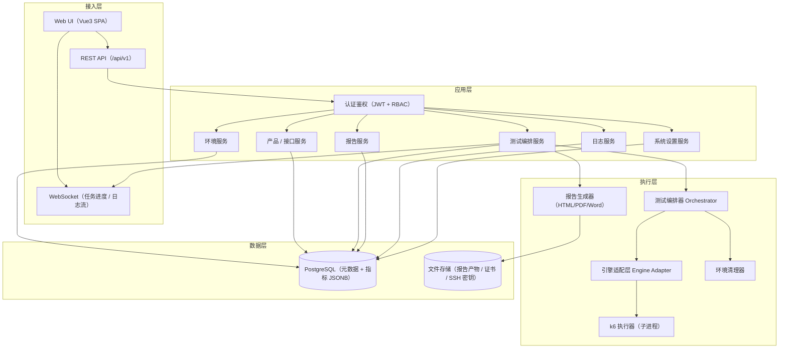
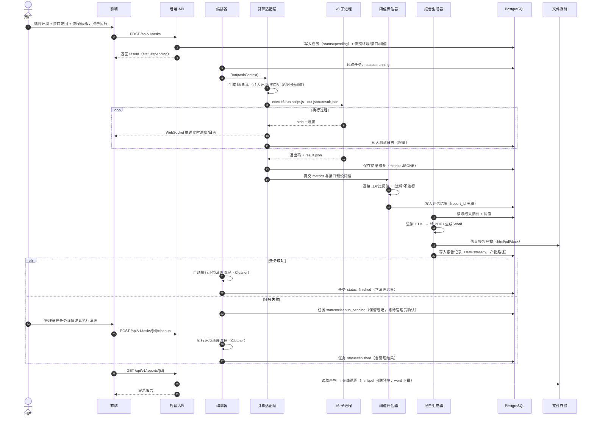
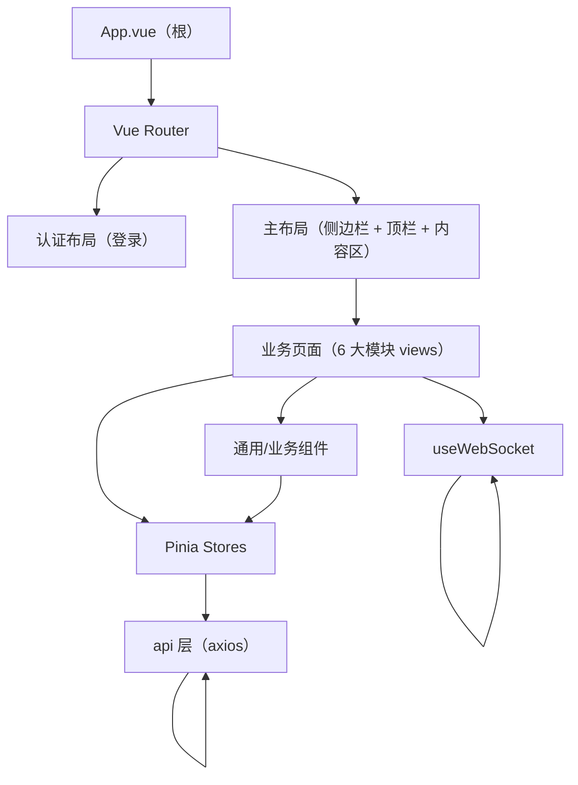
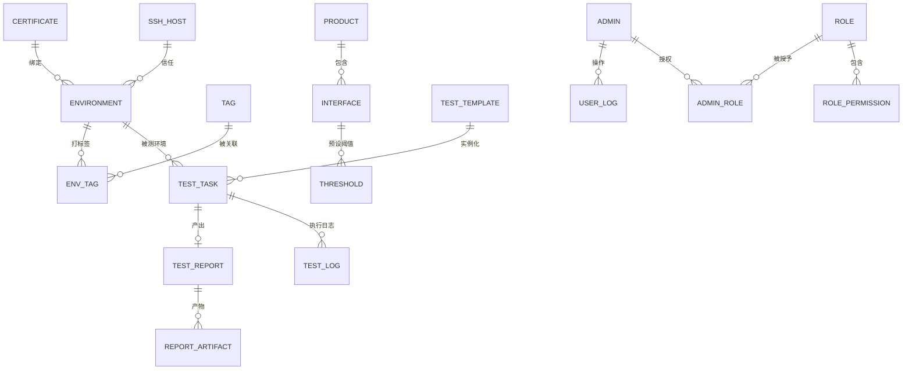
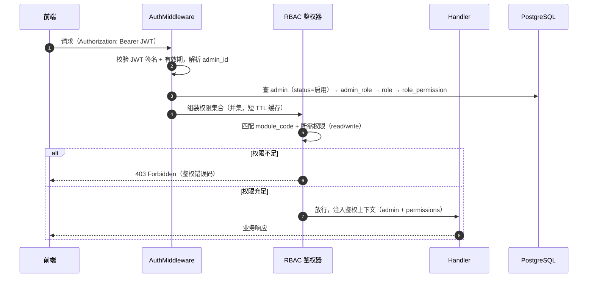
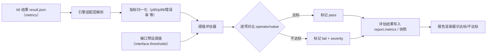
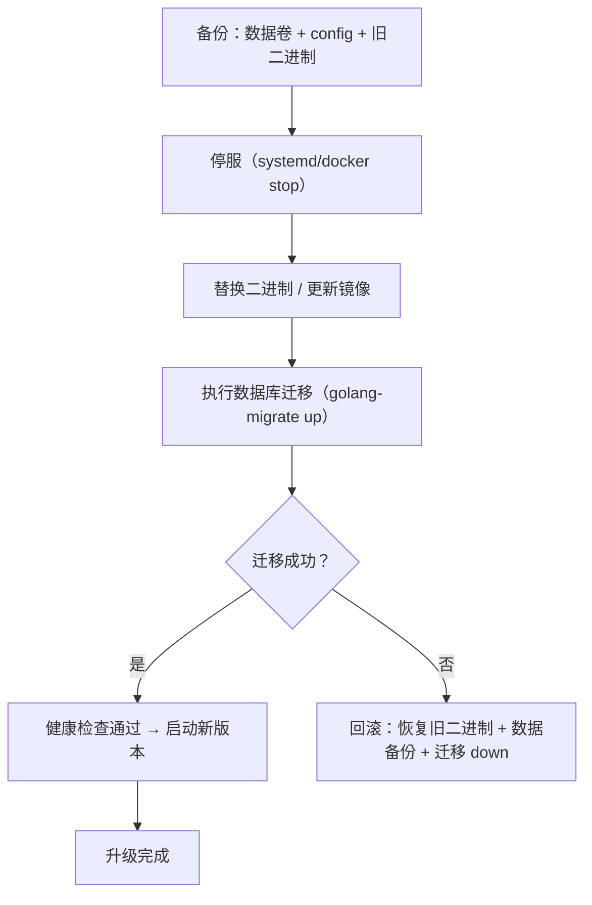

# auto_performance 架构设计文档（architecture.md）

- **项目**：auto_performance（性能测试平台）
- **文档类型**：技术方案 / 架构设计
- **状态**：评审中（Draft）
- **日期**：2026-10-26
- **作者**：架构师
- **关联**：
  - 需求：6 大模块（环境/产品/测试/报告/日志/系统设置）+ 部署运维硬约束（离线部署、可移植、依赖自包含、升级/卸载）
  - 决策：`decisions/ADR-0001~0006`
  - 前端专篇：`specs/frontend-structure.md`

---

## 0. 需求速览与设计约束

### 0.1 六大模块

| # | 模块 | 职责 | 子模块 |
| --- | --- | --- | --- |
| 1 | 环境管理 | 管理待测环境、环境信息；支持分类与打标签（单机/集群） | 环境列表、标签维护（标签显示关联环境） |
| 2 | 产品管理 | 产品列表（版本/平台）、接口管理（接口地址、接口范围、预设关键指标阈值） | 产品列表、接口管理 |
| 3 | 测试管理 | 编排"环境 + 接口范围 + 流程 + 报告输出 + 环境清理"，支持预设模板 | 测试任务、预设模板 |
| 4 | 报告管理 | 解析测试数据生成报告；在线/离线读取；导入/导出；html/pdf/word | 报告列表、在线查看 |
| 5 | 日志管理 | 用户日志（管理员操作）、系统日志（服务运行/重启/启动）、测试日志（任务执行） | 用户/系统/测试日志 |
| 6 | 系统设置 | 管理员管理、证书管理（SSL）、SSH 与 Host 管理 | 管理员、证书、SSH/Host |

### 0.2 部署运维硬约束（核心设计输入）

1. **离线部署**：部署包自包含，目标环境无外网、无预装运行时。
2. **可移植、可维护**：跨平台（linux/amd64、arm64）、迁移成本低、代码可长期维护。
3. **依赖自包含**：构建部署包时全部依赖包含在内。
4. **升级与卸载**：必须提供清晰的升级（含数据迁移/回滚）与卸载（含数据保留/清理）策略。

> 上述约束贯穿所有选型与架构决策，任何方案若与离线/可移植冲突，一律降级或否决。

---

## 1. 技术选型总览

### 1.1 选型结论一览

| 领域 | 选型 | 关键理由 | 决策文档 |
| --- | --- | --- | --- |
| 后端语言/框架 | Go + Gin + go:embed | 单二进制、离线强、高并发低开销、内嵌前端 | ADR-0001 |
| 前端框架 | Vue3 + TypeScript + Vite | 静态产物、内嵌友好、工程化成熟 | ADR-0002 |
| 组件库/样式 | shadcn-vue + Tailwind CSS | 源码进项目、无运行时依赖、定制强 | ADR-0002 |
| 状态管理/路由 | Pinia + Vue Router | 官方维护、类型友好 | ADR-0002 |
| 图表/表格/编辑器 | ECharts / TanStack Table / CodeMirror 6 | 报告可视化、数据表格、脚本编辑 | ADR-0002 |
| 数据库 | PostgreSQL（JSONB） | 半结构化阈值/指标、离线成熟、一致性 | ADR-0004 |
| 压测执行引擎 | 集成 k6（子进程 CLI）+ 引擎适配层 | Go 单二进制、脚本化、JSON 结果 | ADR-0003 |
| 报告生成 | HTML 模板 + headless Chromium 转 PDF + gooxml 生成 Word | 离线、一致性、可维护 | 见 §1.4 |
| 部署/打包 | 单二进制 + 离线包（tar.gz）+ Docker Compose 离线镜像 | 自包含、升级/卸载脚本 | 见 §7 |

### 1.2 后端选型对比（摘要）

| 维度 | Go ✅ | Java | Python |
| --- | --- | --- | --- |
| 部署形态 | 单二进制 | JAR+JRE | 解释器+依赖 |
| 离线 | 极强 | 弱（体积大） | 弱（内嵌解释器） |
| 并发/长连接 | goroutine 原生契合 | 线程池 | 异步+GIL |
| 体积 | 小 | 大 | 中 |

> 详见 `ADR-0001`。

### 1.3 前端选型对比（摘要）

| 维度 | shadcn-vue + Tailwind ✅ | Element Plus |
| --- | --- | --- |
| 组件形态 | 源码进项目 | npm 依赖 |
| 离线友好 | 极强 | 强 |
| 数据密集型组件 | 需组装 | 开箱即用 |
| 定制 | 强 | 中 |

> 详见 `ADR-0002`。团队若走千星/宙斯 QP 微前端体系，则切回 `QP + Vue + Qianxin Design`。

### 1.4 报告生成选型

| 格式 | 方案 | 理由 |
| --- | --- | --- |
| HTML | Go `html/template` 渲染，CSS/JS 全内联（无外部 CDN） | 离线、可离线导出、可在线查看 |
| PDF | 同一份 HTML 经 headless Chromium 打印生成 | HTML/PDF 视觉一致、现代 CSS 渲染质量高；离线内嵌 Chromium 二进制 |
| Word | Go 库 `gooxml`（unioffice）模板填充生成 | 纯 Go、可离线、无需 Office 运行时 |

> PDF 备选：`gopdf`（纯 Go、体积小、中文需内嵌字体、排版弱）。选 headless Chromium 是权衡"离线体积"与"渲染质量/一致性"后的结论：报告质量与 HTML/PDF 一致性价值高于 Chromium 的 ~150MB 体积增量，且 Chromium 可被多个报告复用。
>
> **默认策略（已确认）**：任务完成后**默认全量生成 HTML + PDF + Word 三种格式**，任务创建时可勾选调整输出格式（见 ADR-0006）。

---

## 2. 系统架构设计

### 2.1 分层架构



### 2.2 模块划分与职责

| 层 | 模块 | 职责 |
| --- | --- | --- |
| 接入层 | api/router | 路由、中间件、参数校验、统一响应 |
| 接入层 | ws | WebSocket 会话管理、任务/日志订阅与推送 |
| 应用层 | environment | 环境 CRUD、分类、标签关联 |
| 应用层 | product | 产品 CRUD、接口 CRUD、阈值配置 |
| 应用层 | test | 测试模板、测试任务、编排参数、任务状态机 |
| 应用层 | report | 报告生成、导入/导出、在线读取 |
| 应用层 | log | 用户/系统/测试日志的写入与检索 |
| 应用层 | setting | 管理员、证书、SSH/Host |
| 执行层 | orchestrator | 任务调度、生命周期、状态流转、环境清理编排、环境互斥/排队控制 |
| 执行层 | engine | 引擎接口抽象 + k6 实现（脚本生成/执行/解析/流式日志） |
| 执行层 | reportgen | HTML/PDF/Word 生成 |
| 数据层 | repository | gorm/pgx 数据访问，隔离业务与存储 |

### 2.3 关键数据流：一次测试的完整链路



---

## 3. 项目结构（monorepo 目录树）

```text
auto_performance/
├── backend/                              # Go 后端（单二进制）
│   ├── cmd/
│   │   └── server/
│   │       └── main.go                   # 入口：装配依赖、启动 HTTP/WS、注册路由
│   ├── internal/
│   │   ├── api/                          # REST 路由与 handler（按模块分包）
│   │   │   ├── middleware/               # 鉴权、审计、恢复、CORS
│   │   │   ├── response/                 # 统一响应 {code,message,data}
│   │   │   ├── environment/
│   │   │   ├── product/
│   │   │   ├── task/
│   │   │   ├── report/
│   │   │   ├── log/
│   │   │   └── setting/
│   │   ├── service/                      # 业务服务层（用例编排）
│   │   ├── domain/                       # 领域模型（实体 + 枚举/状态机）
│   │   ├── repository/                   # 数据访问（gorm/pgx 实现）
│   │   ├── orchestrator/                 # 任务编排器、调度器、状态机
│   │   ├── engine/                       # 引擎适配层
│   │   │   ├── engine.go                 # Engine 接口（Generate/Run/Parse/Stream）
│   │   │   └── k6/                       # k6 实现
│   │   ├── reportgen/                    # 报告生成器
│   │   │   ├── html/                     # html/template + 内联资源
│   │   │   ├── pdf/                      # headless Chromium
│   │   │   └── word/                     # gooxml
│   │   ├── evaluator/                    # 阈值评估器
│   │   ├── cleaner/                      # 环境清理器
│   │   ├── auth/                         # JWT、RBAC、密码
│   │   ├── ws/                           # WebSocket hub
│   │   └── config/                       # viper 配置
│   ├── migrations/                       # golang-migrate SQL 迁移
│   ├── web/                              # go:embed 内嵌前端构建产物（由 frontend 产出）
│   ├── templates/                        # 报告 HTML 模板（内嵌）
│   ├── go.mod / go.sum
│   └── Makefile
│
├── frontend/                             # Vue3 前端
│   ├── src/
│   │   ├── api/                          # 接口封装（axios + 按模块）
│   │   ├── router/                       # 路由表（见 frontend-structure.md）
│   │   ├── stores/                       # Pinia 状态
│   │   ├── layouts/                      # 布局组件
│   │   ├── views/                        # 页面（按 6 大模块）
│   │   ├── components/                   # 通用/业务组件
│   │   ├── composables/                  # 组合式函数（useWebSocket 等）
│   │   ├── types/                        # TS 类型
│   │   ├── utils/                        # 工具
│   │   └── assets/                       # 静态资源
│   ├── package.json / tsconfig.json / vite.config.ts
│   └── components.json                   # shadcn-vue 配置
│
├── deploy/                               # 部署与离线打包
│   ├── docker/
│   │   ├── Dockerfile.backend            # 多阶段构建
│   │   ├── Dockerfile.frontend
│   │   └── docker-compose.yml            # 编排（后端 + PostgreSQL + 卷）
│   ├── offline/
│   │   ├── build-offline.sh              # 离线打包脚本
│   │   ├── manifest.yaml.tmpl            # 离线包清单模板
│   │   └── assets/                       # 需随包分发的依赖（k6、chromium、pg）
│   └── scripts/
│       ├── install.sh                    # 安装
│       ├── upgrade.sh                    # 升级（含迁移/回滚）
│       └── uninstall.sh                  # 卸载（--keep-data）
│
├── docs/                                 # 项目文档
├── .project/                             # 设计文档根目录（specs/decisions/prds）
├── Makefile                              # 构建/测试/打包入口
└── README.md
```

---

## 4. 前端层级（概览）

前端完整设计（路由表、组件层级、状态划分、结构图）见专篇 `specs/frontend-structure.md`，此处给出总体结构图。



---

## 5. 关键契约

### 5.1 核心数据模型



| 实体 | 关键字段 | 说明 |
| --- | --- | --- |
| Environment（环境） | id, name, category, tags[], host, ssh_host_id, cert_id, description, status, created_at | 环境分类（单机/集群），标签多对多 |
| Tag（标签） | id, name, color, created_at | 标签维护，可反查关联环境 |
| Product（产品） | id, name, version, platform, description | 产品信息（版本/平台） |
| Interface（接口） | id, product_id, name, method, url, headers, body, timeouts, enabled | 产品接口地址；测试时按范围选择 |
| Threshold（阈值） | id, interface_id, metric, operator, value, severity | 关键指标阈值（如 p95 < 500ms） |
| TestTemplate（模板） | id, name, env_ids, interface_ids, flow, report_config, clean_config | 预设模板 |
| TestTask（任务） | id, template_id, env_id, interface_range_snapshot, threshold_snapshot, flow, report_config, clean_config, status, started_at, finished_at, result | 状态机（含「清理待确认/清理中/已结束」）；创建时对接口范围 + 阈值做快照（历史报告可复现） |
| TestReport（报告） | id, task_id(nullable), source, type, title, summary(jsonb), metrics(jsonb), status | task_id 可空（外部导入孤立归档，source=external 标注「外部导入」） |
| ReportArtifact（产物） | id, report_id, format(html/pdf/word), path, size, created_at | 文件产物路径 |
| UserLog（用户日志） | id, admin_id, action, resource, detail, ip, created_at | 管理员操作审计 |
| SystemLog（系统日志） | id, level, event(start/restart/stop), message, created_at | 服务运行状态 |
| TestLog（测试日志） | id, task_id, seq, level, message, created_at | 任务执行日志（增量） |
| Admin（管理员） | id, username(登录名,唯一), name, phone, email, description, password_hash, status, last_login_at | 分级分权：通过 admin_role 关联多个角色；内置 admin 默认全权限 |
| Role（角色） | id, name(唯一), description, created_at | 权限范围集合，支持新建/删除/修改；被管理员引用时禁止删除 |
| RolePermission（角色权限） | id, role_id, module_code, permission(read/write) | 子模块级授权项（环境/产品/接口/任务/模板/报告/日志/管理员/证书/SSH） |
| AdminRole（管理员-角色） | admin_id, role_id | 管理员 ↔ 角色 多对多；管理员最终权限 = 所授角色权限并集 |
| Certificate（证书） | id, name, issuer, valid_from, valid_to, cert_path, key_path(加密), is_builtin, status | 支持导入/删除；内置自签证书 is_builtin=true 不可删除、可重新初始化（仅更新有效期） |
| SshHost（SSH/Host） | id, type(host/ssh), host, port, user, auth_type, key_path(加密), host_entries(jsonb), description | host 解析 + SSH 信任；支持添加/导入/修改/删除 |

> **数据一致性约定（已确认）**：
> - **快照**：任务创建时对「接口范围 + 阈值」做快照，历史报告可复现；接口删除/停用不影响历史任务与报告。
> - **环境互斥**：同一环境同一时刻仅允许一个任务压测（并发互斥/排队，见 orchestrator）。
> - **孤立归档**：报告 task_id 可空，允许无任务归属的外部导入归档（source=external）。
> - **逻辑删除**：所有对象采用逻辑删除（deleted_at）；存在历史关联时禁止物理删除。
> - **密钥加密**：证书私钥与 SSH 密钥加密存储，不明文落库/落盘。

### 5.2 REST 接口与鉴权约定

- **Base**：`/api/v1`，统一响应 `{ "code": 0, "message": "ok", "data": ... }`，错误码分级（业务/鉴权/系统）。
- **鉴权**：JWT（`Authorization: Bearer <token>`），登录接口 `POST /api/v1/auth/login`；分级分权 RBAC（子模块级只读/可写，管理员权限 = 所授角色权限并集，详见 §5.3）。
- **实时**：WebSocket `WS /api/v1/ws?token=...`，订阅 `task:{id}` 与 `logs:{type}` 频道。

| 模块 | 主要端点 |
| --- | --- |
| 环境 | `GET/POST /environments`，`GET/PUT/DELETE /environments/{id}`，`GET/POST /tags`，`PUT /environments/{id}/tags` |
| 产品 | `GET/POST /products`，`GET/PUT/DELETE /products/{id}`，`GET/POST /products/{id}/interfaces`，`PUT /interfaces/{id}/thresholds` |
| 测试 | `GET/POST /templates`，`POST /tasks`，`GET /tasks/{id}`，`POST /tasks/{id}/cancel` |
| 报告 | `GET /reports`，`GET /reports/{id}`，`GET /reports/{id}/artifact?format=html`，`POST /reports/import`，`GET /reports/{id}/export` |
| 日志 | `GET /logs/user`，`GET /logs/system`，`GET /logs/test?task_id=` |
| 设置 | `GET/POST /admins`，`POST /admins/{id}/roles`，`GET/POST/PUT/DELETE /roles`，`GET/POST/DELETE /certificates`，`POST /certificates/{id}/reinit`，`GET/POST/PUT/DELETE /ssh-hosts`，`POST /ssh-hosts/import` |

### 5.3 权限模型（分级分权 RBAC）

系统不设固定角色枚举，权限**细粒度到子模块**，每个子模块独立授予「只读（read）/ 可写（write）」。管理员通过「角色」获得权限，角色是若干子模块授权项的集合，管理员最终权限 = 所授角色权限范围的**并集**。

#### 5.3.1 数据模型（表结构）

| 表 | 关键字段 | 说明 |
| --- | --- | --- |
| `admin` | id, username(登录名,唯一), name, phone, email, description, password_hash, status, last_login_at, created_at, updated_at, deleted_at | 管理员账号；内置 `admin` 默认全权限、首次登录强制改密 |
| `role` | id, name(唯一), description, created_at, updated_at, deleted_at | 角色 = 权限范围集合，支持新建/删除/修改 |
| `role_permission` | id, role_id, module_code, permission(read/write) | 子模块级授权项（一行 = 某角色在某子模块的读写权限） |
| `admin_role` | admin_id, role_id | 管理员 ↔ 角色 多对多（联合主键） |

子模块授权码（module_code）对应 PRD 第 8 章：

| 模块 | module_code（子模块） | 可授权限 |
| --- | --- | --- |
| 环境管理 | env.list / env.tag | read / write |
| 产品管理 | product.list / product.interface | read / write |
| 测试管理 | testing.task / testing.template | read / write |
| 报告管理 | report.list | read / write（含导入导出） |
| 日志管理 | log.user / log.system / log.test | read（默认只读） |
| 系统设置 | setting.admin / setting.cert / setting.ssh | write（敏感，建议仅授予少数管理员） |

#### 5.3.2 鉴权中间件与权限校验流程



- **JWT 载荷**：`{ sub: admin_id, username, iat, exp }`；权限不写入 token，每次请求从 DB 实时/缓存读取，保证角色变更即时生效（短 TTL 缓存 + 变更失效）。
- **中间件链**：`Recovery → CORS → AuditLog → AuthN(JWT) → AuthZ(RBAC) → Handler`。
- **权限判定**：`required(module_code, permission)` 与管理员权限集合做集合包含判断；只读请求要求 `read`，写操作要求 `write`。
- **敏感子模块**（管理员/证书/SSH）在 RBAC 之上叠加显式保护，仅 `write` 授权可用，默认不开放给普通角色。
- **内置 admin**：`admin` 账号绑定隐式「全权限」标记（不依赖 role 表），不可删除/停用，首次登录强制修改密码。

#### 5.3.3 前端权限控制（路由守卫 + 按钮级）

- **路由守卫**：`router.beforeEach` 校验登录态，再按 `meta.permission`（module_code + read/write）结合用户权限集合判定，无权限跳 403 或提示（详见 frontend-structure.md §6）。
- **按钮级权限**：`v-permission="'module.write'"` 指令与 `usePermission()` 组合式函数，控制新增/编辑/删除/执行等写操作按钮的显隐与禁用。
- **菜单过滤**：侧边栏按「子模块 read 权限」动态过滤，未授权子模块不展示。

### 5.4 阈值评估数据流



> **统计口径（已确认）**：接口评估采用 **P95 + P99 分位响应时间 + 错误率**；错误率 = 失败请求数 / 总请求数（非 2xx 或超时计入失败）。详见 ADR-0006。

---

## 6. 部署 / 离线 / 升级 / 卸载方案

### 6.1 总体策略（双形态）

1. **单二进制形态**（推荐，离线最小）：后端单二进制内嵌前端与报告模板，外部依赖仅 PostgreSQL + k6 + Chromium，随离线包分发。
2. **Docker Compose 形态**（容器化交付）：镜像离线 `docker save` → 离线环境 `docker load`。

### 6.2 离线包结构

```text
auto_performance-offline-<version>.tar.gz
├── bin/
│   ├── auto_performance          # 后端单二进制（内嵌前端 + 报告模板）
│   └── k6                        # 压测引擎二进制
├── runtime/
│   ├── chromium/                 # headless Chromium（PDF 渲染）
│   └── postgres/                 # PostgreSQL 离线安装包/二进制
├── images/                       # （容器形态）docker save 出的镜像 tar
├── config/
│   ├── config.yaml               # 默认配置
│   └── nginx.conf                # （可选）
├── data/                         # 初始数据目录（卷挂载）
├── scripts/
│   ├── install.sh                # 安装
│   ├── upgrade.sh                # 升级
│   └── uninstall.sh              # 卸载
└── manifest.yaml                 # 清单：版本、依赖版本、文件 SHA256 校验和
```

### 6.3 依赖内嵌方式

| 依赖 | 内嵌方式 |
| --- | --- |
| 前端静态资源 | 构建产物复制到 `backend/web`，`go:embed` 进二进制 |
| 报告 HTML 模板 | `backend/templates`，`go:embed` 进二进制 |
| k6 / Chromium | 独立二进制随包分发，后端通过配置路径调用 |
| PostgreSQL | 离线二进制或 Docker 镜像，install.sh 初始化 |
| Go 运行时 | 无（编译进二进制） |
| Node（仅构建期） | 仅 CI/打包机需要，运行时不需要 |

### 6.4 升级策略



- 版本语义化（SemVer），数据库迁移脚本版本化，升级脚本 `upgrade.sh` 自动备份 + 迁移 + 健康检查 + 失败回滚。

### 6.5 卸载策略

- `uninstall.sh`：停服 → 卸载服务（systemd 单元 / docker compose down）→ 清理二进制与配置。
- `--keep-data` 选项：保留 `data/`（数据库卷 + 报告产物 + 证书/密钥），用于后续重装或取证；默认卸载时**不删除**数据，需 `--purge-data` 才物理清除（双重确认）。

---

## 7. 风险与待确认决策

> 本节仅保留**尚未完全收敛**的风险/待确认点；已由需求方确认的业务决策（分级分权、报告全量生成、统计口径、环境互斥、阈值/接口范围快照、孤立归档、逻辑删除、证书/SSH 密钥加密）已落入前文设计与 ADR-0005/0006，不再重复列出。

| # | 风险/待确认 | 影响 | 建议 |
| --- | --- | --- | --- |
| 1 | 大规模分布式压测（k6 原生弱） | 首期范围 | 明确首期仅单机/接口级；多机加压走 Adapter 扩展 |
| 2 | PDF 依赖 Chromium 体积大 | 离线包体积 | 可提供 `--no-chromium` 精简包（仅 html/word） |
| 3 | 环境清理幂等与回滚细节 | 测试管理 | 清理语义已确认（恢复配置/清理数据/重启服务/释放资源 + 脚本执行；成功自动清理，失败标记「清理待确认」待管理员确认）；实现阶段需细化幂等与失败回滚 |
| 4 | 证书/SSH 密钥加密方案落地 | 安全 | 已确认加密存储、不明文；安全设计阶段需细化加密算法、密钥管理与轮换 |
| 5 | 团队技术栈熟悉度 | 落地效率 | 后端 Go / 前端 shadcn-vue 需评估人力 |
