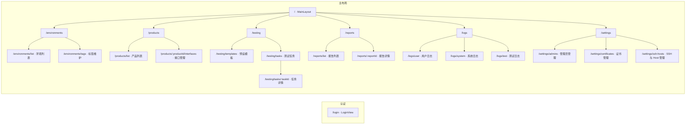
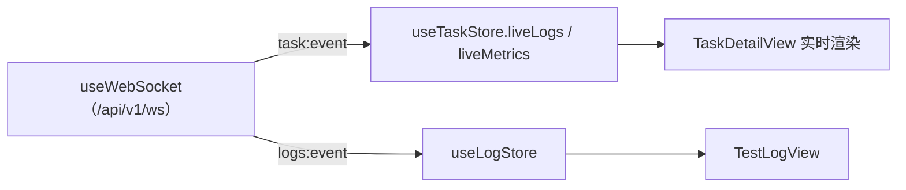
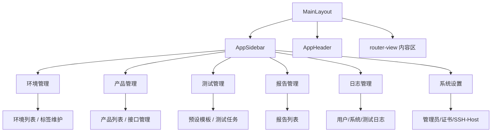

# auto_performance 前端层级设计（frontend-structure.md）

- **项目**：auto_performance（性能测试平台）
- **文档类型**：前端层级专篇（路由表 / 组件层级 / 状态管理 / 通用组件）
- **状态**：评审中（Draft）
- **日期**：2026-10-26
- **关联**：`specs/architecture.md`、`decisions/ADR-0002`

> 技术栈：Vue3 + TypeScript + Vite + Pinia + Vue Router + shadcn-vue + Tailwind CSS。

---

## 1. 路由表（6 大模块 + 子模块 → 页面）

### 1.1 路由清单

| 路径 | 页面（组件） | 所属模块 | 鉴权 | 说明 |
| --- | --- | --- | --- | --- |
| `/login` | `LoginView` | 认证 | 公开 | 登录 |
| `/` | `MainLayout`（重定向 `/environments/list`） | 全局 | 需登录 | 主布局 |
| `/environments/list` | `EnvironmentListView` | 环境管理 | 需登录 | 环境列表 |
| `/environments/tags` | `TagListView` | 环境管理 | 需登录 | 标签维护（显示关联环境） |
| `/products/list` | `ProductListView` | 产品管理 | 需登录 | 产品列表（版本/平台） |
| `/products/:productId/interfaces` | `InterfaceListView` | 产品管理 | 需登录 | 接口管理（地址 + 阈值） |
| `/testing/templates` | `TemplateListView` | 测试管理 | 需登录 | 预设模板 |
| `/testing/tasks` | `TaskListView` | 测试管理 | 需登录 | 测试任务列表 |
| `/testing/tasks/:taskId` | `TaskDetailView` | 测试管理 | 需登录 | 任务编排 + 实时执行 |
| `/reports/list` | `ReportListView` | 报告管理 | 需登录 | 报告列表（导入/导出） |
| `/reports/:reportId` | `ReportDetailView` | 报告管理 | 需登录 | 在线查看 html/pdf |
| `/logs/user` | `UserLogView` | 日志管理 | 需登录 | 用户日志（管理员操作） |
| `/logs/system` | `SystemLogView` | 日志管理 | 需登录 | 系统日志（运行/重启/启动） |
| `/logs/test` | `TestLogView` | 日志管理 | 需登录 | 测试日志（任务执行） |
| `/settings/admins` | `AdminManageView` | 系统设置 | 需 `setting.admin`(write) | 管理员管理（含角色管理：新建/删除/修改角色 + 角色授权） |
| `/settings/certificates` | `CertificateManageView` | 系统设置 | 需 `setting.cert`(write) | 证书管理（导入/删除 + 内置自签证书重新初始化） |
| `/settings/ssh-hosts` | `SshHostManageView` | 系统设置 | 需 `setting.ssh`(write) | SSH 与 Host 管理（添加/导入/修改/删除） |
| `/:pathMatch(.*)*` | `NotFoundView` | 全局 | — | 404 |

### 1.2 路由结构图



---

## 2. 页面组件层级

### 2.1 目录树（frontend/src）

```text
frontend/src/
├── layouts/
│   ├── AuthLayout.vue                 # 登录布局
│   └── MainLayout.vue                 # 主布局：Sidebar + Header + Content
│       ├── AppSidebar.vue             # 侧边导航（6 大模块）
│       ├── AppHeader.vue              # 顶栏（用户菜单、通知）
│       └── AppBreadcrumb.vue
├── views/
│   ├── auth/LoginView.vue
│   ├── environment/
│   │   ├── EnvironmentListView.vue
│   │   └── TagListView.vue
│   ├── product/
│   │   ├── ProductListView.vue
│   │   └── InterfaceListView.vue
│   ├── testing/
│   │   ├── TemplateListView.vue
│   │   ├── TaskListView.vue
│   │   └── TaskDetailView.vue
│   ├── report/
│   │   ├── ReportListView.vue
│   │   └── ReportDetailView.vue
│   ├── log/
│   │   ├── UserLogView.vue
│   │   ├── SystemLogView.vue
│   │   └── TestLogView.vue
│   ├── setting/
│   │   ├── AdminManageView.vue
│   │   ├── CertificateManageView.vue
│   │   └── SshHostManageView.vue
│   └── error/NotFoundView.vue
├── components/
│   ├── ui/                            # shadcn-vue 复制的组件
│   ├── common/                        # 通用业务组件（见 §4）
│   ├── environment/                   # 环境模块业务组件
│   ├── product/                       # 产品模块业务组件
│   ├── testing/                       # 测试模块业务组件
│   ├── report/                        # 报告模块业务组件
│   └── log/                           # 日志模块业务组件
├── stores/                            # Pinia（见 §3）
├── api/                               # axios 封装（按模块）
├── router/                            # 路由表 + 导航守卫
├── composables/                       # useWebSocket / useTable / usePagination 等
├── types/                             # TS 类型
├── utils/                             # 工具
└── assets/
```

### 2.2 关键页面组件层级（Mermaid）

```mermaid
flowchart TB
    subgraph 环境管理
        EnvList["EnvironmentListView"]
        EnvList --> EnvTable["EnvTable"]
        EnvList --> EnvFormDialog["EnvFormDialog（新建/编辑）"]
        EnvList --> TagSelector["TagSelector（标签选择）"]
        EnvFormDialog --> SshSelector["SshHostSelector"]
        EnvFormDialog --> CertSelector["CertificateSelector"]
        TagList["TagListView"]
        TagList --> TagTable["TagTable"]
        TagList --> TagEnvDrawer["TagEnvDrawer（显示关联环境）"]
    end

    subgraph 产品管理
        ProdList["ProductListView"]
        ProdList --> ProdTable["ProductTable"]
        ProdList --> ProdFormDialog["ProdFormDialog"]
        InterList["InterfaceListView"]
        InterList --> InterTable["InterfaceTable"]
        InterList --> InterFormDialog["InterFormDialog（地址/参数）"]
        InterList --> ThresholdEditor["ThresholdEditor（预设阈值）"]
        ThresholdEditor --> MetricRow["MetricRow（指标 + 运算符 + 值）"]
    end

    subgraph 测试管理
        TplList["TemplateListView"]
        TplList --> TplForm["TemplateForm"]
        TplForm --> EnvPicker["EnvPicker（环境选择）"]
        TplForm --> InterRangePicker["InterRangePicker（接口范围）"]
        TplForm --> FlowConfig["FlowConfig（流程编排）"]
        TplForm --> CleanConfig["CleanConfig（环境清理）"]
        TaskList["TaskListView"]
        TaskList --> TaskTable["TaskTable"]
        TaskList --> StatusBadge["StatusBadge"]
        TaskDetail["TaskDetailView"]
        TaskDetail --> TaskSteps["TaskSteps（编排步骤回显）"]
        TaskDetail --> RealtimeLog["RealtimeLog（实时日志）"]
        TaskDetail --> MetricPanel["MetricPanel（实时指标）"]
    end

    subgraph 报告管理
        RepList["ReportListView"]
        RepList --> RepTable["ReportTable"]
        RepList --> ImportDialog["ImportDialog（导入，支持外部孤立归档）"]
        RepDetail["ReportDetailView"]
        RepDetail --> ReportTabs["ReportTabs（html/pdf 切换）"]
        RepDetail --> HtmlPreview["HtmlPreview（iframe 内联）"]
        RepDetail --> PdfPreview["PdfPreview（pdf 预览）"]
        RepDetail --> ExportBtn["ExportBtn（导出）"]
    end

    subgraph 系统设置
        AdminManage["AdminManageView"]
        AdminManage --> AdminTable["AdminTable"]
        AdminManage --> AdminFormDialog["AdminFormDialog（用户名/姓名/手机号/邮箱/描述）"]
        AdminManage --> RoleManage["RoleManage（角色列表 + 权限矩阵）"]
        RoleManage --> RolePermissionEditor["RolePermissionEditor（子模块只读/可写勾选）"]
        AdminManage --> AdminRoleBind["AdminRoleBind（管理员 ↔ 角色 多选授权）"]
        CertManage["CertificateManageView"]
        CertManage --> CertTable["CertTable"]
        CertManage --> CertImport["CertImport（导入证书）"]
        CertManage --> CertReinit["CertReinit（内置证书重新初始化）"]
        SshManage["SshHostManageView"]
        SshManage --> SshTable["SshHostTable"]
        SshManage --> SshForm["SshHostForm（添加/修改）"]
        SshManage --> SshImport["SshImport（批量导入）"]
    end
```



---

## 3. 状态管理划分（Pinia）

| Store | 职责 | 主要 state / getters / actions | 关联页面 |
| --- | --- | --- | --- |
| `useAuthStore` | 登录态、令牌、权限集合 | token, user, permissions(Set) / hasPerm(module, perm) / login, logout | 全局、登录、路由守卫 |
| `useUiStore` | 全局 UI | sidebarCollapsed, theme, notices | MainLayout |
| `useEnvironmentStore` | 环境与标签 | environments, tags, tagEnvMap / fetchList, save, bindTags | 环境列表、标签维护 |
| `useProductStore` | 产品、接口、阈值 | products, interfaces, thresholds / fetch, save | 产品列表、接口管理 |
| `useTaskStore` | 模板、任务、实时执行态 | templates, tasks, currentTask, liveMetrics, liveLogs / create, cancel, onWsEvent | 模板、任务、任务详情 |
| `useReportStore` | 报告列表与详情 | reports, currentReport / fetch, import, export | 报告列表/详情 |
| `useLogStore` | 日志（用户/系统/测试） | userLogs, systemLogs, testLogs / fetchByType, subscribe | 日志三页面 |
| `useSettingStore` | 管理员/角色/证书/SSH | admins, roles, certificates, sshHosts / CRUD / bindRoles / reinitCert | 系统设置三页面 |

> 约定：**页面局部状态留在组件**，**跨页面/可复用的领域数据进 Store**；实时数据（日志/指标）由 `useWebSocket` composable 订阅，事件回调更新对应 Store，避免组件直接持有 WebSocket。

### 3.1 状态流（实时日志）



---

## 4. 通用组件

| 组件 | 说明 | 基于 |
| --- | --- | --- |
| `AppTable` | 通用数据表格（排序/分页/选择/列配置） | TanStack Table + shadcn `Table` |
| `AppForm` / `AppFormItem` | 通用表单 + 校验 | shadcn `Form` + `vee-validate`/`zod` |
| `AppDialog` / `AppDrawer` | 弹窗 / 抽屉 | shadcn `Dialog`/`Sheet` |
| `AppUpload` | 文件上传（报告导入、证书/密钥上传） | 自研 + shadcn |
| `TagSelect` / `TagInput` | 标签选择 / 输入（颜色标记） | 自研 |
| `StatusBadge` | 状态徽标（任务状态 / 达标 pass-fail） | 自研 |
| `JsonViewer` | JSON 结构查看（阈值、结果、配置） | 自研 |
| `CodeEditor` | 脚本/JSON 编辑（接口 body、模板） | CodeMirror 6 |
| `StatCard` | 指标卡片（QPS/延迟/错误率） | 自研 |
| `TrendChart` | 趋势/性能曲线图 | ECharts（vue-echarts） |
| `SearchFilterBar` | 列表搜索/筛选条 | 自研 |
| `EmptyState` / `Loading` | 空态 / 加载 | shadcn `Skeleton` |
| `ConfirmDialog` | 危险操作二次确认（删除/卸载/清理） | shadcn `AlertDialog` |
| `PageHeader` | 页面标题 + 操作区 | 自研 |
| `v-permission` / `usePermission` | 按钮级权限指令/组合式函数（按 module + read/write 控制显隐禁用） | 自研 |

---

## 5. 布局与导航结构



---

## 6. 路由与鉴权约定（分级分权）

- **登录守卫**：`router.beforeEach` 校验 `useAuthStore.token`；无令牌跳 `/login`。
- **权限守卫**：登录后加载管理员权限集合（后端返回「子模块 code + read/write」并集）；路由 `meta = { title, module, permission? }` 中 `permission` 声明访问该页所需子模块与读写级别，不满足则跳 403 或提示无权限（不再使用固定 `role === 'admin'` 判断）。
- **菜单过滤**：侧边栏按「子模块 read 权限」动态过滤，未授权子模块不展示；敏感子模块（管理员/证书/SSH）需 `write` 授权才可见。
- **按钮级权限**：写操作（新增/编辑/删除/执行/停止/导入导出/重新初始化等）通过 `v-permission="'module.write'"` 指令或 `usePermission().hasPerm(module, 'write')` 控制显隐与禁用。
- **角色授权 UI**：管理员管理页内嵌角色管理（新建/删除/修改角色 + 子模块只读/可写权限矩阵），并为管理员绑定一个或多个角色（多选）。
- **懒加载**：所有 `views` 使用 `() => import(...)` 按路由分包，减小首屏体积（内嵌部署下首屏体验更优）。
- **元信息**：路由 `meta = { title, module, permission? }` 驱动面包屑、侧边栏高亮与权限校验。
