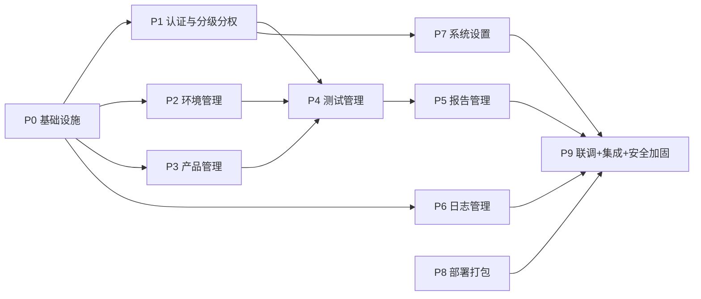

# auto_performance 实现计划

> **给 agentic workers：** 本计划应交给具备代码实现、测试运行和仓库验证能力的执行上下文执行。请使用可见的 `workflow-plan-execute` 加载本计划；执行器可根据任务独立性在内部选择子代理、TDD、完成前验证等策略。本计划用 checkbox（`- [ ]`）追踪步骤。

**目标：** 在已通过编译验证的工程骨架之上，按「环境 → 产品 → 接口 → 测试任务 → 报告」闭环，分 10 个 Phase 增量实现 auto_performance 性能测试平台的全部 78 个 REST 接口、任务编排/阈值评估/报告生成执行链路、分级分权 RBAC、三类日志、系统设置（管理员/证书/SSH-Host）以及离线部署打包，并逐项落实 21 条 Critical/High 安全红线。

**架构：** 分层单体（Go + Gin 单二进制 go:embed 内嵌前端），接入层 `api`（REST + WebSocket）→ 应用层 `service`（按模块分包，承载用例编排与业务错误码）→ 执行层 `orchestrator`/`engine(k6)`/`evaluator`/`reportgen`/`cleaner` → 数据层 `repository`(pgx) + PostgreSQL + 文件存储。中间件链固定为 `Recovery → CORS → AuditLog → AuthN(JWT) → AuthZ(RBAC) → Handler`。

**技术栈：** 后端 Go 1.26 + Gin + pgx/v5 + golang-migrate + golang-jwt/v5 + bcrypt（`x/crypto`）+ slog + AES-256-GCM（`crypto`）+ x/crypto/ssh；前端 Vue3 + TypeScript + Vite + Pinia + Vue Router + shadcn-vue + Tailwind + TanStack Table + ECharts + CodeMirror 6；报告生成 HTML(`html/template`) / PDF(headless Chromium) / Word(`gooxml`)；压测引擎 k6 子进程；数据库 PostgreSQL(JSONB)。

**AC 覆盖：** AC-AUTH-1 / AC-ENV-1 / AC-PROD-1 / AC-TEST-1~4 / AC-REPORT-1 / AC-LOG-1 / AC-SETTING-1~3 / AC-DEPLOY-1（索引见 §3）。

**DFX 覆盖：** 以 `security/security-design-report.md` 的 REQ/DES/TEST 编号为唯一安全事实源，21 条 Critical/High 红线专项覆盖见 §4；部署可维护/可移植/升级/卸载非功能口径由 AC-DEPLOY-1 承接（Phase 8）。

**关键不变量：** INV-1~INV-10（见 §5）。

---

## 1. 来源与约束

- 需求：`prds/PRD-performance-testing-platform.md`（实体/状态机/决策记录）
- 规格：`specs/architecture.md`、`specs/frontend-structure.md`、`specs/api-contract.md`（78 接口）、`specs/errcode.md`
- 安全：`security/security-design-report.md`（REQ→DES→CODE→TEST 追踪矩阵）
- 决策：`decisions/ADR-0001~0006`（后端 Go、前端 Vue3+shadcn-vue、k6 引擎、PostgreSQL、分级分权 RBAC、报告全量生成 + P95/P99/错误率口径）
- 上层意图：本计划只做执行拆分，不重新决定技术方案；实现时必须同时遵守上述 `spec.md` 与安全报告。
- 状态要求：上述规格均为「评审中(Draft)」；但本计划系设计阶段收尾交付物，且已取得用户「编写实现计划」的明确委托，故按现有 Draft 内容落地（不阻塞编码）。

### 1.1 骨架现状与既有约定（实现前必须掌握）

已实现、可直接复用/扩展：
- `internal/errcode/`：全局 `1xxxx` 已完整（code.go/http.go/registry.go），`Register` 注册表可用。
- `internal/auth/`：`jwt.go`（HS256 签发/解析）、`permission.go`（`HasPerm`、`PermissionList`、`SkeletonPermissions`）。
- `internal/api/response/`：统一响应 `{code,message,data}`，`OK/Error` 已实现。
- `internal/api/middleware/`：`Recovery`/`CORS` 已实现；`AuthN`/`AuthZ`/`AuditLog` 为占位（注入全量骨架权限，未落库）。
- `internal/api/handler/`：`health.go` 已实现；`auth.go` 为占位（任意账号发 token）；`placeholder.go` 演示链。
- `internal/api/router.go`：中间件链已串联，仅注册了 7 条演示路由，需按 78 接口补齐。
- `internal/repository/db.go`：pgxpool 已实现（`MinConns=0` lazy 建连）。
- `internal/engine/engine.go`：`Engine` 接口已声明。
- `internal/config/config.go`：viper + `AUTO_PERF_` 环境变量，仅 server/database/jwt 三项，需扩展。
- `backend/web/embed.go`：`//go:embed all:dist` 已就绪。
- `frontend/src/`：路由表/登录守卫/认证 store(`hasPerm`)/fetch 客户端/全部 views 骨架已就位；`useWebSocket`、`v-permission` 指令、真实 store 尚未实现。
- `deploy/`：`install/upgrade/uninstall/build-offline/manifest` 均为占位（含 `# 占位` 注释）。

关键口径裁定（本计划统一采用，后续任务不得偏离）：
1. **数据访问用 pgx（非 gorm）**：`go.mod` 已引入 `jackc/pgx/v5`、无 gorm，骨架 `repository/db.go` 用 `pgxpool`。以 pgx 为准（与 ADR-0004 的「pgx 原生」备选一致），不再引入 gorm。
2. **迁移用 golang-migrate 库（内嵌 SQL）**：新增 `github.com/golang-migrate/migrate/v4` 作为库，`//go:embed migrations/*.sql`，暴露 `migrate up` CLI 子命令；`upgrade.sh` 通过 `auto_performance migrate up` 执行。
3. **业务错误码归属各 service 模块**：骨架无 `internal/module/` 目录，业务码（`2xxxx`）放在各模块 service 包 `internal/service/<module>/errors.go`，经 `errcode.Register` 注册（等价 errcode.md §6.1 的「模块 errors.go」意图，路径以骨架为准）。
4. **ID JSON 序列化为字符串**：DB `bigint` 自增，DTO 一律 `string`（规避 JS 精度丢失，见 api-contract §1.7）。

---

## 2. 文件结构（模块布局约定）

> 以下路径是全部 Phase 的落点约定；单文件职责单一，按模块分包而非机械按层拆分。

```
backend/
├── cmd/server/main.go                    # 依赖注入 + migrate 子命令 + 优雅退出（改）
├── migrations/                           # golang-migrate SQL（新增 18 张表）
│   ├── 000001_init_schema.up.sql / .down.sql
│   └── 000002_audit_trigger.up.sql / .down.sql
├── internal/
│   ├── domain/                           # 实体 + 枚举 + 状态机（纯逻辑，无 IO）
│   │   ├── environment.go  product.go  testing.go  report.go  log.go  setting.go
│   │   └── task_status.go                # 任务状态机（TDD 重点）
│   ├── repository/                       # 仓储接口 + pgx 实现
│   │   ├── repository.go                 # 全部接口定义 + Tx 抽象
│   │   ├── pg_environment.go pg_product.go pg_testing.go pg_report.go pg_log.go pg_setting.go pg_auth.go
│   │   └── migrate.go                    # golang-migrate 内嵌迁移 runner
│   ├── service/                          # 应用层（用例编排 + 业务错误码）
│   │   ├── auth/{auth.go,rbac.go,errors.go}
│   │   ├── environment/{environment.go,category.go,tag.go,errors.go}
│   │   ├── product/{product.go,interface.go,threshold.go,errors.go}
│   │   ├── testing/{template.go,task.go,errors.go}
│   │   ├── report/{report.go,import.go,errors.go}
│   │   ├── log/{log.go,errors.go}
│   │   └── setting/{admin.go,role.go,certificate.go,sshhost.go,errors.go}
│   ├── api/                              # HTTP handler（替换 doc.go 占位）
│   │   ├── environment/{category.go,tag.go,environment.go}
│   │   ├── product/{product.go,interface.go,threshold.go}
│   │   ├── task/{template.go,task.go}
│   │   ├── report/{report.go,import.go}
│   │   ├── log/{log.go}
│   │   ├── setting/{admin.go,role.go,certificate.go,sshhost.go}
│   │   ├── handler/{auth.go,health.go,handler.go}   # auth 占位→真实
│   │   └── router.go                     # 78 接口路由补齐
│   ├── auth/{jwt.go,permission.go,rbac.go}          # rbac.go 新增：权限并集
│   ├── orchestrator/{orchestrator.go,scheduler.go}   # 状态机驱动 + 环境互斥 + 清理编排
│   ├── engine/{engine.go} engine/k6/{script.go,runner.go,parser.go}
│   ├── evaluator/{evaluate.go,metrics.go}            # 阈值评估 + P95/P99/错误率归一化
│   ├── reportgen/{html.go} reportgen/html/{...} reportgen/pdf/{...} reportgen/word/{...}
│   ├── cleaner/{cleaner.go,ssh.go}
│   ├── ws/{hub.go,client.go}
│   ├── crypto/{secret.go}               # AES-256-GCM + KEK 信封加密（新增）
│   ├── config/config.go                 # 扩展 security/report/k6/chromium/paths/max_vus
│   └── errcode/                         # 已存在，不动
├── templates/                           # 报告 HTML 模板（go:embed）
├── web/embed.go
└── go.mod / go.sum                       # 追加 golang-migrate / gooxml / x/crypto/ssh 等

frontend/src/
├── api/{auth,environment,product,testing,report,log,setting}.ts   # 模块化 API 封装
├── stores/{auth,environment,product,task,report,log,setting,ui}.ts
├── composables/{useWebSocket.ts,usePermission.ts,useTable.ts,usePagination.ts}
├── directives/permission.ts              # v-permission 指令
├── components/{common,environment,product,testing,report,log}/...
├── views/**                              # 已有骨架，填充真实逻辑
└── router/index.ts                       # 权限守卫（meta.module/permission → hasPerm）
```

---

## 3. AC 覆盖索引

| AC 编号 | 验收结果（来自 PRD） | 覆盖任务 | 证据命令 / 测试名 |
| --- | --- | --- | --- |
| AC-AUTH-1 | 登录/登出/改密、内置 admin 首登强制改密、停用无法登录、登录失败统一提示+锁定 | Phase1 任务 1.2/1.3 | `go test ./internal/service/auth/...` / `TestLoginLockout`、`TestMustChangePassword` |
| AC-ENV-1 | 环境增删改查 + 分类/标签双向关联 + 组合筛选 + 停用隔离 + 停用不出现在新任务可选 | Phase2 任务 2.1~2.3 | `go test ./internal/service/environment/...` / `TestBindTags`、`TestDeleteReferenced` |
| AC-PROD-1 | 产品/接口/阈值 CRUD、接口归属产品、阈值方向与指标匹配校验、按产品/接口选范围 | Phase3 任务 3.1~3.3 | `go test ./internal/domain/...` / `TestThresholdValid`、`TestInvalidMetricOperator` |
| AC-TEST-1 | 五要素（环境/接口范围/流程/报告/清理）组装 + 模板复用 + 执行/停止 | Phase4 任务 4.1/4.2/4.7 | `go test ./internal/service/testing/...` / `TestCreateTaskRequiresAllElements` |
| AC-TEST-2 | 任务状态机含「清理待确认」；成功自动清理、失败/取消不自动清理待人工确认 | Phase4 任务 4.3/4.6 | `go test ./internal/domain/...` / `TestTaskStateMachine` |
| AC-TEST-3 | 同环境同刻仅一任务压测（互斥/占用） | Phase4 任务 4.2 | `go test ./internal/service/testing/...` / `TestEnvironmentMutualExclusion` |
| AC-TEST-4 | 任务创建时快照接口范围+阈值，历史报告可复现 | Phase4 任务 4.2 | `go test ./internal/service/testing/...` / `TestSnapshotIsolation` |
| AC-REPORT-1 | html/pdf/word 三格式生成、在线查看 html/pdf、导入导出、离线读取 | Phase5 任务 5.1~5.6 | `go test ./internal/reportgen/...` / `TestGenerateHTML`、`TestPathTraversalBlocked` |
| AC-LOG-1 | 用户/系统/测试三类日志可产生、可分类筛选检索、可定位操作人与任务 | Phase6 任务 6.1 | `go test ./internal/service/log/...` / `TestSanitizeLog`、`TestHMACChain` |
| AC-SETTING-1 | 管理员/角色/权限矩阵 CRUD、角色授权、被引用角色禁删、内置 admin 保护 | Phase1 任务 1.3/1.4 | `go test ./internal/service/setting/...` / `TestDeleteReferencedRole` |
| AC-SETTING-2 | 证书导入/删除、内置自签不可删可重新初始化（仅更新有效期） | Phase7 任务 7.1 | `go test ./internal/service/setting/...` / `TestReinitBuiltinCert` |
| AC-SETTING-3 | SSH/Host 增删改导入、密钥加密存储、被引用禁删 | Phase7 任务 7.2 | `go test ./internal/service/setting/...` / `TestSshKeyEncrypted` |
| AC-DEPLOY-1 | 离线包自包含、install/upgrade/uninstall、数据迁移/回滚、卸载数据保护 | Phase8 任务 8.1~8.4 | `bash deploy/offline/build-offline.sh` + `bash deploy/scripts/upgrade.sh`（回滚模拟） |

---

## 4. 安全红线覆盖索引（21 条 Critical/High）

> 编号与 `security-design-report.md` 一致；「覆盖任务」为执行落实点，验证证据为报告 §④ 的 TEST 专项命令。

| 红线（DES/TEST 落点） | 要点 | 覆盖任务 | 验证证据 |
| --- | --- | --- | --- |
| DES-S-001/TEST-S-001 | JWT 服务端最终鉴权 | Phase1 1.2 | `curl -i /api/v1/environments` → 401 |
| DES-S-003/TEST-S-003 | 首登强制改密 + 无隐藏账号/硬编码口令 | Phase1 1.2 | `strings <bin> \| grep -iE "password\|secret"` |
| DES-S-006/TEST-S-001 | bcrypt cost≥10 + 登录锁定 + 防爆破 | Phase1 1.2 | `SELECT password_hash` → `$2a$10$`；连错 5 次 → 429 |
| DES-E-007/TEST-E-001 | 分级分权 RBAC 服务端强制 + 敏感子模块 write-only | Phase1 1.1/1.4 | 只读账号 `POST /environments` → 403 |
| DES-E-002/TEST-E-002 | 防 Mass Assignment（新建账号默认无权限） | Phase1 1.3 | `POST /admins` 夹带 `role` → 被丢弃 |
| DES-I-001/TEST-I-001 | 密码 bcrypt 哈希存储 | Phase1 1.3 | `SELECT password_hash` 非明文/MD5 |
| DES-I-002/TEST-I-002 | 证书私钥/SSH 密钥 AES-256-GCM + KEK 信封加密、0600 | Phase7 7.1/7.2 | `find <data> -name "*.key"` → 密文；`ls -l KEK` → 0600 |
| DES-I-003/TEST-I-003 | 标准算法 + crypto/rand | Phase0 0.3/Phase7 | `grep -RnE "math/rand" <src>` → 密码学无命中 |
| DES-I-008/TEST-I-002 | 密钥加密不硬编码、密钥轮换流程 | Phase7 7.1/7.2 | KEK 安装时生成、0600 服务账号 |
| DES-I-001(产品)/TEST-I-001 | 接口认证头 AES-256-GCM 存储 + 响应/日志脱敏 | Phase3 3.2 | `SELECT headers_enc` → 密文 |
| DES-T-001/TEST-T-001(测试) | k6 脚本参数白名单 + 模板转义 | Phase4 4.4 | 并发数传 `1;exec('id')` → 拒绝 |
| DES-T-002/TEST-T-002(测试) | k6 无 shell 子进程（exec 参数数组） | Phase4 4.4 | 接口地址 `x;id;` → 无命令回显 |
| DES-T-003/TEST-T-003 | 清理走可信 SSH 白名单 + 脚本哈希白名单 | Phase4 4.6 | 注入 `$(rm -rf /)` → 哈希白名单拒绝 |
| DES-T-005/TEST-T-001(报告) | 报告上传扩展名+magic bytes+大小+随机名 | Phase5 5.5 | `shell.php`/伪 docx → 拒绝 |
| DES-T-002(报告)/TEST-T-002 | 路径穿越防护（DB 源 + 白名单前缀） | Phase5 5.4 | `?format=../../etc/passwd` → 拒绝/404 |
| DES-T-006/TEST-T-001(日志) | 审计日志 HMAC 链防篡改 + 应用层只读 | Phase0 0.6/Phase6 6.1 | 改 DB 后回读 → HMAC 校验失败 |
| DES-T-006/TEST-R-001(日志) | 5W1H 全操作审计覆盖 | Phase0 0.6 | 登录/增删/执行后 `GET /logs/user` 均有记录 |
| DES-I-001(日志)/TEST-I-001 | 日志写入前脱敏（口令/认证头/私钥） | Phase0 0.3/Phase6 6.1 | `grep -R "TestPwd" <logdir>` → 无命中 |
| DES-D-001/TEST-D-001(测试) | 环境互斥（DB 行锁） | Phase4 4.2 | 同环境并发 `POST /tasks` → 仅一成功 |
| DES-T-001(部署)/TEST-T-001 | 离线包 SHA256 完整性校验 | Phase8 8.4 | 篡改包内文件后 `install.sh` → 中止 |
| DES-T-003(部署)/TEST-T-003 | 升级备份/迁移/健康检查/回滚 | Phase8 8.3 | 迁移失败 → 自动回滚旧版本 |
| DES-E-001(部署)/TEST-E-001 | 服务进程非 root、端口收敛 | Phase8 8.3 | `ps -o user=` → 非 root；`nmap` 端口比对矩阵 |

> 21 条红线以上表 + Phase 9 的 9.3 专项为完整落点；N/A 项（物理接口认证、移动端、合法监听、AI 滥用、数据出境）已在报告标注理由，不新增实现任务。

---

## 5. 关键不变量（INV）

| 编号 | 不变量 | 守护任务 |
| --- | --- | --- |
| INV-1 | 管理员权限 = 所授角色权限并集；write 蕴含 read；服务端最终鉴权，前端隐藏不可绕过 | Phase1 1.1/1.4 |
| INV-2 | 阈值评估「全启用阈值达标才算接口达标」；错误率=失败/总请求；响应时间取 P95/P99；非法 metric↔operator 组合拦截 | Phase3 3.3 / Phase4 4.5 |
| INV-3 | 任务状态机合法流转（含 cleanup_pending→cleaning→finished）；成功自动清理、失败/取消不自动清理 | Phase4 4.3/4.6 |
| INV-4 | 同环境同刻仅一个任务压测（互斥，DB 行锁） | Phase4 4.2 |
| INV-5 | 任务创建时对「接口范围 + 阈值」做快照，历史报告可复现 | Phase4 4.2 |
| INV-6 | 逻辑删除（deleted_at）；被引用对象（分类/标签/产品/角色/证书/SSH）禁止物理删除 | Phase2 2.1/2.3、Phase3 3.1、Phase7 7.1/7.2 |
| INV-7 | 密钥（接口认证头/证书私钥/SSH 密钥）AES-256-GCM 加密存储，不明文落库/落盘/日志 | Phase3 3.2、Phase7 7.1/7.2 |
| INV-8 | 审计日志 HMAC 链防篡改，应用层无删除/修改端点 | Phase0 0.6、Phase6 6.1 |
| INV-9 | k6 子进程无 shell + 参数白名单，杜绝脚本/命令注入 | Phase4 4.4 |
| INV-10 | 内置 admin 全权限、不可删除/停用，首次登录强制改密 | Phase1 1.2/1.3 |

---

## 6. Phase 总览与依赖



- **强依赖**：P0 是全部 Phase 的前置；P4 依赖 P1(鉴权)/P2(环境)/P3(接口+阈值)；P5 依赖 P4(任务产出评估结果)；P9 依赖 P4~P8。
- **可并行**：P1、P2、P3、P6 在 P0 完成后可并行（各自只依赖 P0 的仓储/错误码/中间件）；P7 依赖 P1(角色/管理员)，与 P2/P3 可并行；P8 可与 P4~P7 并行推进（打包脚本不依赖业务接口实现细节，只需 `make build`/`npm run build` 通过）。
- **每个 Phase 的完成判据**：`cd backend && go build ./... && go vet ./... && go test ./...` 全绿；涉及前端时 `cd frontend && npm run type-check && npm run build` 全绿。

---

## 7. 任务

### Phase 0：基础设施（DB 迁移建表、配置、日志、审计/认证中间件、错误码完整化、仓储骨架）

**目标：** 打通「数据库 schema → 配置 → 日志 → 错误码 → 仓储 → 中间件 → 应用装配」的完整纵向切片，使后续每个 Phase 只需在其模块内做业务实现即可独立编译、测试、运行。

**覆盖 AC：** 无（工程支撑，支撑全部 AC）；**守护不变量：** INV-7/INV-8（密码学与审计链基础设施）；**覆盖 DFX：** DES-I-003(标准算法/crypto-rand)、DES-T-006(审计链)。

**文件：**
- 新建：`backend/migrations/000001_init_schema.up.sql`、`.down.sql`、`000002_audit_trigger.up.sql`、`.down.sql`、`backend/internal/crypto/secret.go`、`backend/internal/repository/repository.go`、`migrate.go`、`pg_auth.go`、`backend/internal/auth/rbac.go`
- 修改：`backend/internal/config/config.go`、`backend/internal/api/middleware/audit.go`、`authn.go`、`backend/cmd/server/main.go`、`backend/go.mod`（追加依赖）

- [ ] **任务 0.1：数据库迁移（18 张表 + 审计触发器）**

编写 `000001_init_schema.up.sql`（全部表 + 唯一约束 + 索引 + `deleted_at`）与 `.down.sql`（逆序 DROP）。表清单（对齐 architecture §5.1）：
`environment_category`、`tag`、`environment`、`env_tag`、`product`、`interface`、`threshold`、`test_template`、`test_task`、`test_report`、`report_artifact`、`user_log`、`system_log`、`test_log`、`admin`、`role`、`role_permission`、`admin_role`、`certificate`、`ssh_host`。
关键约束：`environment.code`、`product.code`、`admin.username`、`role.name`、`tag.name`、`environment_category.name` 唯一；`test_task.env_id`/`interface_range_snapshot`(JSONB)/`threshold_snapshot`(JSONB)/`status`；`interface.headers_enc`(BYTEA 密文)；`certificate.cert_path/key_path`(密文)、`ssh_host.key_path`(密文)；所有业务表含 `version`(乐观锁, 默认 1)、`created_at/updated_at/deleted_at`；日志表按 `created_at` 分区（`PARTITION BY RANGE`，季度分区示例在 up.sql 内给出 1 个初始分区）。

编写 `000002_audit_trigger.up.sql`：为 `user_log` 建 `BEFORE UPDATE/DELETE` 触发器 `RAISE EXCEPTION`（应用层只读，对应 DES-T-006）；`.down.sql` 删除触发器。

验证：`cd backend && go build ./...`（迁移 SQL 不参与编译，此为占位性前置）；人工证据——在 `test` 环境跑 `migrate up` 后 `\d user_log` 可见触发器。

- [ ] **任务 0.2：配置扩展**

在 `config.go` 增加结构体与默认值（`mapstructure` 标签 + `AUTO_PERF_` 环境变量绑定）：
`Security{KEKPath, ReportDir, SecretKeyEnv}`、`Report{MaxSizeBytes, GenTimeoutSeconds, ChromiumPath}`、`K6{BinaryPath, MaxVUs, WorkDir}`、`Cleaner{LowPrivUID, LowPrivGID}`、`Server{StaticDir, TmpDir}`。`config.example.yaml` 同步补注释示例。

验证：`cd backend && go test ./internal/config/...`（为 `Load` 写表驱动测试：默认值 + 环境变量覆盖 + 缺文件降级）。

- [ ] **任务 0.3：结构化日志 + 脱敏过滤器**

新建 `internal/crypto/secret.go`：`EncryptGCM(plain, kek)` / `DecryptGCM` / `NewKEK()`（crypto/rand 生成 32B KEK）/ `DeriveDEK()`。实现信封加密：`KEK(DEK) || DEK(data)`（对齐安全报告 CODE-I-002）。
在 `internal/service/log`（或独立 `internal/logutil`）实现 `SanitizeLog(s string) string`：正则剥离 `Authorization:`、`password=`、`-----BEGIN ... PRIVATE KEY-----`。

验证：`cd backend && go test ./internal/crypto/... ./internal/logutil/...`（`TestEncryptDecryptRoundTrip`、`TestSanitizeLogStripsSecret`）。

- [ ] **任务 0.4：业务错误码完整化（200xx~260xx）**

在各模块 `internal/service/<module>/errors.go` 用 `errcode.Register` 注册 errcode.md §4 全部业务码（auth 20001~20005、environment 21001~21004、product 22001~22003、testing 23001~23005、report 24001~24004、log 25001、setting 26001~26005）。注册表去重/越界由既有 `Register` 保证。

验证：`cd backend && go test ./internal/errcode/... ./internal/service/...`（`TestRegisterAllBusinessCodesNoPanic`：遍历调用全部模块 `errors.go` 的 init，断言 `errcode.ByCode(21001).Code==21001`）。

- [ ] **任务 0.5：仓储层骨架**

`repository.go` 定义仓储接口（每模块一组 `Create/Get/List/Update/Delete/...`），并定义 `Tx` 抽象（`WithTx(ctx, fn)`）供环境互斥/快照事务使用。`pg_*` 用 pgx 实现；`pg_auth.go` 实现 `GetAdminByUsername`、`ListPermissionsByAdmin`、`LoadRolesByAdmin`（为 Phase1 做准备）。通用 helper：`applySoftDelete`、`optimisticUpdate`（`WHERE id=? AND version=?`，`RowsAffected==0 → errcode.ErrConcurrent`）。

验证：`cd backend && go build ./...`；为 `optimisticUpdate` 写 `TestOptimisticUpdateConflict`（用 `pgxmock` 或内存假实现，返回 0 行断言冲突错误）。

- [ ] **任务 0.6：审计中间件落库（HMAC 链）**

改造 `audit.go`：`AuditLog()` 从上下文取 `admin_id`/`ip`/`method`/`path`/`status`/`resource`，调用 `service/log.AppendAudit(ctx, prevHash, event, hmacKey)` 写入 `user_log`；`AppendAudit` 实现 `hash = HMAC-SHA256(prevHash || entryJSON)` 链式签名。密钥从配置读取。

验证：`cd backend && go test ./internal/service/log/...`（`TestHMACChainDetectsTamper`：写入 2 条，篡改第 1 条后重算链，断言 hash 不一致）。

- [ ] **任务 0.7：认证中间件真实化**

改造 `authn.go`：解析 JWT 后，从 `service/auth` 加载权限并集（`admin → admin_role → role → role_permission`），带短 TTL 缓存（内存 `map[adminID]{perms,exp}`），角色变更时失效（service 层 `InvalidatePermCache(adminID)` 钩子）；停用账号返回 `errcode.ErrDisabled`；`must_change_password` 时除 `/auth/change-password`、`/auth/logout`、`/auth/me` 外返回 `errcode.ErrMustPwd`。登出失效：内存 `blacklist[jti]` + 短 TTL（`10102`）。`jwt.go` 增加 `jti` 声明。

验证：`cd backend && go test ./internal/api/middleware/...`（`TestAuthNRejectsExpiredToken`、`TestAuthNBlocksDisabledAdmin`）。

- [ ] **任务 0.8：应用装配**

`main.go` 增加 `migrate`/`healthcheck` 子命令（`migrate up` 走 `repository/migrate.go`）；`router.go` 移除 `PlaceholderList`，把 78 接口的路由骨架（handler 先返回 `501`/空实现）按模块注册，保证中间件链与权限点映射完整；`Handler` 聚合注入 service 依赖。

验证：`cd backend && go build ./... && go run ./cmd/server -config config/config.example.yaml` 可启动并 `curl /healthz` 返回 200；`go run ./cmd/server migrate up` 对空库执行成功。

---

### Phase 1：认证与分级分权（登录/登出/改密、JWT、RBAC 权限判定、角色/管理员管理）

**目标：** 实现完整认证闭环 + 子模块级 RBAC，为所有后续业务接口提供「服务端强制鉴权」底座。

**覆盖 AC：** AC-AUTH-1、AC-SETTING-1；**守护不变量：** INV-1、INV-10；**覆盖 DFX：** DES-S-001/003/006、DES-E-002/007、DES-I-001。

- [ ] **任务 1.1：RBAC 权限并集判定（TDD 重点）**

**文件：** 新建 `internal/auth/rbac.go`、测试 `internal/auth/rbac_test.go`；`internal/domain/setting.go`（`Role/RolePermission/Admin` 实体）。

**覆盖 AC：** AC-SETTING-1；**守护不变量：** INV-1。

- [ ] 步骤 1：写失败测试
```go
// internal/auth/rbac_test.go
func TestUnionPermissionsMergesRolesAndWriteImpliesRead(t *testing.T) {
    grants := []PermissionGrant{
        {Module: "env.list", Permission: "read"},
        {Module: "env.list", Permission: "write"}, // 多角色并集，write 覆盖 read
        {Module: "setting.cert", Permission: "write"},
    }
    got := UnionPermissions(grants)
    if !HasPerm(got, "env.list", "read") { t.Fatal("expected env.list:read") }
    if !HasPerm(got, "setting.cert", "write") { t.Fatal("expected setting.cert:write") }
    if HasPerm(got, "setting.cert", "read") { t.Fatal("write should not be required to read sensitive") }
    if HasPerm(got, "testing.task", "read") { t.Fatal("unexpected permission") }
}
```
- [ ] 步骤 2：运行确认失败：`cd backend && go test ./internal/auth/ -run TestUnionPermissionsMergesRolesAndWriteImpliesRead` → 编译失败（`UnionPermissions` 未定义）。
- [ ] 步骤 3：写最小实现：`rbac.go` 定义 `PermissionGrant{Module, Permission string}`、`UnionPermissions(grants []PermissionGrant) map[string]bool`（逐 grant 置位，复用 `HasPerm`）。
- [ ] 步骤 4：运行确认通过：`cd backend && go test ./internal/auth/` → 通过。
- [ ] 步骤 5：检查点：记录 `rbac.go` 新增、覆盖 AC-SETTING-1/INV-1、已验证。

- [ ] **任务 1.2：认证接口（登录/登出/改密/me）**

**文件：** 修改 `internal/api/handler/auth.go`、`internal/service/auth/auth.go`、`errors.go`；新建测试 `internal/service/auth/auth_test.go`。

**覆盖 AC：** AC-AUTH-1；**守护不变量：** INV-10。

关键逻辑（TDD）：
- `Login`：bcrypt `CompareHashAndPassword`；失败统一提示 `20001`（不区分账号不存在/口令错误）；失败计数达阈值 → 账号+IP 双维度锁定 `10502`；`admin` 首登返回 `must_change_password=true`。
- `ChangePassword`：校验旧密码 `20003`、复杂度（≥8 位含大小写/数字/特殊字符）`20004`、新旧不同 `20005`；成功后清 `must_change_password` + 失效旧 token。
- `Logout`：token 加入短期失效名单；`Me`：返回当前用户 + 权限并集。

验证：`cd backend && go test ./internal/service/auth/`（`TestLoginUnifiedErrorMessage`、`TestLoginLockoutAfterN`、`TestMustChangePassword`、`TestChangePasswordComplexity`）。

- [ ] **任务 1.3：管理员管理 CRUD**

**文件：** 新建 `internal/service/setting/admin.go`、`internal/api/setting/admin.go`；测试 `internal/service/setting/admin_test.go`。

**覆盖 AC：** AC-SETTING-1；**守护不变量：** INV-10。

关键逻辑：
- 新建管理员：白名单绑定 `username/name/phone/email/description/password`（不含 `role/status/is_super`，防 Mass Assignment，DES-E-002）；bcrypt 哈希；默认无权限。
- 内置 `admin`：`DELETE`/`PATCH status` 返回 `26002`。
- 停用管理员 → 登录 `10202`；重置密码接口 `POST /admins/{id}/reset-password`。

验证：`cd backend && go test ./internal/service/setting/`（`TestCreateAdminIgnoresMassAssignment`、`TestBuiltinAdminProtected`）。

- [ ] **任务 1.4：角色管理 + 权限矩阵 + 绑定角色**

**文件：** 新建 `internal/service/setting/role.go`、`internal/api/setting/role.go`；测试 `internal/service/setting/role_test.go`。

**覆盖 AC：** AC-SETTING-1；**守护不变量：** INV-1。

关键逻辑：
- 角色 CRUD 含 `permissions[]`（`module_code + read/write`）；`GET /permissions` 返回子模块元数据（含敏感标记）。
- 删除角色：被 `admin_role` 引用 → `26003`。
- `POST /admins/{id}/roles`：全量替换绑定；变更后 `InvalidatePermCache(adminID)`（权限即时生效）。

验证：`cd backend && go test ./internal/service/setting/`（`TestDeleteReferencedRole`、`TestBindRolesInvalidatesCache`）。

- [ ] **任务 1.5：前端认证与权限（登录页 + 守卫 + v-permission）**

**文件：** 新建 `frontend/src/api/auth.ts`、`frontend/src/directives/permission.ts`、`frontend/src/composables/usePermission.ts`；修改 `frontend/src/views/auth/LoginView.vue`、`frontend/src/stores/auth.ts`、`frontend/src/router/index.ts`、`frontend/src/api/http.ts`。

**覆盖 AC：** AC-AUTH-1；**守护不变量：** INV-1（前端隐藏，不替代服务端）。

关键逻辑：
- `http.ts`：HTTP 状态码全局拦截（401 跳登录 / 403 跳 403 页 / 10103 跳改密页），`code` 业务分支。
- 路由守卫：`meta.module`/`meta.permission` → `authStore.hasPerm`，不满足跳 403；敏感子模块需 `write`。
- `v-permission` 指令 + `usePermission().hasPerm(module, perm)` 控制写按钮显隐禁用。

验证：`cd frontend && npm run type-check && npm run build`（构建通过 + 类型检查通过）。

---

### Phase 2：环境管理（分类/标签/环境 CRUD，含标签↔环境关联）

**目标：** 环境资产完整可维护，标签双向关联，组合筛选，停用隔离。

**覆盖 AC：** AC-ENV-1；**守护不变量：** INV-6（引用保护）。

**文件：** 新建 `internal/domain/environment.go`、`internal/repository/pg_environment.go`、`internal/service/environment/{category.go,tag.go,environment.go,errors.go}`、`internal/api/environment/{category.go,tag.go,environment.go}`、前端 `frontend/src/api/environment.ts`、`stores/environment.ts`、`views/environment/*.vue`（填充真实逻辑）。

- [ ] **任务 2.1：环境分类 CRUD**

`POST/GET/PUT/DELETE /environment-categories`；删除分类时若被环境引用 → `21002`。

验证：`cd backend && go test ./internal/service/environment/`（`TestDeleteCategoryReferenced`）。

- [ ] **任务 2.2：标签 CRUD + 关联环境反查**

`GET/POST/PUT/DELETE /tags`、`GET /tags/{id}/environments`；删除被引用标签 → `21003`；`GET /tags` 返回关联环境数。

验证：`cd backend && go test ./internal/service/environment/`（`TestTagEnvironmentCount`、`TestDeleteTagReferenced`）。

- [ ] **任务 2.3：环境 CRUD + 标签绑定 + 停用/启用 + 乐观锁**

`GET/POST/GET{id}/PUT/DELETE /environments`、`PUT /environments/{id}/tags`、`PATCH /environments/{id}/status`。
- 新建：`category_id` 必填、`code` 唯一、`tag_ids[]` 预定义复选。
- 修改：全量字段 + `version` 乐观锁，冲突 → `10402`。
- 删除/停用：环境 `testing` 时 → `21004`；逻辑删除。
- 状态机：`pending ↔ disabled`（手动），`pending → testing → pending`（任务占用，Phase4 触发）。
- 响应脱敏：无 `env.list:read` 不返回 `hosts`（DES-I-001，此处按权限裁剪）。

验证：`cd backend && go test ./internal/service/environment/`（`TestBindTags`、`TestDisableBusyEnvironment`、`TestOptimisticLockConflict`）。

- [ ] **任务 2.4：前端环境列表 + 标签维护页**

填充 `EnvironmentListView.vue`（EnvTable + EnvFormDialog + TagSelector + SshSelector + CertSelector）、`TagListView.vue`（TagTable + TagEnvDrawer）。

验证：`cd frontend && npm run type-check && npm run build`。

---

### Phase 3：产品管理（产品/接口/阈值 CRUD）

**目标：** 产品资产 + 接口（含认证头加密）+ 阈值（方向/指标匹配校验）完整可维护，为任务快照提供数据源。

**覆盖 AC：** AC-PROD-1；**守护不变量：** INV-2（阈值校验）、INV-6、INV-7；**覆盖 DFX：** DES-I-001(认证头加密)。

**文件：** 新建 `internal/domain/product.go`、`internal/repository/pg_product.go`、`internal/service/product/{product.go,interface.go,threshold.go,errors.go}`、`internal/api/product/{product.go,interface.go,threshold.go}`、前端 `frontend/src/api/product.ts`、`stores/product.ts`、`views/product/*.vue`。

- [ ] **任务 3.1：产品 CRUD**

`GET/POST/GET{id}/PUT/DELETE /products`、`PATCH /products/{id}/status`；`code` 唯一 `22001`；删除时下有接口 → `22002`；逻辑删除 + 引用保护。

验证：`cd backend && go test ./internal/service/product/`（`TestDeleteProductWithInterfaces`）。

- [ ] **任务 3.2：接口 CRUD（认证头加密存储）**

`GET/POST /products/{id}/interfaces`、`PUT/DELETE/PATCH /interfaces/{id}`、`PATCH /interfaces/{id}/status`。
- `headers` 中 `Authorization/Token` 等认证头字段 → `crypto.EncryptGCM` 存 `headers_enc`；列表/详情/日志脱敏，不返回明文（DES-I-001）。

验证：`cd backend && go test ./internal/service/product/`（`TestInterfaceAuthHeaderEncrypted`：保存后 `headers_enc` 为密文、DTO 无明文）。

- [ ] **任务 3.3：阈值配置（方向/指标匹配校验，TDD 重点）**

**文件：** `internal/domain/product.go` 增加 `Threshold` 校验；`internal/domain/product_test.go`。

**覆盖 AC：** AC-PROD-1；**守护不变量：** INV-2。

`GET/PUT /interfaces/{id}/thresholds`（全量替换）。校验函数 `ValidateThreshold(metric, operator) error`：合法映射（`avg_rt/p95/p99/max_rt/error_rate → le`；`throughput/success_rate/concurrency → ge`）；`success_rate + le` 等非法组合返回 `22003`。

- [ ] 步骤 1：写失败测试
```go
// internal/domain/product_test.go
func TestValidateThresholdRejectsInvalidCombination(t *testing.T) {
    if err := ValidateThreshold("success_rate", "le"); err == nil {
        t.Fatal("expected error for success_rate + le")
    }
    if err := ValidateThreshold("p95", "ge"); err == nil {
        t.Fatal("expected error for p95 + ge")
    }
    if err := ValidateThreshold("p95", "le"); err != nil {
        t.Fatalf("p95 + le should be valid, got %v", err)
    }
    if err := ValidateThreshold("throughput", "ge"); err != nil {
        t.Fatalf("throughput + ge should be valid, got %v", err)
    }
}
```
- [ ] 步骤 2：运行确认失败：`cd backend && go test ./internal/domain/ -run TestValidateThresholdRejectsInvalidCombination` → 编译失败。
- [ ] 步骤 3：写最小实现：`ValidateThreshold(metric, operator string) error`，用 `map[Metric][]Operator` 白名单表实现，非法返回 `errcode` 对应错误（或 sentinel error，由 service 转 `22003`）。
- [ ] 步骤 4：运行确认通过：`cd backend && go test ./internal/domain/` → 通过。
- [ ] 步骤 5：检查点：记录覆盖 AC-PROD-1/INV-2。

- [ ] **任务 3.4：前端产品列表 + 接口管理页**

填充 `ProductListView.vue`、`InterfaceListView.vue`（InterTable + InterFormDialog + ThresholdEditor → MetricRow）。

验证：`cd frontend && npm run type-check && npm run build`。

---

### Phase 4：测试管理（模板、任务编排、状态机含清理待确认、k6 引擎适配、环境互斥、清理）

**目标：** 打通「任务编排 → 执行 → 采集评估 → 报告生成 → 清理」完整执行链路，是本项目技术核心。

**覆盖 AC：** AC-TEST-1~4；**守护不变量：** INV-2/3/4/5/9；**覆盖 DFX：** DES-T-001/002/003(测试)、DES-D-001(测试)。

**文件：** 新建 `internal/domain/testing.go`、`task_status.go`、`internal/repository/pg_testing.go`、`internal/service/testing/{template.go,task.go,errors.go}`、`internal/api/task/{template.go,task.go}`、`internal/orchestrator/{orchestrator.go,scheduler.go}`、`internal/engine/k6/{script.go,runner.go,parser.go}`、`internal/evaluator/{evaluate.go,metrics.go}`、`internal/cleaner/{cleaner.go,ssh.go}`、`internal/ws/{hub.go,client.go}`、前端 `api/testing.ts`、`stores/task.ts`、`views/testing/*.vue`、`composables/useWebSocket.ts`（真实实现）。

- [ ] **任务 4.1：测试模板 CRUD**

`GET/POST/GET{id}/PUT/DELETE /templates`。模板字段：`name`、`env_ids`、`interface_ids`、`flow`(JSON)、`report_config`(JSON)、`clean_config`(JSON)。

验证：`cd backend && go test ./internal/service/testing/`（`TestTemplateCRUD`）。

- [ ] **任务 4.2：任务创建（五要素 + 快照 + 环境互斥，TDD 重点）**

**文件：** `internal/service/testing/task.go`、`task_test.go`。

**覆盖 AC：** AC-TEST-1/3/4；**守护不变量：** INV-4、INV-5。

`POST /tasks`：校验五要素（环境/接口范围非空 `23003`、flow/report_config/clean_config）；`interface_ids` 非空 `23003`；并发数正整数且 ≤ max_vus `23004`；环境 `testing` → `23002`。
创建事务内：`SELECT ... FOR UPDATE` 锁环境行（互斥），快照 `interface_range_snapshot` + `threshold_snapshot`（JSONB 固化），状态 `pending`。

- [ ] 步骤 1：写失败测试（用内存假仓储模拟互斥与快照）
```go
// internal/service/testing/task_test.go
func TestCreateTaskFailsWhenEnvironmentBusy(t *testing.T) {
    repo := &fakeTaskRepo{envStatus: domain.EnvTesting}
    svc := NewTaskService(repo, nil)
    _, err := svc.Create(ctx, validCreateTaskReq())
    if !errors.Is(err, errcode.ErrEnvBusy) { t.Fatalf("want ErrEnvBusy, got %v", err) }
}
func TestCreateTaskSnapshotsInterfaceAndThreshold(t *testing.T) {
    repo := &fakeTaskRepo{envStatus: domain.EnvPending}
    svc := NewTaskService(repo, nil)
    task, err := svc.Create(ctx, validCreateTaskReq())
    if err != nil { t.Fatal(err) }
    if len(task.InterfaceRangeSnapshot) == 0 || len(task.ThresholdSnapshot) == 0 {
        t.Fatal("snapshot must be populated")
    }
}
```
- [ ] 步骤 2：运行确认失败：`cd backend && go test ./internal/service/testing/ -run 'TestCreateTask'` → 编译失败/断言失败。
- [ ] 步骤 3：写最小实现：`TaskService.Create` 调用 `repo.WithTx` → `repo.AcquireEnvLock`（返回 busy 则 `ErrEnvBusy`）→ `repo.SnapshotInterfaces(ids)`/`SnapshotThresholds(ids)` → 建任务。
- [ ] 步骤 4：运行确认通过：`cd backend && go test ./internal/service/testing/` → 通过。
- [ ] 步骤 5：检查点：覆盖 AC-TEST-1/3/4、INV-4/5。

- [ ] **任务 4.3：任务状态机（TDD 重点）**

**文件：** `internal/domain/task_status.go`、`task_status_test.go`。

**覆盖 AC：** AC-TEST-2；**守护不变量：** INV-3。

状态常量：`pending/running/collecting/evaluating/generating/finished/failed/cancelled/cleanup_pending/cleaning/ended`。

- [ ] 步骤 1：写失败测试
```go
// internal/domain/task_status_test.go
func TestTaskStateMachine(t *testing.T) {
    valid := [][2]TaskStatus{
        {TaskPending, TaskRunning}, {TaskRunning, TaskCollecting},
        {TaskCollecting, TaskEvaluating}, {TaskEvaluating, TaskGenerating},
        {TaskGenerating, TaskFinished}, {TaskFinished, TaskCleaning},
        {TaskRunning, TaskFailed}, {TaskRunning, TaskCancelled},
        {TaskFailed, TaskCleanupPending}, {TaskCancelled, TaskCleanupPending},
        {TaskCleanupPending, TaskCleaning}, {TaskCleaning, TaskEnded},
        {TaskFailed, TaskPending}, // retry
    }
    for _, p := range valid {
        if !CanTransition(p[0], p[1]) { t.Fatalf("expected %v -> %v", p[0], p[1]) }
    }
    invalid := [][2]TaskStatus{
        {TaskFinished, TaskCleanupPending}, // 成功不得跳待确认
        {TaskFailed, TaskFinished},          // 失败不得直达完成
        {TaskCleanupPending, TaskRunning},   // 待确认不得直接回执行
        {TaskCancelled, TaskRunning},        // 取消不得回执行
    }
    for _, p := range invalid {
        if CanTransition(p[0], p[1]) { t.Fatalf("unexpected %v -> %v", p[0], p[1]) }
    }
}
```
- [ ] 步骤 2：运行确认失败：`cd backend && go test ./internal/domain/ -run TestTaskStateMachine` → 编译失败。
- [ ] 步骤 3：写最小实现：`CanTransition(from, to TaskStatus) bool` 用邻接表（`map[TaskStatus]map[TaskStatus]bool`）实现；附 `Transition(from, to)` 返回 `errcode.ErrState`（`23001`）在非法时。
- [ ] 步骤 4：运行确认通过：`cd backend && go test ./internal/domain/` → 通过。
- [ ] 步骤 5：检查点：覆盖 AC-TEST-2、INV-3。

- [ ] **任务 4.4：编排器 + k6 引擎适配层（无 shell + 白名单）**

**文件：** `internal/orchestrator/orchestrator.go`、`internal/engine/k6/{script.go,runner.go,parser.go}`。

**覆盖 AC：** AC-TEST-1；**守护不变量：** INV-9；**覆盖 DFX：** DES-T-001/002。

- `orchestrator`：领取 `pending` 任务 → `running`；调用 `engine.Generate/Run/Parse/Stream`；子进程输出经 `SanitizeLog` 后 WebSocket 推送 + 写 `test_log` 增量；进程以低权限 `SysProcAttr.Credential` 运行（DES-E-002）。
- `k6/script.go`：`text/template` 生成脚本，所有变量转义；并发数 `strconv.Atoi` 校验正整数且 ≤ max_vus；URL 走白名单；无用户 JS 拼接（DES-T-001）。
- `k6/runner.go`：`exec.CommandContext(ctx, k6Bin, "run", scriptPath, "--out", "json="+outPath)` 参数数组、无 shell（DES-T-002）。

验证：`cd backend && go test ./internal/engine/k6/`（`TestBuildK6ScriptRejectsInjection`：并发数 `1;exec('id')` → 错误；`TestRunK6NoShell`：断言 `cmd.Args` 无 `sh -c`）。

- [ ] **任务 4.5：阈值评估器（TDD 重点）**

**文件：** `internal/evaluator/{evaluate.go,metrics.go}`、`evaluate_test.go`。

**覆盖 AC：** AC-TEST-4（快照评估口径）；**守护不变量：** INV-2。

- `metrics.go`：从 k6 结果归一化 `p95/p99/error_rate/throughput/success_rate`；`error_rate = 失败请求/总请求`（非 2xx 或超时计入失败）；分位用样本排序计算。
- `evaluate.go`：`Evaluate(metrics map[Metric]float64, thresholds []Threshold) Evaluation`——全启用阈值逐条 `le/ge` 比较，全部达标才 pass；任一不达标 fail；无启用阈值 → `Unconfigured`；数据缺失 → `Missing`。

- [ ] 步骤 1：写失败测试
```go
// internal/evaluator/evaluate_test.go
func TestEvaluateAllThresholdsMustPass(t *testing.T) {
    ths := []Threshold{
        {Metric: "p95", Operator: "le", Value: 500, Enabled: true},
        {Metric: "error_rate", Operator: "le", Value: 1.0, Enabled: true},
    }
    e := Evaluate(map[Metric]float64{"p95": 480, "error_rate": 1.5}, ths)
    if e.Pass { t.Fatal("error_rate 1.5 > 1.0 should fail") }
    e2 := Evaluate(map[Metric]float64{"p95": 480, "error_rate": 0.5}, ths)
    if !e2.Pass { t.Fatal("both within threshold should pass") }
}
func TestEvaluateUnconfiguredAndMissing(t *testing.T) {
    if got := Evaluate(nil, nil); got.State != StateUnconfigured { t.Fatalf("want Unconfigured, got %v", got.State) }
    if got := Evaluate(map[Metric]float64{"p95": 100}, []Threshold{{Metric:"error_rate",Operator:"le",Value:1,Enabled:true}}); got.State != StateMissing {
        t.Fatalf("missing metric should be Missing, got %v", got.State)
    }
}
```
- [ ] 步骤 2：运行确认失败：`cd backend && go test ./internal/evaluator/ -run TestEvaluate` → 编译失败。
- [ ] 步骤 3：写最小实现：`Evaluate` 遍历启用阈值，缺失指标 → `StateMissing`；无启用阈值 → `StateUnconfigured`；否则逐条比较，产出 `Pass/fail` 与 `perMetric`。
- [ ] 步骤 4：运行确认通过：`cd backend && go test ./internal/evaluator/` → 通过。
- [ ] 步骤 5：检查点：覆盖 AC-TEST-4、INV-2。

- [ ] **任务 4.6：环境清理器（成功自动/失败待确认 + 可信 SSH）**

**文件：** `internal/cleaner/{cleaner.go,ssh.go}`、`cleaner_test.go`。

**覆盖 AC：** AC-TEST-2；**守护不变量：** INV-3；**覆盖 DFX：** DES-T-003(测试)。

- `cleaner`：内置动作（恢复配置/清理数据/重启服务/释放资源）+ 用户脚本；脚本执行仅走 `SshHost` 白名单主机 + 脚本内容哈希白名单（DES-T-003）。
- 编排语义：任务成功 → 自动 `cleaning → finished`；任务失败/取消 → `cleanup_pending`（不自动清理）；`POST /tasks/{id}/cleanup` 人工确认后 `cleaning → finished`。

验证：`cd backend && go test ./internal/cleaner/`（`TestCleanerRejectsNonAllowlistedScript`：脚本哈希不在白名单 → 拒绝）。

- [ ] **任务 4.7：任务执行/停止/重试/清理接口 + WebSocket**

`POST /tasks/{id}/start|/cancel|/retry|/cleanup`、`GET /tasks/{id}`、`GET /tasks`（筛选/分页）。`cancel`：`running → cancelled` 终止 k6 子进程；`retry`：`failed → pending`；`cleanup`：仅 `cleanup_pending`。
`internal/ws/hub.go`：`WS /api/v1/ws?token=` 握手鉴权；订阅 `task:{id}`、`logs:{type}`；推送前 `SanitizeLog` 脱敏（DES-I-001 测试模块）。

验证：`cd backend && go test ./internal/service/testing/ ./internal/ws/`（`TestCancelRunningTask`、`TestCleanupOnlyFromCleanupPending`、`TestWSRejectsNoToken`）。

- [ ] **任务 4.8：前端模板 + 任务列表 + 任务详情**

填充 `TemplateListView.vue`（TemplateForm → EnvPicker/InterRangePicker/FlowConfig/CleanConfig）、`TaskListView.vue`、`TaskDetailView.vue`（TaskSteps + RealtimeLog + MetricPanel）；`useWebSocket.ts` 真实订阅。

验证：`cd frontend && npm run type-check && npm run build`。

---

### Phase 5：报告管理（HTML/PDF/Word 生成、导入/导出、在线查看）

**目标：** 任务完成后默认全量生成三格式报告，支持在线查看/导入/导出，路径与上传安全。

**覆盖 AC：** AC-REPORT-1；**守护不变量：** 无独立不变量（承接 INV 之外，覆盖 DES-T-005/DES-T-002(报告)）；**覆盖 DFX：** DES-T-005、DES-T-002(报告)。

**文件：** 新建 `internal/domain/report.go`、`internal/repository/pg_report.go`、`internal/service/report/{report.go,import.go,errors.go}`、`internal/api/report/{report.go,import.go}`、`internal/reportgen/{html.go}`、`internal/reportgen/html/`、`pdf/`、`word/`、前端 `api/report.ts`、`stores/report.ts`、`views/report/*.vue`。

- [ ] **任务 5.1：HTML 报告生成（内联模板）**

`internal/reportgen/html.go` + `templates/report.html`：`html/template` 渲染结果摘要 + 阈值快照 + 达标/不达标高亮；CSS/JS 全内联（无 CDN）。

验证：`cd backend && go test ./internal/reportgen/`（`TestGenerateHTMLContainsPassFail`）。

- [ ] **任务 5.2：PDF 生成（headless Chromium）**

`internal/reportgen/pdf/`：`exec.CommandContext(ctx, chromium, "--headless", "--print-to-pdf", htmlPath)`；超时 `context.DeadlineExceeded → 24004`。

验证：`cd backend && go test ./internal/reportgen/pdf/`（`TestChromiumTimeout`，用假 chromium 脚本）。

- [ ] **任务 5.3：Word 生成（gooxml）**

`internal/reportgen/word/`：gooxml 模板填充。

验证：`cd backend && go test ./internal/reportgen/word/`（`TestGenerateDocx`）。

- [ ] **任务 5.4：报告记录/产物 + 生成/重新生成 + 在线查看/导出（路径穿越防护）**

`GET /reports`、`GET /reports/{id}`、`POST /reports/{id}/generate`、`GET /reports/{id}/artifact`、`GET /reports/{id}/export`。
- 产物路径源 DB（非用户输入），下载前 `filepath.Clean` + 白名单目录前缀校验（DES-T-002 报告）；`format=html/pdf` 内联、`word` attachment；不存在 → `24001`。

验证：`cd backend && go test ./internal/service/report/`（`TestPathTraversalBlocked`）。

- [ ] **任务 5.5：报告导入（双校验 + 随机名）**

`POST /reports/import`：扩展名 + `http.DetectContentType` magic bytes 双校验（`24002`）+ 大小限制（`24003`）+ 随机文件名落盘；`task_id` 可空（孤立归档 `source=external`）。

验证：`cd backend && go test ./internal/service/report/`（`TestImportRejectsDisguisedFile`）。

- [ ] **任务 5.6：前端报告列表 + 详情页**

填充 `ReportListView.vue`（RepTable + ImportDialog）、`ReportDetailView.vue`（ReportTabs + HtmlPreview iframe + PdfPreview + ExportBtn）。

验证：`cd frontend && npm run type-check && npm run build`。

---

### Phase 6：日志管理（用户/系统/测试日志）

**目标：** 三类日志可产生、可分类筛选检索、脱敏、审计链防篡改。

**覆盖 AC：** AC-LOG-1；**守护不变量：** INV-8；**覆盖 DFX：** DES-T-006、DES-I-001(日志)。

**文件：** 新建 `internal/domain/log.go`、`internal/repository/pg_log.go`、`internal/service/log/{log.go,errors.go}`、`internal/api/log/log.go`、前端 `api/log.ts`、`stores/log.ts`、`views/log/*.vue`。

- [ ] **任务 6.1：日志写入 + 筛选查询（脱敏 + HMAC 链）**

`GET /logs/user|system|test`（只读，`log.*:read`；时间范围校验 `25001`）。
- 用户日志：5W1H（操作人/时间/IP/动作/资源/结果），写入前 `SanitizeLog`；HMAC 链式签名（复用 Phase0 0.6）。
- 测试日志：按 `task_id` 定位，增量 seq。

验证：`cd backend && go test ./internal/service/log/`（`TestSanitizeLog`、`TestHMACChain`、`TestTestLogByTask`）。

- [ ] **任务 6.2：前端日志三页面**

填充 `UserLogView.vue`、`SystemLogView.vue`、`TestLogView.vue`（SearchFilterBar + AppTable，按类型/时间/关键字/关联对象筛选）。

验证：`cd frontend && npm run type-check && npm run build`。

---

### Phase 7：系统设置（证书含内置自签重新初始化、SSH/Host 添加/导入/修改/删除）

**目标：** 证书与 SSH/Host 完整可维护，密钥加密存储，内置自签可重新初始化。

**覆盖 AC：** AC-SETTING-2、AC-SETTING-3；**守护不变量：** INV-6、INV-7；**覆盖 DFX：** DES-I-002、DES-I-008。

**文件：** 新建 `internal/service/setting/{certificate.go,sshhost.go,errors.go}`、`internal/api/setting/{certificate.go,sshhost.go}`、前端 `api/setting.ts`、`stores/setting.ts`、`views/setting/{CertificateManageView.vue,SshHostManageView.vue}`（填充）。

- [ ] **任务 7.1：证书管理**

`GET/POST/DELETE /certificates`、`POST /certificates/{id}/reinit`。
- 导入：私钥 `crypto.EncryptGCM` + KEK 信封加密存储，响应脱敏。
- 内置自签 `is_builtin=true`：不可删除 `26004`；`reinit` 仅更新 `valid_from/valid_to`（非内置 → `10401`）。
- 状态推导：`valid/expiring/expired`（按有效期）。

验证：`cd backend && go test ./internal/service/setting/`（`TestCertKeyEncrypted`、`TestReinitBuiltinCertOnly`、`TestDeleteBuiltinCertForbidden`）。

- [ ] **任务 7.2：SSH/Host 管理**

`GET/POST/PUT/DELETE /ssh-hosts`、`POST /ssh-hosts/import`。
- `type=host|ssh`；SSH 私钥加密存储；批量导入（JSON/CSV，重复跳过）。
- 被环境引用 → 删除 `26005`。

验证：`cd backend && go test ./internal/service/setting/`（`TestSshKeyEncrypted`、`TestDeleteReferencedSshHost`、`TestImportSkipsDuplicates`）。

- [ ] **任务 7.3：前端证书 + SSH/Host 页面**

填充 `CertificateManageView.vue`（CertTable + CertImport + CertReinit）、`SshHostManageView.vue`（SshHostTable + SshHostForm + SshImport）。

验证：`cd frontend && npm run type-check && npm run build`。

---

### Phase 8：部署打包（离线包、install/upgrade/uninstall、数据迁移/回滚）

**目标：** 交付自包含离线包与完整安装/升级/卸载脚本，满足可移植/可维护/可升级/可卸载。

**覆盖 AC：** AC-DEPLOY-1；**覆盖 DFX：** DES-T-001/003(部署)、DES-E-001(部署)。

**文件：** 修改 `deploy/docker/{Dockerfile.backend,Dockerfile.frontend,docker-compose.yml}`、`deploy/offline/{build-offline.sh,manifest.txt}`、`deploy/scripts/{install.sh,upgrade.sh,uninstall.sh}`。

- [ ] **任务 8.1：Docker Compose 形态**

`Dockerfile.backend`（多阶段 `CGO_ENABLED=0` 静态编译）、`Dockerfile.frontend`（Node 构建 → 复制到 backend/web）、`docker-compose.yml`（后端 + PostgreSQL + 卷）。

验证：`docker build -f deploy/docker/Dockerfile.backend .`（人工/CI）；`docker compose config` 语法校验。

- [ ] **任务 8.2：离线打包脚本完善**

`build-offline.sh`：引入 k6/chromium/postgres 二进制（`runtime/`、`bin/k6`），生成 manifest + SHA256。

验证：`VERSION=0.1.0 bash deploy/offline/build-offline.sh` → 产出 `dist/auto_performance-offline-0.1.0.tar.gz` + `.sha256`。

- [ ] **任务 8.3：install/upgrade/uninstall 完善**

- `install.sh`：初始化 PostgreSQL、创建低权限账号 `autoperf`、生成 KEK（0600）、注册 systemd（`User=autoperf`、`NoNewPrivileges=true`）。
- `upgrade.sh`：备份 → 停服 → 替换二进制 → `auto_performance migrate up` → 健康检查 → 失败自动回滚。
- `uninstall.sh`：默认保留数据；`--purge-data` 二次确认物理清除。

验证：`bash -n deploy/scripts/*.sh`（语法）；人工模拟迁移失败 → 回滚。

- [ ] **任务 8.4：manifest + 完整性校验**

`manifest.yaml` 记录版本/依赖/SHA256；`install.sh` 部署前逐文件校验 SHA256（DES-T-001 部署）。

验证：篡改包内文件后 `install.sh` → 哈希校验失败中止（人工证据）。

---

### Phase 9：前端联调 + 集成测试 + 安全加固（红线专项）

**目标：** 全链路联调 + 任务全流程集成测试 + 21 条红线逐条验证 + 安全资料交付。

**覆盖 AC：** 全部；**守护不变量：** 全部；**覆盖 DFX：** 全部安全 TEST 专项。

- [ ] **任务 9.1：前后端联调（78 接口全链路）**

前端 `npm run dev`（vite proxy `/api`）对接后端，逐接口验证 request/response 与权限映射一致；修正 api-contract 偏差（不改 `.project/` 已有文档，仅修代码）。

验证：`cd frontend && npm run build && cd ../backend && go build ./...`；人工/脚本 `curl` 覆盖 78 接口主路径。

- [ ] **任务 9.2：任务全流程集成测试**

准备环境 → 建产品/接口/阈值 → 建任务（五要素+快照）→ start → 观察状态机流转 + WS 推送 → 评估 → 报告生成（三格式）→ 成功自动清理 / 失败待确认 → cleanup 确认 → 报告在线查看/导出。

验证：`cd backend && go test ./internal/orchestrator/...`（`TestEndToEndTaskFlow`，用假 k6 引擎 + 内存/测试 DB）。

- [ ] **任务 9.3：安全红线专项测试（21 条 Critical/High）**

逐条执行 security-design-report §④ 的 TEST 专项命令（§4 索引表），重点：暴力破解、会话失效、首登改密、越权、Mass Assignment、密钥加密、注入（k6/SSH/路径穿越/上传）、审计防篡改、脱敏、低权限、完整性。

验证：`cd backend && go test ./...` + 人工渗透命令清单全部出证（`curl -i`、`grep`、`strings`、`ps`、`nmap`）。

- [ ] **任务 9.4：安全资料交付**

输出《通信矩阵》《安全加固指南》《缺省账号清单》《个人数据说明》四类资料（DES-R-001 部署）。

验证：人工检查四类文档存在且与实现一致。

---

## 8. 粒度与约束（执行要求）

1. **粒度**：里程碑级任务为主（每个 Phase 拆 3~7 个任务），关键核心逻辑（RBAC 权限并集、阈值评估、任务状态机、任务创建快照+互斥、阈值方向校验）细化到 TDD 五步（写失败测试 → 确认失败 → 最小实现 → 确认通过 → 记录检查点）；其余任务给出可运行验证命令 + 明确的测试名/人工证据，不逐个展开 78 接口的 TDD 模板。
2. **禁止占位**：本计划不含 `TBD/TODO/implement later`；每个任务均给出「文件 + 步骤 + 验证命令 + 覆盖 AC/INV/DFX」。
3. **验证命令可运行**：
   - 后端：`cd backend && go build ./...`、`go vet ./...`、`go test ./...`、`go run ./cmd/server ...`。
   - 前端：`cd frontend && npm run type-check`、`npm run build`。
   - 部署：`bash deploy/offline/build-offline.sh`、`bash -n deploy/scripts/*.sh`。
4. **类型一致性**：后续任务引用的 `domain.TestTask`、`TaskStatus` 常量、`evaluator.Threshold`、`auth.PermissionGrant`、`crypto.EncryptGCM` 等符号，均在本计划前序任务定义；执行器不得改名或换签名。
5. **不改 `.project/` 既有文件**：本计划只新增 `specs/plan.md`；实现阶段若发现规格偏差，修正代码而非回改设计文档（除非另行立项）。
6. **Git 提交**：由执行阶段按项目 repo 流程处理，本计划不硬编码提交命令。

---

## 9. 自检记录

- **规格覆盖**：PRD 6 大模块验收口径（§3.x.5）映射到 AC-ENV/PROD/TEST/REPORT/LOG/SETTING + AC-AUTH + AC-DEPLOY；78 接口按 api-contract §2 分包到 Phase 0~7 的 handler 文件；安全 21 条红线映射到 §4 索引。
- **占位符扫描**：无 `TBD/TODO`；「占位」仅出现在描述骨架现状（§1.1）与已存在的骨架注释说明中，计划任务本身不含占位。
- **不变量守护**：INV-1~10 均有明确守护任务（§5）。
- **路径与命令**：全部相对 `backend/`/`frontend/`/`deploy/`，验证命令在骨架内可运行（已核实 Makefile/package.json 存在对应 target）。
