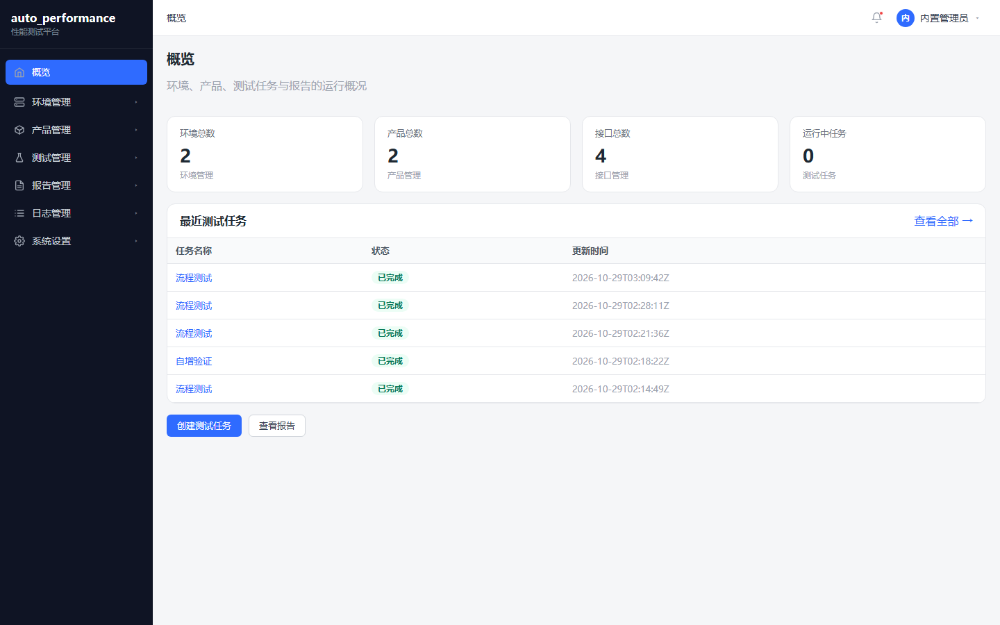
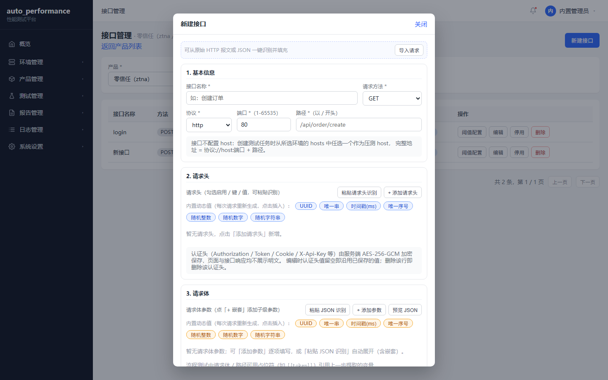
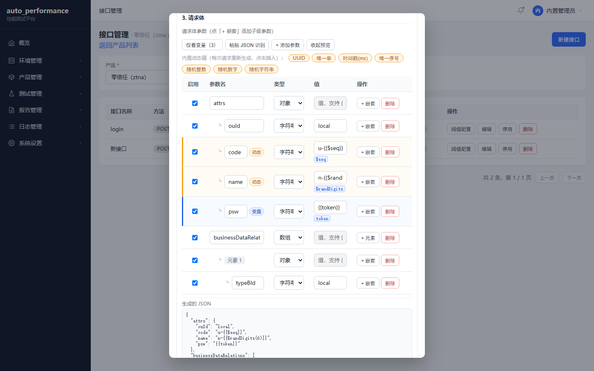
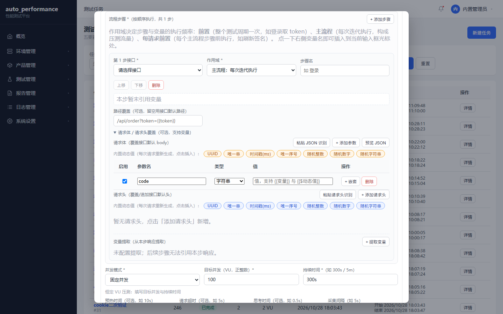
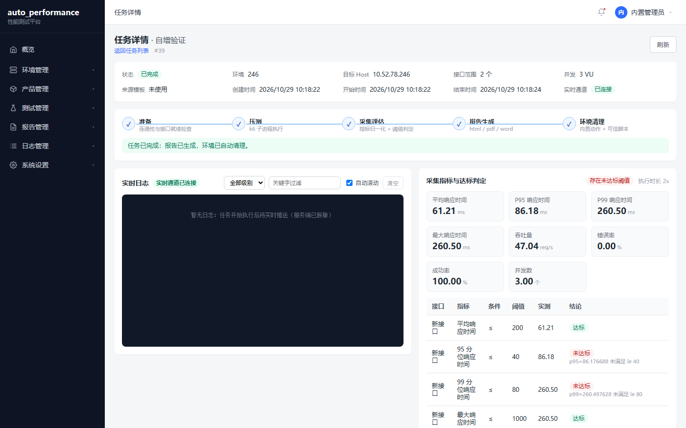
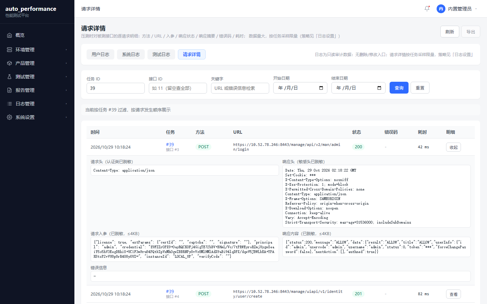
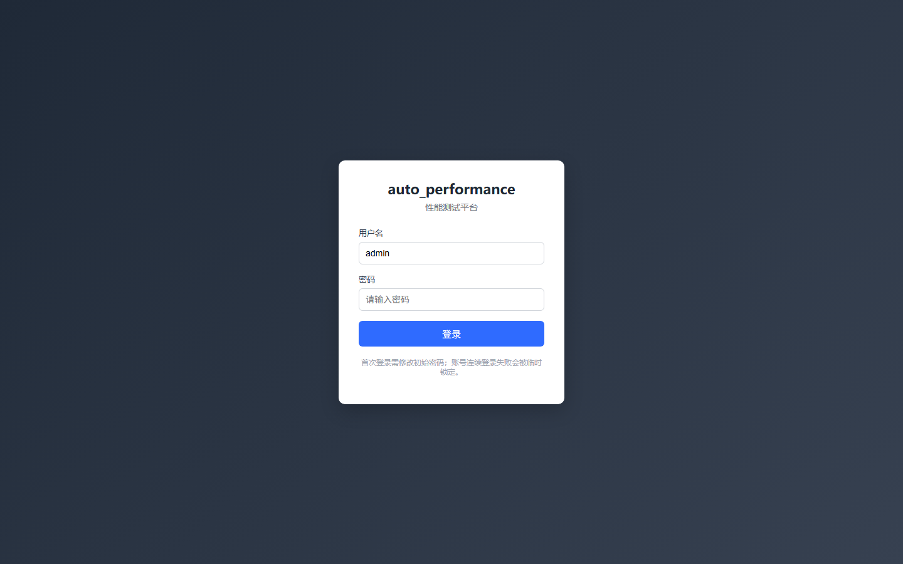
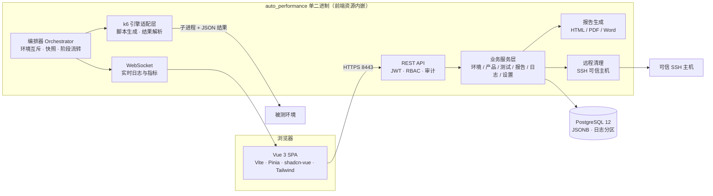
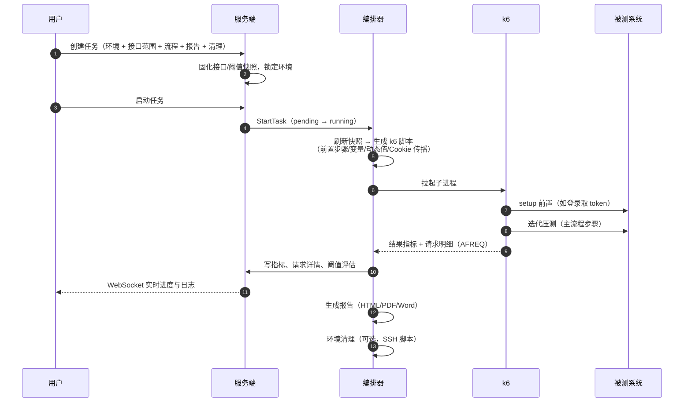

# auto_performance · 性能测试平台

面向内网交付的**一站式接口性能测试平台**：环境与接口管理、单接口/流程编排压测、实时指标与阈值判定、HTML/PDF/Word 报告、全链路日志与远程环境清理。

单二进制交付（前端资源内嵌）、离线安装包、随包 PostgreSQL 与 k6，目标机无需外网与额外依赖。



---

## 目录

- [核心能力](#核心能力)
- [界面预览](#界面预览)
- [系统架构](#系统架构)
- [技术路线](#技术路线)
- [快速开始](#快速开始)
- [目录结构](#目录结构)
- [流程测试示例](#流程测试示例)
- [文档索引](#文档索引)
- [安全设计要点](#安全设计要点)
- [开发指南](#开发指南)

---

## 核心能力

| 模块 | 能力 |
| --- | --- |
| **环境管理** | 环境增删改查、hosts 列表（压测目标）、环境标签、SSH 主机、连通性检查；测试中环境互斥占用 |
| **产品与接口** | 产品/接口 CRUD；接口地址拆分为 `协议 + 端口 + 路径`（host 由任务选择）；请求头/请求体**行式编辑**、**粘贴导入**（原始 HTTP 报文 / JSON）；认证头 AES-256-GCM 加密存储 |
| **测试管理** | 任务与模板；**单接口测试** 与 **流程测试** 两种模式；固定并发 / 阶梯加压 / 脉冲三种加压方式；接口范围与阈值**快照固化**，历史结果可复现 |
| **流程编排** | 有序步骤（接口 + 作用域 + 路径/请求头/请求体覆盖）；三档作用域：`once_per_test`（前置一次）/ `once_per_iteration`（每迭代）/ `every_request`（每请求前）；响应变量提取（JSONPath / 正则）；`{{var}}` 引用与高亮；**会话 Cookie 自动传播**；内置动态值（`{{$uuid}}`、`{{$unique}}`、`{{$seq}}` 等） |
| **实时执行** | k6 子进程执行、WebSocket 实时日志与指标、阶段进度（准备→压测→采集→报告→清理）、随时停止/取消 |
| **报告** | HTML / PDF / Word 三种格式**独立生成**（单格式失败不影响其它）；在线查看与下载、导入外部报告 |
| **日志** | 用户/系统/测试/请求详情四类；请求详情含方法、URL、**请求头、响应头、请求入参、响应内容**、状态码、耗时；敏感头自动脱敏；按任务采样与保留策略 |
| **系统设置** | 管理员与角色（角色 = 权限集合，子模块级 read/write 分级授权）、证书管理（内置自签证书不可删）、SSH/Host 管理、日志设置 |

---

## 界面预览

### 接口配置：分区表单 + 行式请求头/请求体 + 一键导入



### 请求体：嵌套参数（+ 嵌套 / + 元素）、变量与动态值标识、JSON 预览

支持嵌套对象与数组，引用变量的参数带「变量 / 动态」徽标与色条，可一键「仅看变量」。



### 流程编排：步骤 / 作用域 / 变量提取



### 执行详情：阶段进度 + 实时指标 + 阈值判定



### 请求详情：请求头 / 响应头 / 入参 / 响应（脱敏）



<details>
<summary>登录页</summary>



</details>

---

## 系统架构



### 一次压测的执行链路



---

## 技术路线

| 层 | 选型 | 说明 |
| --- | --- | --- |
| 后端 | **Go 1.26 + Gin** | 单二进制，`go:embed` 内嵌前端构建产物 |
| 认证授权 | JWT + RBAC | 角色 = 权限集合，子模块级 `read/write`；审计日志 HMAC 链式防篡改 |
| 数据库 | **PostgreSQL 12**（随包） | JSONB 存配置/快照，日志表按时间分区；`golang-migrate` 内嵌 SQL 迁移（DDL 即版本） |
| 数据访问 | pgx/v5 原生 | 事务抽象 + 乐观锁 + 逻辑删除 |
| 压测引擎 | **k6 v0.54**（随包 CLI） | 服务端模板生成 JS 脚本，子进程执行，`--out json` 解析指标 |
| 前端 | **Vue 3 + TypeScript + Vite** | Pinia 状态、shadcn-vue + Tailwind、按路由懒加载 |
| 实时通道 | gorilla/websocket | 任务级频道推送日志/指标/状态 |
| 报告 | HTML 模板 / headless Chromium（PDF）/ gooxml（Word） | 三种格式独立生成，部分失败不影响整体 |
| 部署 | 离线 `tar.gz` + `install.sh / upgrade.sh / uninstall.sh` | 目标机无需外网；PG、k6、运行时库自带 |
| 安全 | AES-256-GCM 信封加密 + KEK 文件 | 证书/私钥/认证头密文落库，明文不落盘、不展示 |

---

## 快速开始

### 环境要求

- Linux x86_64（CentOS 7+ / 麒麟 / 统信等），2C4G 起
- 默认监听 `8443`（HTTPS，证书来自「系统设置 → 证书管理」的内置自签证书）

### 安装

```bash
tar -xzf auto_performance-<version>-linux-amd64.tar.gz
cd auto_performance-<version>
sudo ./install.sh            # 安装到 /opt/auto_performance，数据在 /var/lib/auto_performance
```

安装脚本会初始化 PostgreSQL 数据目录、执行数据库迁移、注册 systemd 服务并启动。

访问：`https://<服务器IP>:8443`

> 内置管理员 `admin` 首次登录后**强制修改密码**；初始密码见安装输出（或 `.project/security/缺省账号清单.md`）。

### 升级 / 卸载

```bash
sudo ./upgrade.sh --package auto_performance-<new-version>-linux-amd64.tar.gz
sudo ./uninstall.sh --purge     # 彻底删除（含数据目录）
```

### 目录约定

| 路径 | 用途 |
| --- | --- |
| `/opt/auto_performance/bin` | 服务与 k6 可执行文件 |
| `/opt/auto_performance/runtime` | 随包 PostgreSQL 运行时 |
| `/etc/auto_performance/config.yaml` | 配置文件 |
| `/var/lib/auto_performance` | 数据（PG 数据、证书、工作目录、KEK） |

---

## 目录结构

```
auto_performance/
├── backend/                  # Go 服务
│   ├── cmd/server/           # 入口（含 migrate 子命令）
│   ├── internal/
│   │   ├── api/              # 路由 / handler / 中间件（鉴权、审计、脱敏）
│   │   ├── service/          # 业务服务（环境/产品/测试/报告/日志/设置）
│   │   ├── repository/       # pgx 数据访问 + 迁移
│   │   ├── domain/           # 实体、状态机、白名单校验
│   │   ├── engine/k6/        # 脚本生成 + 结果解析
│   │   ├── orchestrator/     # 任务编排、请求明细、清理调度
│   │   ├── evaluator/        # 指标评估（P95/P99/错误率…）
│   │   ├── reportgen/        # HTML / PDF / Word 报告
│   │   ├── cleaner/          # SSH 远程清理
│   │   ├── crypto/           # 信封加密（AES-256-GCM）
│   │   ├── errcode/          # 全局/业务错误码
│   │   └── ws/               # WebSocket 推送
│   ├── migrations/           # 内嵌 SQL 迁移（000001~000007）
│   ├── templates/            # 报告模板
│   └── web/dist/             # 前端构建产物（go:embed）
├── frontend/                 # Vue 3 前端
│   └── src/{api,components,views,stores,router,utils,types}
├── deploy/                   # 离线打包与安装脚本
│   ├── offline/              # build-offline.sh + 运行时资产
│   └── scripts/              # install / upgrade / uninstall
├── docs/images/              # README 截图
└── .project/                 # 设计文档（PRD / 架构 / 契约 / ADR / 安全）
```

---

## 流程测试示例

很多接口压测需要**先登录拿凭证**，或**多接口串联**。流程模式用一个有序步骤列表表达，并提供三档作用域。

```jsonc
{
  "test_mode": "flow",
  "steps": [
    {
      "seq": 1,
      "name": "登录",
      "interface_id": 3,
      "scope": "once_per_test",              // 整个测试周期只执行一次
      "extract": [
        { "name": "token", "source": "jsonpath", "expr": "$.data.userInfo.token" }
      ]
    },
    {
      "seq": 2,
      "name": "创建用户",
      "interface_id": 4,
      "scope": "once_per_iteration",          // 每次迭代执行（构成压测流量）
      "headers": { "csrfToken": "{{token}}" }, // 引用上一步提取的变量
      "body": "{\"attrs\":{\"code\":\"u-{{$unique}}\",\"name\":\"n-{{$randDigits(6)}}\"}}"
    }
  ]
}
```

要点：

- **作用域**决定步骤与变量的执行频率：前置一次 / 每迭代 / 每请求前
- **变量提取**支持 JSONPath（`$.data.token`、`$.list[0].id`）与正则（含捕获组）
- **内置动态值**每次请求重新生成：`{{$uuid}}` `{{$unique}}` `{{$seq}}` `{{$ts}}` `{{$randInt(1,9999)}}` `{{$randStr(8)}}` `{{$randDigits(6)}}`
- **会话 Cookie 自动传播**：前置步骤响应的 `Set-Cookie` 会注入每个 VU 的 cookie jar（适配「Cookie + csrfToken」双要素鉴权的网关）
- 变量提取失败或引用未定义变量时，会写入**测试日志告警**，不会静默发送空值

---

## 文档索引

| 文档 | 内容 |
| --- | --- |
| [PRD](.project/prds/PRD-performance-testing-platform.md) | 需求、状态机、验收口径 |
| [架构设计](.project/specs/architecture.md) | 分层、模块边界、数据模型、部署拓扑 |
| [接口契约](.project/specs/api-contract.md) | 82 个 REST 接口 + WebSocket 事件 |
| [错误码](.project/specs/errcode.md) | 全局 `1xxxx` / 业务 `2xxxx` 分层 |
| [安全设计](.project/security/security-design-report.md) | STRIDE 威胁建模、REQ→DES→CODE→TEST 追溯 |
| [ADRs](.project/decisions/) | 技术选型决策记录（后端/前端/引擎/数据库/权限/报告） |
| [变更记录](.project/CHANGELOG.md) | 设计文档与实现变更归档 |

---

## 安全设计要点

- 接口**认证头**、证书私钥、SSH 私钥均 AES-256-GCM 加密落库，界面与 API 不返回明文（只回名称）
- 请求详情中的 `Cookie` / `Authorization` / `Token` / `*Key*` / `Set-Cookie` 等在 **k6 侧即脱敏**，明文不进入 stdout 与数据库
- 日志为只读接口；审计日志 HMAC 链式校验，应用层禁止 UPDATE/DELETE
- RBAC 子模块级授权（如 `testing.task:write`），前后端双重校验
- 任务流程参数（并发、时长、URL、脚本路径）全部走白名单校验，杜绝命令注入

---

## 开发指南

```bash
# 后端
cd backend
go build ./... && go vet ./... && go test ./...
go run ./cmd/server -config ../deploy/config.example.yaml

# 前端
cd frontend
npm install
npm run dev          # 本地开发（代理到后端）
npm run type-check
npm run build        # 产物 frontend/dist
```

> **注意**：前端构建产物需要复制到 `backend/web/dist/` 后再编译后端，否则二进制内嵌的是旧前端。
> `npm run build && rm -rf ../backend/web/dist/* && cp -r dist/* ../backend/web/dist/ && cd ../backend && go build ./cmd/server`

### 离线包构建

```bash
cd deploy/offline
bash build-offline.sh          # 产出 dist/auto_performance-<version>-linux-amd64.tar.gz
```

---

## License

内部使用。
